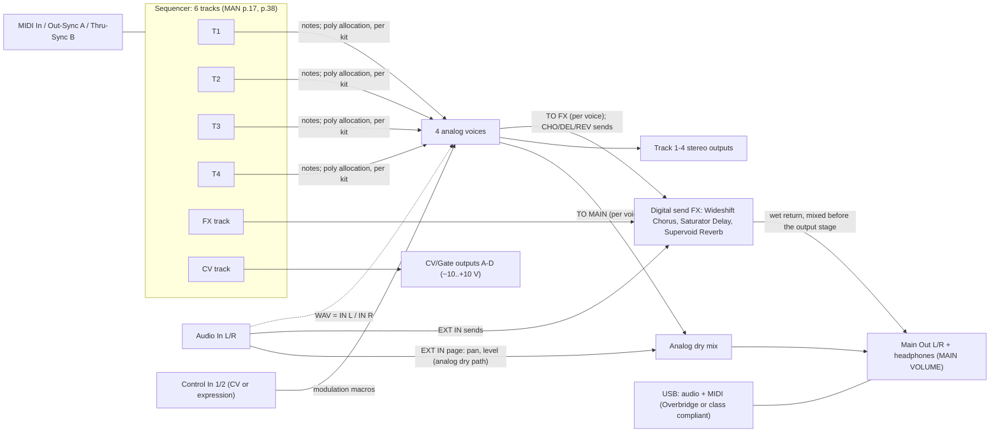

# Elektron Analog Four MKII: signal flow and parameters

The reference is the A4 MKII User Manual for OS 1.55, cited as **(MAN p.N)**.

- **Tags:** verified (MAN p.N), verified (other source), likely, guess. They are defined in `sources.md` §0.
- **Other source IDs:** MG = midi.guide; KA = reverse-engineered sysex; EMU = firmware emulator on the real OS 1.56; EL = elekloader; MW = modwerk.
- **Knob letters:** A–E are the top row of DATA ENTRY knobs and F–J the bottom row. Every letter below is verified by the "Encoder" column of the manual's MIDI tables (MAN pp.102–109).
- **"Display"** is the value range shown on screen. **"CC / NRPN"** is the MIDI map, verified (MAN pp.101–109) and identical to MG. A 14-bit pair is written as MSB/LSB.

---

## 1. System overview



| Fact | Tag |
|---|---|
| Synth tracks 1–4 each host one Sound. The FX track controls the internal send effects. The CV track controls external CV/Gate gear | verified (MAN p.17) |
| Oscillators and their waveshaping are analog, with digitally controlled pitch. The **noise generator is digital**. Both filters and the overdrive between them are analog, and so are the amplifiers. The envelopes and LFOs are digital | verified (MAN p.15) |
| The path from the oscillators to the outputs is fully analog, and so is the path **from the external inputs to the outputs**. The digital send effects run in parallel, and their wet signal is mixed with the dry signal before the main output stage | verified (MAN p.15) |
| A ladder filter of discrete low-noise transistors; a multimode filter built on VCAs | verified (MAN p.15) |
| Each voice can be routed to the main output and/or the FX, per voice. The setting is stored per kit, or global with USE GLOBAL SETTING. Shortcuts: [TRIG 1–4] for voice to main, [TRIG 9–12] for voice to FX | verified (MAN p.29, pp.66–67) |
| Outputs: 2 × 1/4" impedance-balanced main outs; **4 × 1/4" separate stereo voice outputs**; 1/4" stereo headphones | verified (MAN p.14, p.85) |
| Inputs: 2 × 1/4" audio in; 2 × 1/4" CV/expression inputs | verified (MAN p.14, p.85) |
| Converters: 48 kHz, 24-bit A/D and D/A | verified (MAN p.85) |
| USB audio routing: USB IN to main out, voice 1–4, or a stereo voice pair; USB OUT from main, voice 1–4, EXT IN, or a voice pair; USB TO MAIN gain 0…+18 dB | verified (MAN p.67) |
| Control rate: the voice control frame and the FX update once per 32-sample block (about 1.5 kHz) | verified (EMU, code reading) |

---

## 2. Synth voice architecture

The manual's signal path (MAN p.15) and full architecture (MAN p.110, appendix E) agree. Redrawn in my own words:

```
 SOURCES (per voice)                                     ANALOG FILTER/AMP CHAIN                                 OUT
 ┌──────────── OSC 1 (analog) ─────────────┐
 │ WAV: SAW TRP PUL TRI | IN L IN R FDB OFF│── LEV1 (osc + sub combined) ─┐
 │ PW waveshape ◄── PWM LFO 1 (SPD, PWM)   │                              │
 │ SUB 1: 1OCT 2OCT 2PUL 5TH (or OFF)      │                              │
 └───────────────▲─────────────────────────┘                              │      ┌───────────────┐   ┌─────────┐   ┌──────────────────┐   ┌─────────────┐
       AM1 / AM2 │  SYNC (SMD, SNC)                                       ├────► │ FILTER 1      │──►│OVERDRIVE│──►│ FILTER 2         │──►│ AMP (VCA)   │──► PAN ──► OUTPUT L / R
 ┌───────────────▼─────────────────────────┐                              │      │ 4-pole ladder │   │ OVR >0: │   │ 2-pole multimode │   │ ENV A       │     │
 │ WAV: SAW TRP PUL TRI | IN L IN R NEI OFF│── LEV2 ──────────────────────┤      │ lowpass       │   │ clipper │   │ LP2 LP1 BP HP1   │   └─────────────┘     ├──► CHORUS / DELAY / REVERB
 │ PW waveshape ◄── PWM LFO 2              │                              │      │ 24 dB/oct     │   │ (OVR <0:│   │ HP2 BS PK        │                       │    SENDS ──► "TO EFFECTS"
 │ SUB 2                                   │                              │      │ FRQ RES TRK   │   │ soft    │   │ FRQ RES TYP TRK  │                       │
 └─────────────────────────────────────────┘                              │      │ DEP(ENVF)     │   │ drive   │   │ DEP(ENVF)        │                       └──► Track 1–4 stereo out
 ┌──────── NOISE (digital) ────────────────┐                              │      └───────┬───────┘   │ inside  │   └────────┬─────────┘
 │ S&H, COL; FAD = fade envelope           │── LEV ───────────────────────┘              │           │ F1)     │            │
 └─────────────────────────────────────────┘                                     ladder out = FDB     └─────────┘    MM out ──► NEI source of the NEXT voice
 FROM PREVIOUS VOICE (MM out) ──► OSC 2 slot when WAV = NEI; EXT IN L/R ──► OSC slot when WAV = IN L/IN R
```

| Block | Fact | Tag |
|---|---|---|
| Sources into F1 | OSC1, SUB1, OSC2, SUB2 and NOISE all feed the ladder filter | verified (MAN p.15 figure) |
| AM and sync | Act between the two oscillators | verified (MAN p.15, p.88) |
| FDB | OSC 1 only. The **ladder filter output** becomes OSC 1's source, at LEV1. High levels self-oscillate; moderate levels overload what OSC 2 feeds in | verified (MAN p.73) |
| NEI | OSC 2 only. The **multimode-filter output of the preceding track** becomes OSC 2's source: track 1 → 2, 2 → 3, 3 → 4. It does nothing on track 1 | verified (MAN p.73, p.88; p.110: "from previous voice" / "to next voice") |
| IN L / IN R | External input L or R replaces the oscillator. The result is still affected by AM, the filters, the overdrive and the amp envelope | verified (MAN p.73) |
| AM with other sources | AM still works when the oscillator slot carries FDB, NEI or IN L/IN R | verified (MAN p.73) |
| Filters | A 24 dB/oct 4-pole ladder lowpass, then the overdrive, then a 2-pole multimode, in series | verified (MAN p.36, p.89) |
| Out | AMP, PAN, OUTPUT L/R, plus the chorus, delay and reverb sends ("to effects") | verified (MAN p.110) |

**Modulators per voice** [verified (MAN p.110), unless noted]:

| Modulator | What it drives |
|---|---|
| AMP ENVELOPE (ENV A) | The VCA |
| FILTER ENVELOPE (ENVF) | **Hard-linked** to both cutoffs through F1 DEP and F2 DEP, plus two assignable destinations A and B (MAN p.91) |
| ENVELOPE 2 (ENV2) | Two assignable destinations (MAN p.91) |
| LFO 1 and LFO 2 | Two destinations each, each LFO with its own fade envelope (MAN p.92) |
| PWM LFO, one per oscillator | That oscillator's PW (MAN p.72, p.87) |
| VIBRATO LFO, with fade | Both oscillators' pitch (MAN p.88) |
| BEND ENVELOPE | Auto-bend: BND amount, SLI time (MAN p.88) |
| NOISE fade envelope | The noise level (FAD, MAN p.87) |
| Note pitch | Oscillators (TRK on/off) and both filters (TRK amount; 32 = 1:1) (MAN p.87, p.89) |
| Velocity, pitch bend, mod wheel, breath, aftertouch | Up to 5 parameters each (SOUND SETTINGS, §10) (MAN pp.35–36) |
| Performance macros (10) and Control In 1/2 macros | Up to 5 parameters each, on any track (MAN pp.25–27) |
| Accent | Volume and filter-envelope accentuation, plus the "Accent Level" destination (MAN pp.51–52) |

---

## 3. Synth track pages

There are six PARAMETER keys (MAN p.17, p.36). A second press opens the sub-page (MAN p.12, p.36).

| Key | Page 1 | Page 2 | Source |
|---|---|---|---|
| [OSC1] | OSC1 | NOISE | MAN p.36, p.87 |
| [OSC2] | OSC2 | **OSC 1&2** (shared oscillator settings; "OSC COMMON" in the MIDI tables) | MAN p.36, p.88, p.102 |
| [FLTR] | FILTERS | — | MAN p.36, p.89 |
| [AMP] | AMP | — | MAN p.36, p.90 |
| [ENV] | ENVF | ENV2 | MAN p.36, p.91 |
| [LFO] | LFO1 | LFO2 | MAN p.36, p.92 |

[ARP] (arpeggiator) and [NOTE] (note menu) are separate keys; see §14 (MAN p.12).

**Editing conveniences** [verified]:

- Push and turn a knob for coarse steps (MAN p.18).
- Hold FUNC while turning for value jumps; for example, TUN jumps by octaves (MAN p.18).
- Hold a PARAMETER key to see every value on its page (MAN p.18).
- [PARAMETER] + [YES] randomises the page; [PARAMETER] + [NO] reverts it to the last saved state (MAN p.17).
- Hold [T1–4] while turning to set that parameter on every audio track ("control all") (MAN p.18).

---

## 4. Oscillators

### 4.1 OSC1 page ([OSC1] first press) and OSC2 page ([OSC2] first press)

The screen legend is `TUN FIN DET TRK LEV / WAV SUB PW SPD PWM` [verified (MAN p.18 figure)].

| Knob | Label | Meaning (MAN p.87–88) | Init (KA) | OSC1 CC / NRPN | OSC2 CC / NRPN |
|---|---|---|---|---|---|
| A | TUN | Coarse pitch in semitones. FUNC + turn jumps an octave; push + turn jumps 4 semitones | 0 | CC 16/48 (14-bit pitch with FIN) / 1:0 | CC 17/49 / 1:20 |
| B | FIN | Fine pitch. It turns continuously, and each full turn carries one semitone into TUN (EMU: 1/128 semitone per step) | 0 | (the LSB of the pitch pair) | (LSB) |
| C | DET | **Linear detune in hertz** (not cents): more detune in the bass, an old-big-synth chorus effect | 0 | NRPN 1:2 | NRPN 1:22 |
| D | TRK | Keytrack on/off. Off gives a constant pitch, for drums and effects | ON | NRPN 1:3 | NRPN 1:23 |
| E | LEV | Oscillator **and sub** level combined (MAN p.73). The normal level is 100; higher is dirtier, and lower is cleaner with more pronounced resonance | OSC1 100, OSC2 0 | CC 69 / 1:4 | CC 78 / 1:24 |
| F | WAV | Waveform: §4.2 | SAW | CC 70 / 1:5 | CC 79 / 1:25 |
| G | SUB | Sub oscillator: §4.3 | OFF | CC 71 / 1:6 | CC 80 / 1:26 |
| H | PW | Waveshape for **all four** waveforms. The centre gives the default shape (MAN calls the centre 0 on p.72 and 64 on p.87) | centre | CC 72 / 1:7 | CC 81 / 1:27 |
| I | SPD | Speed of the oscillator's dedicated PWM LFO | 10 / 37 | CC 73 / 1:8 | CC 82 / 1:28 |
| J | PWM | Depth of the PWM, around the PW setting | 0 | CC 74 / 1:9 | CC 83 / 1:29 |

Choosing a different waveform does not change PW (MAN p.87).

### 4.2 Waveforms (WAV) and what PW does to each [verified (MAN p.72–73, p.87–88)]

| WAV | Sound | PW effect |
|---|---|---|
| SAW | All harmonics | PW adds a **second sawtooth, out of phase**; PW or PWM sweeps the phase, like two detuned oscillators. A single saw sounds at the PW centre or at either extreme |
| TRP (transistor pulse) | A shriller, "acid" pulse. One half of the wave slopes like a saw, adding even harmonics. The shape shifts slightly with pitch | Sets the width; **the extremes mute the wave** |
| PUL (pulse) | The PW centre gives a square (odd harmonics) | Asymmetry adds even harmonics, thinner and more nasal; **the extremes mute** |
| TRI | Odd harmonics, low level | Adds an edge: a pure triangle at the centre, a **reversed saw** at the extremes |
| IN L / IN R | External audio as the source (§2) | — |
| FDB (OSC1 only) | Ladder output fed back into the voice (§2) | — |
| NEI (OSC2 only) | The previous track's multimode output (§2) | — |
| OFF | The oscillator is off. **The sub is not affected** | — |

### 4.3 Sub oscillators (SUB) [verified (MAN p.72–73)]

| SUB | Signal | Frequency |
|---|---|---|
| OFF | No sub. Otherwise the sub stays on whatever the main waveform, at LEV | — |
| 1OCT | Square | f/2 (one octave down) |
| 2OCT | Square | f/4 (two octaves down) |
| 2PUL | 25 % pulse, two octaves down (sounds like 1OCT plus 2OCT) | f/4 |
| 5TH | 33 % pulse, **a perfect fifth (7 semitones) below** | 2/3 f. MAN's example: the oscillator plays G and the sub plays the C below |

- The sub follows the oscillator's pitch, but **neither waveshaping (PW) nor PWM affects it** [verified (MAN p.72)].
- Chord trick (MAN p.73): with OSC1 at TUN +7 and SUB = 5TH, and OSC2 at +3 or +4, one track plays a minor or major triad. With both subs on 5TH you can build 7th chords.

### 4.4 OSC 1&2 page ([OSC2] second press) [verified (MAN p.88; knob letters p.102–103)]

| Knob | Label | Meaning | Init (KA) | CC / NRPN |
|---|---|---|---|---|
| A | AM1 | OSC1 is switched on and off by (multiplied by) **OSC2's pulse wave**: sum and difference frequencies, ring-mod-like. OSC2's waveform and PW matter even when OSC2 is silent | OFF | NRPN 1:30 |
| B | SMD | Sync mode: OFF, OSC2 synced to OSC1 (1→2), OSC1 to OSC2 (2→1), or METAL (both reset each other) | OFF | NRPN 1:31 |
| C | SNC | Sync amount: the maximum is hard sync; lower values are soft sync, which can also lock to subharmonics; 0 is no sync | 127 | CC 84 / 1:32 |
| D | BND | **Auto-bend** depth: each trigged note starts offset and glides to its pitch. With sync engaged, only the synced oscillator bends | 0 | CC 85 / 1:33 |
| E | SLI | Note-slide time, also used for the auto-bend time | 32 | CC 5 / 1:34 |
| F | AM2 | OSC2 multiplied by OSC1's pulse wave | OFF | NRPN 1:35 |
| G | TRG | Oscillator retrig: both oscillators start each note in phase, for a consistent attack ("Note Sync" in MAN p.103) | OFF | NRPN 1:36 |
| H | FAD | Vibrato fade: 0 is constant, positive values fade out, negative values fade in | 0 | NRPN 1:37 |
| I | SPD | Vibrato speed (the vibrato LFO acts on both oscillators) | 32 | CC 87 / 1:38 |
| J | VIB | Vibrato depth | 0 | CC 88 / 1:39 |

**Oscillator modulation destinations** [verified (MG, KA)]:

- Per oscillator: Pitch Mod (exponential [likely]), Freq Mod (linear [likely]), Linear Detune, Keytrack, Level, Waveform, Sub, PW, PWM Speed, PWM Depth, AM.
- Shared: Pitch Mod, Freq Mod, Sync Mode, Sync Amount, Bend Depth, Slide Time, and vibrato fade, speed and depth.

---

## 5. NOISE page ([OSC1] second press) [verified (MAN p.87; knob letters p.102)]

| Knob | Label | Meaning | Init (KA) | CC / NRPN |
|---|---|---|---|---|
| A | S&H | Sample and hold: sets the "tuning" of the noise spectrum, from grainy to fine | 0 | CC 75 / 1:10 |
| B | COL | Colour filter on the noise: −64 is red (−6 dB/oct), −32 pink (−3 dB/oct), 0 white (filter off), positive values high-pass | 0 | (not in MAN's MIDI table; MG lists NRPN 1:11) |
| C | FAD | Noise fade: 0 is constant, positive values fade out, negative values fade in | 0 | CC 76 / 1:12 |
| D | — | (empty) | | |
| E | LEV | Noise level into the voice | 0 | CC 77 / 1:14 |
| F–J | — | (empty) | | |

---

## 6. FILTERS page ([FLTR]) [verified (MAN p.89; knob letters p.103)]

The top row is Filter 1 and the bottom row Filter 2. On screen, FRQ and RES share one filter-curve graphic (MAN p.89 figure).

| Knob | Label | Meaning | Init (KA) | CC / NRPN |
|---|---|---|---|---|
| A | FRQ | F1 cutoff: the 4-pole lowpass **transistor ladder**. Two decimals (0.00–127.99) [verified (KA, EMU)] | 127 (open) | CC 18/50 / 1:40 |
| B | RES | F1 resonance. By design it is stronger at high frequencies: a sharp start that falls with a falling envelope. The flattest response is at about 25, the default; 0 drops some treble and bass (MAN p.73) | ≈25 | CC 89 / 1:41 |
| C | OVR | **Bipolar overdrive.** 0 is clean; positive values give **clipping after F1** (before F2); negative values give a **softer overdrive inside F1** | 0 | CC 86 / 1:42 |
| D | TRK | F1 keytrack. **32 tracks the oscillator 1:1**, so the resonance can be played like an oscillator | 0 | NRPN 1:43 |
| E | DEP | ENVF to F1 cutoff, bipolar. ENVF always affects F1, whatever its own destinations are | 0 | CC 102 / 1:44 |
| F | FRQ | F2 cutoff: the 2-pole multimode, after F1 and the overdrive | 0.00 | CC 19/51 / 1:45 |
| G | RES | F2 resonance: more uniform across the spectrum. For BS it is a notch, widest at the lowest RES | 12 | CC 90 / 1:46 |
| H | TYP | LP2, LP1, BP, HP1, HP2, BS, PK. All are technically 2-pole with resonance; the "1-pole" types have a flatter, 6 dB/oct-like slope | HP2 | NRPN 1:47 |
| I | TRK | F2 keytrack (32 = 1:1) | 0 | NRPN 1:48 |
| J | DEP | ENVF to F2 cutoff, bipolar; ENVF always affects F2 | 0 | CC 103 / 1:49 |

**F2 types** [verified (MAN p.74)]:

| Type | Response |
|---|---|
| LP2 | 12 dB/oct lowpass, cleaner than the ladder. LP2 after the ladder makes a 6-pole slope |
| LP1 | 6 dB/oct lowpass, with a resonance peak |
| BP | Bandpass, 6 dB/oct each side |
| HP1 | 6 dB/oct highpass |
| HP2 | 12 dB/oct highpass |
| BS | Notch |
| PK | Peak boost around the cutoff |

**Pass-through settings for F2** [verified (MAN p.73)]: HP2 at the minimum frequency, BS at the minimum, LP2 at the maximum, PK at the maximum (all with 0 resonance), or PK at the minimum, which inverts the signal. The ladder cannot be bypassed; open its cutoff instead (MAN p.73).

**Hz law** (not in MAN): about `f = 440 × 2^((FRQ − 60)/12)`, giving 13.8 Hz at 0 and 21 kHz at 127. This was measured on the Rytm MKII multimode filter (MW), and EMU's A4 frame fits one semitone per unit. Tag: likely for the A4.

**Destinations** [verified (MG)]: F1 Freq, F1 Res, F1 Overdrive, F1 EnvF Depth, F2 Freq, F2 Res, F2 EnvF Depth, and **F1+F2 Freq** together.

---

## 7. AMP page ([AMP]) [verified (MAN p.90; knob letters p.103)]

| Knob | Label | Meaning | Init (KA) | CC / NRPN |
|---|---|---|---|---|
| A | ATK | EnvA attack | 0 | CC 104 / 1:50 |
| B | DEC | EnvA decay | 64 | CC 105 / 1:51 |
| C | SUS | EnvA sustain level | 100 | CC 106 / 1:52 |
| D | REL | EnvA release (KA: 127 = infinite) | 8 | CC 107 / 1:53 |
| E | SHP | EnvA shape (§8.1). A dot on the shape graphic means it restarts from zero | Standard | NRPN 1:54 |
| F | CHO | Send to the Wideshift Chorus | 0 | CC 91 / 1:55 |
| G | DEL | Send to the Saturator Delay | 0 | CC 92 / 1:56 |
| H | REV | Send to the Supervoid Reverb | 0 | CC 93 / 1:57 |
| I | PAN | Stereo position | centre | CC 10 / 1:58 |
| J | VOL | Sound volume. Independent of the track level (TRACK LEVEL / CC 95) | 100 | CC 7 / 1:59 |

- **Track level:** the TRACK LEVEL knob (CC 95 / NRPN 1:100). **Track mute:** FUNC + track key (CC 94 / NRPN 1:101) (MAN p.101).
- Kits store the level settings of the synth and FX tracks (MAN p.24).
- The PERFORMANCE MIXER ([MIX]) sets the track levels on knobs A–E (MAN p.28).

---

## 8. ENVF and ENV2 ([ENV]: ENVF on page 1, ENV2 on page 2) [verified (MAN p.91; knob letters p.103–104)]

| Knob | Label | Meaning | Init (KA) | ENVF CC / NRPN | ENV2 CC / NRPN |
|---|---|---|---|---|---|
| A | ATK | Attack | 0 | CC 108 / 1:60 | CC 112 / 1:70 |
| B | DEC | Decay | 64 | CC 109 / 1:61 | CC 113 / 1:71 |
| C | SUS | Sustain | 64 | CC 110 / 1:62 | CC 114 / 1:72 |
| D | REL | Release | 8 | CC 111 / 1:63 | CC 115 / 1:73 |
| E | SHP | Shape (§8.1) | Standard | 1:64 | 1:74 |
| F | LEN | Gate length, independent of the note length, **in sequencer steps** | (off) | 1:65 | 1:75 |
| G | DST | Destination A (confirm with [YES]) | ENVF: OSC1 PW; ENV2: LFO1 speed | 1:66 | 1:76 |
| H | DEP | Depth A, bipolar (14-bit) | 0 | CC 20/52 / 1:67 | CC 22/54 / 1:77 |
| I | DST | Destination B | OSC2 PW | 1:68 | 1:78 |
| J | DEP | Depth B, bipolar | 0 | CC 21/53 / 1:69 | CC 23/55 / 1:79 |

- ENVF is hard-linked to both filter cutoffs (FILTERS DEP); see §6 (MAN p.91).
- The NOTE menu has per-trig retrigger switches for ENVF, ENV2, LFO1 and LFO2: ENV(F), ENV(2), LFO(1), LFO(2). They can be changed only as parameter locks, as can µTM (MAN p.45).

### 8.1 Envelope shapes (all envelopes) [verified (MAN pp.74–75); index names from MG]

Each shape exists in two triggering behaviours. **With the dot, the envelope restarts from level 0 at every trigger; without it, it continues from its current level** (MAN p.74). MG and KA put the restart variant on the odd value of each pair [verified (MG, KA)].

| Values | Rise | Fall (decay/release) | Use |
|---|---|---|---|
| 0–1 | Linear | Linear (sounds like it drops faster at the end) | Linear filter sweeps; fades without a tail |
| 2–3 | Standard (the default) | Falls fast at first, leaving a tail | Kicks, basses, pads |
| 4–5 | Exponential (rises faster and faster) | Linear | Reverse-like swells, sudden attacks |
| 6–7 | Exponential | Exponential | Very long fades; whip-like filter sweeps |
| 8–9 | **Full**: jumps to full level and holds it for the ATK time | Linear | Punchy percussion |
| 10–11 | Full | Exponential | Percussion with a snappy tail |

---

## 9. LFO1 and LFO2 ([LFO]: LFO1 on page 1, LFO2 on page 2) [verified (MAN p.92; knob letters p.104)]

| Knob | Label | Meaning | Init (KA) | LFO1 CC / NRPN | LFO2 CC / NRPN |
|---|---|---|---|---|---|
| A | SPD | Speed, synced to the BPM. **Bipolar**: negative values play the shape backwards. 16, 32 or 64 give straight beats | +48 / +32 | CC 116 / 1:80 | CC 118 / 1:90 |
| B | MUL | Multiplier. **×** multiplies the current tempo; **dot** uses a fixed 120 BPM; **tuning fork** syncs LFO1 to OSC1 and LFO2 to OSC2. Values: ×1…×2048, ·1…·2048, fork 1…2048 (MG) | ×16 | CC 117 / 1:81 | CC 119 / 1:91 |
| C | FAD | Fade: 0 none, positive fades out, negative fades in | 0 | 1:82 | 1:92 |
| D | SPH | Start phase on retrigger | 0 | 1:83 | 1:93 |
| E | MOD | Trig mode (see below) | FRE | 1:84 | 1:94 |
| F | WAV | TRI, SIN, SQR, SAW, EXP, RMP, RND (MG) | TRI | 1:85 | 1:95 |
| G | DST | Destination A | F1 freq | 1:86 | 1:96 |
| H | DEP | Depth A, bipolar | 0 | CC 24/56 / 1:87 | CC 26/58 / 1:97 |
| I | DST | Destination B | F2 freq | 1:88 | 1:98 |
| J | DEP | Depth B, bipolar | 0 | CC 25/57 / 1:89 | CC 27/59 / 1:99 |

**Trig modes** [verified (MAN p.92)]:

- FRE: free-running, never restarts.
- TRG: restarts at each note.
- HLD: runs free, but latches its output at each note.
- ONE: on a note, runs one cycle and stops (envelope-like).
- HLF: on a note, runs half a cycle and stops.

Destination lists include LFO1's own parameters but none of LFO2's. So LFO2 can modulate LFO1, not the reverse [likely; MG, KA].

---

## 10. Velocity, controllers, accent and macros

| Item | Fact | Tag |
|---|---|---|
| **SOUND SETTINGS** (FUNC + [SND]) | OSCILLATOR DRIFT (subtle pitch drift); F1 RESONANCE BOOST (more F1 resonance, affecting the resonance and gain of the upper and lower frequencies); VELOCITY TO VOL (OFF, LOG, LIN, EXP curves); LEGATO MODE (no envelope retrigger on overlapping notes); PORTAMENTO (OFF, ON, LEGATO). Legato and portamento apply only to notes played on the keyboard or from MIDI, **not to sequencer notes** | verified (MAN p.35) |
| Controller routing | VELOCITY MOD, PITCH BEND, MODULATION WHEEL (CC 1), BREATH CONTROLLER (CC 2) and AFTERTOUCH each route to **up to 5 parameters** with depths, set up like a performance macro. Velocity mod reacts to both the trig's VEL and incoming MIDI velocity | verified (MAN pp.35–36) |
| Assignable targets | Depend on the active track type (synth, FX or CV) | verified (MAN p.35) |
| MIDI | Mod wheel CC 1/33, breath CC 2/34 | verified (MAN p.101) |
| Per-trig VEL | The NOTE menu sets the default VEL (100). The built-in keyboard is not velocity sensitive | verified (MAN p.45, p.47) |
| Accent | FUNC + [BANK F] opens ACCENT. Accent trigs raise the volume and the filter-envelope response; TRACK LEVEL sets the accent amount in that menu; Accent Level is a modulation destination | verified (MAN pp.51–52) |
| Performance macros | 10 macros (knobs A–J in PERFORMANCE mode), each assigning **up to 5 parameters from any of the 6 tracks**, with depths as offsets | verified (MAN pp.26–27) |
| Macro range | 0–127 by default. Push TRACK LEVEL in the setup to make a macro bipolar (−64…+63) | verified (MAN p.27) |
| Muting macros | FUNC + [QPER] mutes or unmutes all macro offsets. [QPER] lights green when active and goes off when muted | verified (MAN p.27) |
| Macros and p-locks | Macros cannot be p-locked | verified (MAN p.27) |
| Quick performance | Hold [QPER] and tap [TRIG 1–10] to choose the macros that the QUICK PERF AMOUNT knob drives outside PERFORMANCE mode | verified (MAN p.12, p.28) |
| Control In 1/2 | Each is a modulation macro of up to 5 parameters (KIT menu: CONTROL 1/2 IN MOD), fed by CV or an expression pedal | verified (MAN pp.25–26) |
| Control In setup | GLOBAL > CONTROL: MODE (CV, EXPR, OFF), CV ZERO LEVEL and CV MAX LEVEL (−5.5…+5.5 V), EXPRESSION LEARN, REVERSE DIRECTION | verified (MAN p.68) |
| Control In hardware | The jack takes −5…+5 V on the tip and supplies +5 V on the ring | verified (MAN p.85) |

---

## 11. Tracks, voices, polyphony and routing

| Fact | Tag |
|---|---|
| **Monophonic by default.** Track n plays voice n (MAN p.28 figure). The MIDI CHANNELS menu sets which channel drives each track (MAN p.36, p.60). EMU measured the defaults as channels 1–4 for T1–T4 and 5 for FX | verified (MAN; EMU) |
| **POLY CONFIG** (FUNC + [MIX], or KIT menu): four-voice multitimbral polyphony or unison. The sequencer is fully polyphonic, and any track can play up to 4 notes with its sound. The setting is stored per kit | verified (MAN p.28) |
| VOICES: choose which voices are poly-enabled ([TRIG 1–4] shows half-bright when off, full-bright when on). Voices left out stay dedicated mono voices for their own tracks | verified (MAN p.29) |
| ALLOCATION: **RESET** takes the first free voice in order from voice 1; **ROTATE** cycles; **REASSIGN** reuses the last voice if free, else the least recently used; **UNISON** plays every enabled voice on the same note | verified (MAN p.29) |
| USE TRK SOUNDS: voices keep the four track sounds instead of loading the played sound | verified (MAN p.29) |
| UNISON DETUNE 0–127 and UNISON PAN SPREAD 0–127 | verified (MAN p.29) |
| If no voice is free, the least recently used voice is stolen (all methods) | verified (MAN p.29) |
| **VOICE ROUTING** (KIT menu, per kit, or USE GLOBAL SETTING): voice 1–4 TO MAIN and TO FX boxes. **AUDIO ROUTING** (GLOBAL) holds the same global settings plus the USB routing | verified (MAN p.29, pp.66–67) |
| The arpeggiator is per track (six of them) and belongs to the pattern, not the kit | verified (MAN p.43) |

---

## 12. FX track ([FX]) [verified (MAN p.37, pp.93–97; knob letters pp.105–106)]

**Pages** (keys from the panel legends, MAN p.12; IMG):

| Key | Page |
|---|---|
| [OSC1] | EXT IN |
| [FLTR] | CHORUS |
| [AMP] | DELAY |
| [ENV] | REVERB |
| [LFO] | FX LFO1 / FX LFO2 |

[OSC2] has no FX page. Selecting [FX] keeps the keyboard playing the previous synth track, whose key shows half-bright red. Press [FX] again to make the FX track fully active (MAN p.36).

### 12.1 Pages and knobs

| Page | A | B | C | D | E | F | G | H | I | J |
|---|---|---|---|---|---|---|---|---|---|---|
| **EXT IN** (2:0–9) | L CHO send | L DEL send | L REV send | L PAN | L VOL | R CHO | R DEL | R REV | R PAN | R VOL |
| **CHORUS** "Wideshift" (2:40–49) | PRE predelay | SPD | DEP | WID stereo width | FDB feedback | HPF (input) | LPF (input) | DEL: wet to delay | REV: to reverb | VOL mix |
| **DELAY** "Saturator" (2:50–59) | TIM | X ping-pong ("Mode") | — | WID width / placement | FDB | HPF (taps) | LPF (taps) | OVR overdrive | REV: to reverb | VOL mix |
| **REVERB** "Supervoid" (2:60–69) | PRE | DEC decay (room size) | FRQ shelving freq | GAI shelving gain | — | HPF (input) | LPF (input) | — | — | VOL mix |
| **FX LFO1 / LFO2** (2:80–99) | SPD (bipolar) | MUL | FAD | SPH | MOD | WAV | DST A | DEP A | DST B | DEP B |

**EXT IN.** It controls the inputs' path to the main mixer, with sends and pan like a synth track. For a stereo source, pan L hard left and R hard right (MAN p.93). The dry input path is analog (MAN p.15).

**Delay TIM** is in 128th notes, relative to the BPM (MAN p.95):

| TIM | Note value |
|---|---|
| 128 | 1/1 |
| 96 | 1/2 dotted |
| 64 | 1/2 |
| 48 | 1/4 dotted |
| 32 | 1/4 |
| 24 | 1/8 dotted |
| 16 | 1/8 |
| 12 | 1/16 dotted |
| 8 | 1/16 |
| 6 | 1/32 dotted |
| 4 | 1/32 |
| 3 | 1/64 dotted |
| 2 | 1/64 |
| 1 | 1/128 |

So delay = TIM/128 × 4 × 60/BPM seconds. EMU measured 0.5621 s for TIM 24 at 80 BPM.

**Delay X (ping-pong):**

- 0: WID places the echo in the stereo field.
- 1: the echo alternates left and right, and WID sets how far.

**Delay feedback.** High FDB can swell or run forever, and OVR adds to the feedback (MAN p.95).

**Reverb tone.** FRQ and GAI set a high shelf. GAI at maximum keeps the treble; lower values darken the tail (MAN p.96).

**FX LFO multiplier.** MG lists only 24 values (the × and · groups). MAN's mention of the tuning fork on p.97 is copied text [likely].

### 12.2 Routing [verified (MAN p.110, pp.93–96)]

```
synth voices 1–4 (TO FX) ──CHO/DEL/REV sends──┐
EXT IN L ──PAN/VOL──► dry out ; CHO/DEL/REV ──┤
EXT IN R ──PAN/VOL──► dry out ; CHO/DEL/REV ──┤
                                              ▼
                  ┌───────── CHORUS ─────────┐── VOL ──► wet out L/R
                  │                          ├── DEL send ──► DELAY
                  │                          └── REV send ──► REVERB
                  ├───────── DELAY ──────────┐── VOL ──► wet out L/R
                  │  (fed by the track sends │
                  │   + chorus DEL send)     └── REV send ──► REVERB
                  └───────── REVERB ─────────── VOL ──► wet out L/R
                     (fed by the track sends + chorus REV + delay REV)
wet outs ──► summed with the analog dry mix before the main output stage (MAN p.15)
```

- **Chain order: CHORUS → DELAY → REVERB.** Each effect is also fed in parallel by every source's send.
- [STOP] lets the delay tail ring out; a quick [STOP][STOP] fades the send FX and sends MIDI All Sound Off (MAN p.38).

---

## 13. CV track ([CV]) [verified (MAN p.37, pp.63–64, pp.98–100, p.85)]

| Fact | Source |
|---|---|
| The CV track controls external CV/Gate gear | MAN p.17 |
| **Eight pages**: CV A ([OSC1]), CV B ([OSC2]), CV C ([FLTR]), CV D ([AMP]), ENV1/ENV2 ([ENV] ×2), LFO1/LFO2 ([LFO] ×2) | MAN p.37; keys per the panel legends p.12 |
| Hardware: 4 × 1/4" CV/Gate outputs, **−10…+10 V** | MAN p.14, p.85 |
| On the CV track, FUNC + [CV A–D] key opens that output's CV CONFIG | MAN p.63 |

**GLOBAL > CV CONFIG > CV A–D TYPE** (MAN pp.63–64), and the knobs each type shows on its CV page (MAN p.98; slot letters p.106–107):

| TYPE | Config settings | CV page knobs |
|---|---|---|
| GROUNDED | Output off | — |
| PITCH V/OCT | Two-point calibration: NOTE 1 / VOLTAGE 1 and NOTE 2 / VOLTAGE 2, best 2–3 octaves apart | A TUN (semitones), B FIN, F BND (bend depth), G SLI (slide time), E SRC (source track: T1–T4, FX or CV) |
| PITCH HZ/V | As V/OCT (for older Korg and Yamaha gear) | As V/OCT |
| VALUE LIN | VALUE MIN / VALUE MAX (a ±15 V caution) | C VAL |
| TRIG | LENGTH; POLARITY V-TRIG or S-TRIG; LEVEL in volts | E SRC |
| GATE | Lasts the whole note; POLARITY; LEVEL | E SRC |
| CLOCK | Pulses at a division of the step length | D CLK (clock division, relative to the BPM) |

Unused slots H–J are empty.

**Voltage trim** (GLOBAL > CV CONFIG): 0 V and 8 V trim points per output (8 V for continuous and for pulse), measured tip to sleeve on a TRS cable. These are stored in the machine, not in the project (MAN p.64).

**CV ENV1/2 and CV LFO1/2.** These have the synth parameter sets (MAN pp.99–100). They modulate CV-track parameters. To send them out as voltages, set an output to VALUE LIN and modulate its VAL (MAN p.99–100).

---

## 14. Sequencer, transport, MIDI and performance

| Item | Fact | Tag |
|---|---|---|
| Structure | A project holds 128 patterns (8 banks A–H × 16), 128 kits, 16 songs, 4 global slots and a 128-sound pool. The +Drive holds 128 projects and 4096 sounds (16 banks A–P × 256) | verified (MAN p.16, p.22, p.34) |
| Kit contents | 4 sounds, the FX and CV track settings, track levels, performance settings and poly settings | verified (MAN p.24) |
| Pattern contents | Note and lock trigs, p-locks (up to 128 locked parameters per pattern), trig mutes, accents, note and parameter slides, swing, ARP and NOTE settings, the linked kit, and per-track length and time signature | verified (MAN p.38, p.50) |
| Recording | GRID ([RECORD]); LIVE ([RECORD] + [PLAY]; double-press [PLAY] to quantise); STEP ([RECORD] + [STOP], in STANDARD or JUMP mode) | verified (MAN pp.40–41) |
| Trig types | Note trigs and lock trigs (FUNC + [TRIG]); micro-timing with [TRIG] + [LEFT]/[RIGHT], in 1/384-note steps (µTM) | verified (MAN p.40, p.45) |
| NOTE menu ([NOTE], 2 pages) | Page 1: NOT, VEL, LEN, µTM, PRB (probability; TRC trig conditions when locked), retrig flags ENV(F), ENV(2), LFO(1), LFO(2) | verified (MAN pp.44–45) |
| NOTE page 2 (Euclidean) | PL1, PL2, LEN, EUC, RO1, RO2, TRO, OP (OR, XOR, AND, SUB). [RECORD] turns purple in this mode | verified (MAN pp.46–47) |
| NOTES SETUP (FUNC + [NOTE]) | GLOBAL QUANTIZE, QUANTIZE, KEY SCALE, KEY NOTE, TRANSPOSABLE, SEND MIDI | verified (MAN p.47) |
| Trig conditions | X%, FILL, NOT FILL, PRE, NOT PRE, NEI (the previous track), NOT NEI, 1ST, NOT 1ST, A:B | verified (MAN pp.50–51) |
| ARP ([ARP]) | MOD (OFF, THR, UP, DWN, CYC, SHF, RND, PLY); SPD (6 = 1/16, 12 = 1/8); RNG; LEG; LEN; NO2–NO4 note offsets (the only p-lockable arp parameters). ARP SETUP (FUNC + [ARP]): length up to 16 steps (knob E) and per-step note offsets (knob J) | verified (MAN pp.43–44) |
| Tempo | [TEMPO] opens it. TRACK LEVEL sets the BPM and [UP]/[DOWN] the decimal. FUNC + [YES] toggles project and pattern tempo. FUNC + [TEMPO] taps (averaged over 4 taps). [LEFT]/[RIGHT] shift the tempo by ±10 % while held | verified (MAN p.39) |
| Scale | FUNC + [PAGE] opens SCALE: NORMAL (all tracks share 16/32/48/64 steps; speed 1/8X, 1/4X, 1/2X, 3/4X, 1X, 3/2X, 2X) or ADVANCED (per-track length and scale, with MASTER LEN, CHNG and scale) | verified (MAN pp.48–49) |
| Pattern modes | FUNC + [BANK A–D]: SEQUENTIAL (the default), DIRECT START, DIRECT JUMP, TEMP JUMP | verified (MAN pp.39–40) |
| Trig modes | FUNC + [BANK E–H]: TRIG MUTE, ACCENT, NOTE SLIDE (uses SLI), PARAMETER SLIDE | verified (MAN pp.51–53) |
| Swing | FUNC + [PTN] | verified (MAN p.53) |
| Click | FUNC + [TRK]: ACTIVE, TIME SIG NUM/DEN, PREROLL, VOLUME | verified (MAN p.48) |
| Fill | Hold [FILL]; FUNC + [FILL] cues a fill; FUNC + double-press [FILL] latches it | verified (MAN p.51) |
| Transpose | [TRNS] + [KEYBOARD] transposes; FUNC + [TRNS] locks it | verified (MAN p.53) |
| Chains and songs | [CHAIN MODE] (FUNC: new scratch-pad row); [SONG MODE] (FUNC: SONG EDIT); SONG menu ([SONG]). 256 chain slots across 64 chains | verified (MAN pp.55–57) |
| Quick save and reload | [YES] or [NO] + [KIT], [SND], [TRK], [PTN] or [SONG] | verified (MAN p.54, p.83) |
| MIDI CONFIG > SYNC | CLOCK RECEIVE/SEND, TRANSPORT RECEIVE/SEND, PRG CH RECEIVE/SEND | verified (MAN pp.58–59) |
| MIDI CONFIG > PORT CONFIG | TURBO SPEED; OUT and THRU PORT FUNCTIONALITY (MIDI, DIN 24, DIN 48), so the Out and Thru ports double as DIN sync A/B; INPUT FROM / OUTPUT TO (MIDI, USB, both or disabled); OUTPUT CH; PARAM OUTPUT (NRPN or CC); ENCODER DEST; KEYBOARD DST; MUTE DEST; RECEIVE NOTES; RECEIVE CC/NRPN; LIVE REC ON TRACK CHANNEL | verified (MAN pp.59–60) |
| MIDI CONFIG > CHANNELS | TRACK 1–4, FX, CV, PERF CHANNEL, AUTO CHANNEL, PROGRAM CHANGE IN and OUT channels. Also MULTI MAP EDIT (keyboard splits, sound, pattern and external triggers) | verified (MAN pp.60–63) |
| Performance CCs | Macros A–J on CC 3, 4, 8, 9, 11, 64, 65, 66, 67, 68 (NRPN 0:0–0:9). They are also sent when the knobs turn | verified (MAN p.101) |
| GLOBAL SETTINGS | PROJECT, GLOBAL SLOT, MIDI CONFIG, CV CONFIG, SYSEX DUMP, AUDIO ROUTING, CONTROL (Control In 1/2, sequencer config), SYSTEM (LED INTENSITY LOW/MID/MAX, USB CONFIG, OS UPGRADE, FORMAT +DRIVE, CALIBRATION, MASTER TUNE 440.0 Hz default, 12-TET) | verified (MAN pp.58–70) |
| Startup menu | FUNC at power-on: TRIG 1 TEST MODE, 2 EMPTY RESET, 3 FACTORY RESET, 4 OS UPGRADE | verified (MAN p.71) |

---

## 15. What changed from MKI to MKII

| Area | MKI | MKII | Tag |
|---|---|---|---|
| Voice engine | 2 analog osc + subs, digital noise, ladder, overdrive, multimode, VCA; 3 envelopes and 2 LFOs per voice | The same architecture and the same OS framework and voice-frame format (OS 1.56 on both). MAN p.11 lists the MKII's improvements: reworked circuitry with deeper bass, new sound-control features, and a dedicated output for every voice | verified (MAN p.11; EMU) |
| Display | 122×32 backlit LCD | A large 128×64 OLED | verified (EMU; MAN p.11, p.85) |
| LEDs and keys | Single-colour LEDs; round rubber keys | RGB backlit keys, described as more durable | verified (EMU; MAN p.11) |
| Keyboard and menus | 8 white keyboard keys doubling as KIT, SOUND, TRACK, PATTERN, SONG, CLICK, SWING, GLOBAL, plus 5 black; Bank Group + A–D | A dedicated 13-key keyboard with OCT−/+ and 7 octave LEDs; dedicated menu keys; 8 bank keys; new FILL, QPER, MIX keys and a QUICK PERF AMOUNT knob | verified (EMU from MKI photos; MAN p.12) |
| Level and master | LEVEL encoder; MASTER VOLUME | TRACK LEVEL (FUNC: Sound Browser); MAIN VOLUME | verified (MAN p.12; WS) |
| I/O | Main L/R, headphones, inputs L/R, CV A/B and C/D, MIDI, USB (MKI rear not re-checked) | Adds 4 stereo voice outputs, 2 CV/expression control inputs, DIN sync on Out/Thru, and high-speed USB 2.0 with class-compliant audio | MKII verified (MAN pp.13–14, p.20, p.85); MKI guess |
| USB / internals | Full-speed USB, 64 MB DDR, ELE2 OS shared with the Analog Keys | High-speed USB, 128 MB DDR, FPGA, panel MCU, ELE3 OS | verified (EMU) |
| Size, weight, power | MKI power 8 W typical / 18 W max | 385 × 225 × 82 mm, about 2.4 kg, aluminium, 15 W typical / 20 W max, PSU-3 12 V 2 A | verified (MAN p.85; WS for MKI) |

---

## 16. Modelling notes for the Web Audio twin

1. **Topology** [verified]:
   - The source mix (OSC1 + SUB1, OSC2 + SUB2, NOISE, each sub sharing its oscillator's LEV) feeds the **ladder**, then the overdrive (positive OVR = clipper; negative OVR = drive inside the ladder), then the **multimode**, then the **VCA (ENV A)**, then **pan**.
   - Then three outputs: the main mix (if TO MAIN), the stereo voice output, and the sends (if TO FX).
2. **Pitch**: `f = f_note × 2^((TUN + FIN/128 + mods)/12)` [verified scaling].
   - Add DET as ±Hz [verified concept; scale unknown].
   - Add a slow drift only when OSCILLATOR DRIFT is on.
3. **Waveshape**: implement PW per waveform as in §4.2. The saw becomes a dual saw, the pulse and transistor pulse mute at the extremes, and the triangle morphs to a reversed saw. Each oscillator has its own PWM LFO.
4. **Sub**: derive it from the oscillator phase: ÷2 or ÷4 square, ÷4 at 25 % duty, or **×2/3 at 33 % duty** [verified]. It is unaffected by PW/PWM.
5. **Filter Hz**: `440 × 2^((FRQ + mod − 60)/12)` [likely].
   - F1 TRK and F2 TRK: +32 = 1:1 key tracking [verified].
   - F1 resonance is stronger at high frequencies [verified]. F1 RES ≈ 25 is the flat point, and RES 0 dips the treble and bass [verified].
6. **Control rate** of about 1.5 kHz (32-sample blocks at 48 kHz) [verified, EMU]. Stepping the envelope and LFO control at block rate is authentic.
7. **FX** run at 48 kHz in the digital domain [verified]: chorus → delay → reverb, with the inter-FX sends of §12.2. The delay TIM table is exact [verified].
8. **Time units** [verified]: µTM is 1/384 note; arp SPD 6 = 1/16; ENVF and ENV2 LEN count sequencer steps.

## 17. Still open

- The A4's own FRQ-to-Hz law (the Rytm law is assumed).
- Envelope stage times in ms.
- DET Hz per step; BND units.
- The absolute LFO rate formula.
- Chorus and reverb units.
- The exact noise S&H behaviour.
- The circuit behind F1 RESONANCE BOOST.
- Which SHP value of each pair carries the restart dot (MG and KA say the odd values).
