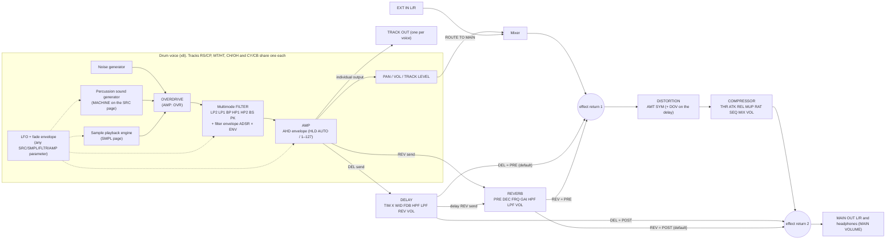

# Analog Rytm MKII: signal flow and spec for the twin (v2, from the OS 1.72 manual)

**Primary source:** *Analog Rytm MKII User Manual, OS 1.72* (Elektron, last updated 2025‑01‑30), cited as "(p.N)". It is read from `scratchpad/manuals/analog-rytm/Analog_Rytm_MKII_User_Manual_OS1.72/`. Facts are restated in our own words; quotes are short.

**Secondary sources:** libanalogrytm and rytm-rs for init values and raw encodings; midi.guide (see `sources.md`).

**Confidence labels:**

| Label | Meaning |
|---|---|
| **V** | Verified in the manual (page given). For SRC, SMPL, FLTR, AMP, LFO and FX layouts, the manual's screen images were checked. |
| **L** | Likely: a hardware-tested library, or an inference from the manual. |
| **G** | Guess or design proposal (DSP scalings, curves). |

Values are hardware display values. Where a MIDI CC is centred, raw = display + 64.

**v1 → v2 changes**

v1 assumed that the SRC encoders follow the sysex slot order. They don't: the manual warns that the MIDI order "will sometimes differ from the order of the parameters shown on the SRC page" (p.86). The layouts in §9 now come from the manual's screens. Other corrections:
- The overdrive sits **before** the filter.
- AMP HLD is **AUTO / 1–127**.
- The DIST DEL return defaults to **PRE**.
- All seven filter types are 2-pole designs.
- SY DUAL VCO CFG "R" means ring modulation, not sync.

---

## 0. Key facts and fixes for the current twin

1. **SRC pages use the manual's layouts (§9).** Almost every machine puts TUN on A, DEC on D and LEV on H (p.96–109 screens). **V**
   - **BD HARD** is TUN · SWT · SNP · DEC / WAV · HLD · TIC · LEV.
   - Its sweep depth is fixed: SWT *"sets the pitch sweep time. The depth of the sweep is fixed"* (p.97).
   - `params.ts` currently has LEV TUN DEC HLD / SWT SWD SNP WAV, and has to change.
2. **Each track picks a MACHINE** with [SRC] pressed twice, or [FUNC] + [SRC] (p.21). The menus per track are in §3.2 (p.21, p.96).
   - BD HARD is the BD track's default (p.22).
   - Init kit, from rytm-rs (**L**): BD HARD, SD HARD, RS HARD, CP CLASSIC, BT CLASSIC, XT CLASSIC ×3, CH CLASSIC, OH CLASSIC, CY CLASSIC, CB CLASSIC.
3. **The voice chain is: sound generators (machine + noise + sample) → OVERDRIVE → multimode FILTER → AMP → PAN → mixer.** **V**
   - p.13 shows the chain.
   - AMP OVR is *"located before the multimode filter in the signal path"* (p.79).
   - The current twin's pre-filter overdrive is right; v1's post-filter guess was wrong.
4. **Voice sharing.** The pairs RS/CP, MT/HT, CH/OH and CY/CB share a voice, and *"the right-hand track has a higher priority"* (p.21). **V**
   - So CP mutes RS, HT mutes MT, OH mutes CH, and CB mutes CY (p.21).
   - The twin's "right-hand pad wins" rule is verified.
5. **TRIG page** (p.43–44). **V**
   - Top row: NOT −24…+24, VEL 1–127, LEN, PRB 0–100 %. While a trig is held, PRB becomes **TRC**, the trig condition.
   - Bottom row: SYN, SMP, ENV, LFO.
   - *"Setting SYN and SMP to zero on a note trig turns it into a lock trig"* (p.43).
6. **AMP page** (p.79). **V**
   - Layout: ATK · HLD · DEC · OVR / DEL · REV · PAN · VOL.
   - HLD is **AUTO or 1–127**. AUTO holds for as long as the pad is pressed.
   - PAN is −64…+63.
   - VOL is independent of the track LEVEL.
7. **FLTR page** (p.79). **V**
   - Layout: ATK · DEC · SUS · REL / FRQ · RES · TYP · ENV.
   - Seven types: LP2, LP1, BP, HP1, HP2, BS, PK. Technically every type is a resonant **2-pole** filter; the "1-pole" types just have a flatter, 1-pole-like slope (p.79).
   - With BS, resonance controls the notch width: it is widest at the lowest RES (p.79).
8. **LFO page** (p.80). **V**
   - Layout: SPD · MUL · FAD · DST / WAV · SPH · MOD · DEP.
   - 7 waves.
   - 5 trig modes: FREE, TRIG, HOLD, ONE, HALF.
   - MUL has 24 settings: 12 synced, and 12 dotted ones locked to 120 BPM.
9. **FX track.** **V**
   - Pages: DELAY, REVERB, DIST and COMP, on the SRC, SMPL, FLTR and AMP keys, plus an LFO (p.11).
   - On the FX track, TRACK LEVEL sets the master return level of the delay and reverb (p.36).
   - The DIST page defaults are DEL **PRE** and REV **POST** (p.82).
   - The COMP MIX init is 0 (rytm-rs, **L**). The manual describes the left extreme as fully uncompressed (p.83).
10. **Mixing and routing.** **V**
    - ROUTE TO MAIN (per track) sends a track to the master effects and the main out. Every track still feeds its individual output (p.27, p.65).
    - SEND TO FX (per track) routes a track to the delay and reverb (p.27, p.65).
    - EXT IN L/R joins the mixer before DIST and COMP (p.13).
    - AUDIO IN L/R is for sampling and USB sound-card use (p.12).

---

## 1. Hardware

| Item | MKII | Ref |
|---|---|---|
| Voices and tracks | 8 analog voices; 12 drum tracks; 1 FX track | p.13, p.15 |
| Voice components | Every voice has the same sample playback engine, overdrive circuit and multimode filter. The percussion sound generators differ per voice. | p.13 |
| Pads | 12 velocity- and pressure-sensitive pads | p.21 |
| Keys and knobs | 16 [TRIG] keys. DATA ENTRY A–H, which are relative encoders. TRACK LEVEL, relative. MAIN VOLUME and QUICK PERF AMOUNT, absolute (about 320°). | p.10, p.22 |
| Page keys | [TRIG] plus the five PARAMETER keys SRC, SMPL, FLTR, AMP and LFO. They act as radio buttons. | p.10–11, p.22 |
| Mode keys | [PLAY MODE], [MUTE], [CHRO], [SCNE], [PERF]: on/off, with at most one active | p.11, p.22 |
| Other keys | [TRK] (+ pad selects a track), [FX], [FUNC], [RTRG], [FILL], [PAGE], [RECORD], [PLAY], [STOP], [TEMPO], [BANK A–H], [SONG MODE], [CHAIN MODE], [QPER], [FIX], [SAMPLING], [GLOBAL SETTINGS], [YES], [NO], arrow keys | p.10–11 |
| Screen | 128 × 64 OLED | p.76 |
| Outputs | MAIN OUT L/R (impedance balanced, +15 dBu); 8 individual TRACK OUTs (+15 dBu); headphones | p.12, p.76 |
| Inputs | AUDIO IN L/R (balanced; sampling and sound-card use); EXT IN L/R (unbalanced; external sound into the mixer); 2 EXP/CV control inputs (tip −5…+5 V, +5 V supplied on ring) | p.12, p.13, p.76 |
| MIDI and USB | MIDI IN; MIDI OUT/SYNC A and THRU/SYNC B, both able to send DIN sync; USB 2.0 for Overbridge and class-compliant audio/MIDI | p.12, p.62, p.17–18 |
| Converters | 48 kHz, 24-bit | p.76 |
| Size and weight | W385 × D225 × H82 mm; about 2.4 kg | p.76 |
| Storage | Per project: 128 patterns, 128 kits, 16 songs, 4 global slots, 127 sample slots, Sound pool of 128. The +Drive holds 128 projects and a Sound library of 4096 (16 banks × 256). Samples up to 64 MB per project, about 11 minutes. | p.14, p.33 |

---

## 2. Block diagram (drawn from the facts on p.13)



ASCII version:

```
            ┌──────────────────────────── DRUM VOICE (x8) ─────────────────────────────┐
 noise gen ─┤                                                                           │
 MACHINE ───┼─(+)─► OVERDRIVE ─► MULTIMODE FILTER ─► AMP ─┬─► PAN/VOL/LEVEL ─► mixer   │
 SAMPLE ────┤        (AMP:OVR)   (FLTR + ADSR)    (AHD)   ├─► TRACK OUT (individual)    │
            │                         ▲  LFO + FADE ──────┤─► DEL send ─► DELAY ──┐     │
            └─────────────────────────┴───────────────────┴─► REV send ─► REVERB ─┤     │
                                                                ▲ delay → reverb  │     │
 mixer (+ EXT IN L/R) ─►(return 1)─► DISTORTION ─► COMPRESSOR ─►(return 2)─► MAIN OUT L/R
                        ▲ PRE returns                              ▲ POST returns
```

**Confidence**

| Part | Conf. | Notes |
|---|---|---|
| Order of the stages | **V** | p.13, p.79 |
| Individual outputs | **V/L** | Every track still sends to its individual output (p.65). The tap point after the amp is **L**. |
| Sends | **V/L** | DEL and REV are on the AMP page (p.79); their exact tap point is **L** |
| Effect returns 1 and 2 | **V** | Correspond to the PRE and POST settings (p.13, p.82) |
| Delay overdrive (DOV) | **V** | Acts on the delay effect (p.82) |

---

## 3. Tracks, voices, sharing, machine menus

### 3.1 Tracks and voices (p.21, p.15) **V**

| Voice | Tracks | Pad generator (p.21 illustration) |
|---|---|---|
| 1 | BD (1) | Dual-oscillator synthesis capable of a wide range of sounds |
| 2 | SD (2) | Dual-oscillator synthesis capable of a wide range of sounds |
| 3 | RS (3) + CP (4) | Dual-oscillator synthesis with extra rimshot shaping |
| 4 | BT (5) | Single-oscillator synthesis for the bass tom |
| 5 | LT (6) | Single-oscillator synthesis for low, mid and high toms |
| 6 | MT (7) + HT (8) | Single-oscillator synthesis for low, mid and high toms |
| 7 | CH (9) + OH (10) | Multi-oscillator synthesis for hi-hats |
| 8 | CY (11) + CB (12) | Multi-oscillator synthesis for cymbals and cowbells |

Track selection (p.15, p.22, p.67):
- Select a track with [TRK] + its pad, or [FX] for the FX track. Exactly one track is always active.
- Tapping a pad only *plays* it, unless SETTINGS > SEQUENCER CONFIG > **AUTO TRK SWITCH** is on. Then the last pad or [TRIG] key pressed becomes active.

**The twin should keep [TRK] + pad, and offer AUTO TRK SWITCH as a setting.**

### 3.2 Machine menu per track (p.21, p.96) **V**

| Track | Machines |
|---|---|
| BD | BD HARD, BD CLASSIC, BD FM, BD PLASTIC, BD SILKY, BD SHARP, BD ACOUSTIC, SY DUAL VCO, SY CHIP, SY RAW, plus every SD machine |
| SD | SD HARD, SD CLASSIC, SD FM, SD NATURAL, SD ACOUSTIC, SY ×3, plus every BD machine |
| RS | RS HARD, RS CLASSIC, SY ×3, plus every BD, SD and CP machine |
| CP | CP CLASSIC, SY ×3, plus every BD, SD and RS machine |
| BT | BT CLASSIC |
| LT, MT, HT | XT CLASSIC |
| CH | CH CLASSIC, CH METALLIC, HH BASIC, HH LAB, plus every OH machine |
| OH | OH CLASSIC, OH METALLIC, HH BASIC, HH LAB, plus every CH machine |
| CY | CY CLASSIC, CY METALLIC, CY RIDE, plus every CB machine |
| CB | CB CLASSIC, CB METALLIC, plus every CY machine |
| **All tracks** | UT NOISE and UT IMPULSE ("general machines"), and **DISABLE** (no SRC parameters; for sample-only Sounds that can load and Sound-lock on any track) (p.21, p.96) |

### 3.3 Voice sharing and choke (p.21) **V**, sequential behaviour **L**

- One voice makes one sound. A trig on either track of a pair loads that track's Sound into the shared voice: machine, sample, overdrive, filter, amp and sends.
- **If both tracks of a pair play, the right-hand track wins**: CP over RS, HT over MT, OH over CH, CB over CY (p.21).
- When the two tracks play one after another, the newer hit takes over the voice. This is how a closed hat cuts a ringing open hat (**L**: it follows from one voice).
- USB track routing treats the pairs as one destination as well (p.66).

```
onTrig(track, time):
  v = VOICE_OF[track]
  if two trigs on the same voice share a tick: keep the higher track number (p.21)
  if voice[v].active: voice[v].cutAt(time, 2 ms)   // fade to avoid a click (G)
  voice[v].load(sound[track]).start(time); voice[v].owner = track
```

---

## 4. The per-track pages

### 4.1 TRIG (p.43–44) **V**

| Enc | Label | Range | Init | Notes |
|---|---|---|---|---|
| A | NOT | −24…+24 | 0 | Pitch of the note trig. The CHROMATIC sound setting decides whether it moves the synth, the sample or both (p.34). |
| B | VEL | 1–127 | 100 (L) | Used for sequenced trigs, [FUNC] + pads, [TRIG]-key playing, and FIXED VELOCITY set to AUTO (p.43). |
| C | LEN | 1/128 … INF | 1/16 (L) | Note length |
| D | PRB / TRC | 0–100 %, or a condition | 100 % | Track trig probability. While a trig is held this becomes TRC (§8). A condition overrides PRB (p.44). |
| E | SYN | on/off | on | The trig plays the synth part |
| F | SMP | on/off | on | The trig plays the sample part |
| G | ENV | on/off | on | The trig restarts the filter envelope |
| H | LFO | on/off | on | The trig restarts the LFO |

TRIG settings are stored with the **pattern**, not the kit (p.43). Trigs can lock all of them (p.47).

### 4.2 SRC (machine): see §9.

The sound generator's level is LEV, which sits on H on every machine except DISABLE.

### 4.3 SMPL (p.77–78; screen p.78) **V**

| Enc | Label | Range | Notes |
|---|---|---|---|
| A | TUN | −24…+24 semitones | |
| B | FIN | −64…+63 | Spans ±1 semitone |
| C | BR | 0–127 | Bit reduction |
| D | SMP | OFF, 1–127 | Sample slot |
| E | STA | 0–120 | Start |
| F | END | 0–120 | END below STA plays the sample **backwards** |
| G | LOP | OFF/ON | Loops for the trig's LEN, confined by AMP HLD and DEC |
| H | LEV | 0–127 | Sample level |

Pressing [SMPL] again shows page 2, a waveform view of the same parameters (p.78).

The sample is mixed with the machine **before the overdrive and filter** (p.13).

### 4.4 FLTR (p.78–79; screen p.78) **V**

| Enc | Label | Notes |
|---|---|---|
| A | ATK | Filter envelope attack |
| B | DEC | Filter envelope decay |
| C | SUS | Filter envelope sustain |
| D | REL | Filter envelope release |
| E | FRQ | Cutoff |
| F | RES | Resonance; notch width on BS |
| G | TYP | LP2 / LP1 / BP / HP1 / HP2 / BS / PK. All are resonant 2-pole designs; LP1 and HP1 have flatter slopes. |
| H | ENV | Envelope depth, bipolar −64…+63 |

- ENV RESET, a sound setting: FILTER (the default) restarts the envelope on every trig; OFF continues from its current level (p.34).
- Release starts at the end of the gate, LEN (**L**).

Twin DSP (**G**):
- FRQ → 20 Hz × 1000^(v/127).
- Use resonant 2-pole SVF or biquad types for every mode. For LP1 and HP1, lower Q to about 0.5 to imitate the flatter spectrum.
- RES → Q 0.5–25.
- ENV ±63 → ±7 octaves × envelope.
- Envelope times as the A4 twin: `time127` = 1 ms × 2^(14·v/127).

### 4.5 AMP (p.79; screen p.79) **V**

| Enc | Label | Range | Notes |
|---|---|---|---|
| A | ATK | 0–127 | Attack |
| B | HLD | AUTO, 1–127 | AUTO holds for as long as the pad is pressed (p.79). For sequenced trigs, use the trig LEN (**L**). Raw 0 = AUTO (**L**). |
| C | DEC | 0–126, INF | Decay. 127 = INF is **L** (libanalogrytm); the manual gives no range. |
| D | OVR | 0–127 | Overdrive: a gain boost **before** the filter |
| E | DEL | 0–127 | Delay send |
| F | REV | 0–127 | Reverb send |
| G | PAN | −64…+63 | |
| H | VOL | 0–127 | Init 110 (L). Independent of TRACK LEVEL. |

Related level controls:
- The **TRACK LEVEL** knob sets the active track's overall level, stored in the kit (p.35). It is CC95.
- **Accent**: accent trigs come from the ACCENT menu ([FUNC] + [BANK F]). TRACK LEVEL sets the accent amount there, and accent level can be modulated, for example by the LFO (p.49–50).
- **VELOCITY TO VOL**: ON makes level follow velocity *linearly* (p.34).
- **LEGACY FX SEND** lowers the send levels slightly, so that Sounds from older OS versions sound as designed (p.34).

Twin DSP (**G**):
- AHD envelope with `time127`.
- OVR: pre-filter `tanh` with drive 1 + 15·v/127, plus partial gain compensation.
- PAN: equal power.
- VOL: (v/127)²·1.3.

### 4.6 LFO (p.79–80; screen p.80) **V**

| Enc | Label | Range | Notes |
|---|---|---|---|
| A | SPD | −64…+63 | Negative values run the shape backwards. Try 8, 16 or 32 for straight-beat sync (p.80). |
| B | MUL | 24 settings | ×1…×2k synced to tempo; ·1…·2k ("dot") locked to 120 BPM. Init ×16 (screen, p.80). |
| C | FAD | bipolar | + fades out, − fades in, 0 = no fade |
| D | DST | any SRC, SMPL, FLTR or AMP parameter | List order from libanalogrytm: NONE, SYN 1–8 named per machine, the SMPL parameters, FLT ENV/ATK/DEC/SUS/REL/FRQ/RES, AMP ATK/HLD/DEC/OVR/VOL/PAN/ACC/DEL/REV (33 entries, **L**) |
| E | WAV | TRI, SIN, SQR, SAW, EXP, RMP, RND | |
| F | SPH | 0–127 | Start phase; 64 = centre. With WAV = RND it becomes **slew**. |
| G | MOD | FREE, TRIG, HOLD, ONE, HALF | |
| H | DEP | bipolar | −128.00…+127.99 (L). + starts toward the crest of the wave, − toward the trough. |

Rate rule: SPD × MUL = 128 gives one cycle per 16 steps. This is **L**; it matches the A4 manual p.87 and the "8, 16, 32" hint above.

### 4.7 Velocity, pressure and modulation (p.34–35, p.27–28) **V**

| Source | Facts |
|---|---|
| **VELOCITY MOD** | Per Sound: up to 4 parameters, each with its own depth. TRACK LEVEL sets the overall velocity range (p.34). |
| **AFTERTOUCH** | Per Sound: up to 4 parameters driven by pad pressure or MIDI aftertouch (p.34). Init AT slot 1 = +16 → FLT FRQ (rytm-rs, L). |
| **CONTROL IN 1/2 MOD** | In the kit: up to 4 track parameters per input, each with a depth offset of −128…127, like a performance macro (p.27–28). |
| **Control inputs** | SETTINGS > CONTROL: MODE CV / EXPR / OFF, CV ZERO and MAX levels, expression learn, reverse (p.66–67) |
| **FIXED VELOCITY** | [FIX] toggles it. The amount is set with [FUNC] + [FIX]: 100 by default, or AUTO = the TRIG VEL (p.45). |
| **Retrig by hand** | [RTRG] + pad retrigs while held. **Pressure sets the retrig velocity**, and aftertouch is off during retrig (p.35). |

---

## 5. FX track (Appendix B, p.81–84; screens p.81–82)

### 5.1 DELAY (p.81) **V**

| Enc | Label | Notes | Init (L) |
|---|---|---|---|
| A | TIM | Delay time in 128th notes of the tempo. 32 is one beat (p.81). Display 0–127. | 23 |
| B | X | Ping-pong 0/1. When ON, WID sets how wide the repeats pan. | OFF |
| C | WID | Stereo width, bipolar | 0 |
| D | FDB | Feedback. High values give infinite or swelling repeats; combine with DOV for harsh repeats. Display range 0–198 is **L** (rytm-rs). | 49 |
| E | HPF | Delay high-pass | 32 |
| F | LPF | Delay low-pass | 96 |
| G | REV | Delay → reverb send | 0 |
| H | VOL | Delay return. Before or after DIST/COMP, per DIST DEL. | 110 |

### 5.2 REVERB (p.81–82) **V**

| Enc | Label | Notes | Init (L) |
|---|---|---|---|
| A | PRE | Pre-delay | 8 |
| B | DEC | Decay, roughly the size of the space | 40 |
| C | FRQ | Shelving frequency | 64 |
| D | GAI | Shelving gain. At max, the treble stays in the reverb; lower values damp it. | 32 |
| E | HPF | Reverb high-pass | 32 |
| F | LPF | Reverb low-pass | 96 |
| G | – | | |
| H | VOL | Reverb return. Before or after DIST/COMP, per DIST REV. | 110 |

### 5.3 DISTORTION (p.82; screen) **V**

| Enc | Label | Notes |
|---|---|---|
| A | AMT | Distortion amount |
| B | SYM | Offsets the signal up or down before clipping, so only crests or only troughs fringe |
| C | DOV | Delay overdrive: warm drive on the delay effect |
| D–F | – | |
| G | DEL | Delay return PRE or POST the DIST + COMP. **Default PRE.** |
| H | REV | Reverb return PRE or POST. **Default POST.** |

### 5.4 COMPRESSOR (p.82–83; screen) **V**

| Enc | Label | Values | Notes |
|---|---|---|---|
| A | THR | 0–127 | Lower = more of the signal is compressed. Init 96 (L). |
| B | ATK | 0.03, 0.1, 0.3, 1, 3, 10, 30 ms | Endpoints are **V**; intermediate steps are L |
| C | REL | 0.1, 0.2, 0.4, 0.6, 1, 2 s, A1, A2 | A1 and A2 are auto releases; A2 is slightly longer |
| D | MUP | 0–127 | Makeup gain |
| E | RAT | 1:2, 1:4, 1:8, MAX | |
| F | SEQ | OFF, LPF, HPF, HIT | Sidechain EQ. LPF reacts mostly to the bass, for pumping. HPF reacts less to the bass, to avoid pumping. HIT balances the detector across all frequencies. |
| G | MIX | 0–127 | Left extreme fully dry, right fully compressed, in between parallel. Init 0 (L). |
| H | VOL | 0–127 | Output volume. Init 64 (L). |

### 5.5 FX LFO (p.83–84) **V**

Same page as the track LFO. DST lists the FX parameters. libanalogrytm's destination order (**L**):
- Delay: TIM, X, WID, FDB, HPF, LPF, REV, VOL, DOV.
- Reverb: PRE, DEC, FRQ, GAI, HPF, LPF, VOL.
- Distortion: AMT, SYM.
- Compressor: THR, ATK, REL, RAT, SEQ, MUP, MIX, VOL.

Twin DSP (**G**):
- Delay = TIM/128 of a 4/4 bar. FDB gain = v/128, with soft clipping in the loop; DOV raises that drive.
- Reverb: RT60 0.2–15 s; GAI is a high-shelf cut.
- DIST: SYM is a DC offset before `tanh`, with DC removed afterwards.
- COMP: a hand-built detector (follower + gain) fed through the SEQ filter, with MIX as a wet/dry crossfade.

---

## 6. Routing and outputs

| Setting | Effect | Ref |
|---|---|---|
| ROUTE TO MAIN (global, or per kit) | Which tracks reach the master effects and main out. Every track still sends to its individual output. | p.27, p.65 |
| SEND TO FX (global, or per kit) | Which tracks feed the delay and reverb | p.27, p.65 |
| TRACK ROUTING KIT | Per-kit override of the global routing ("USE GLOBAL SETTING") | p.27 |
| USB IN | PRE-FX, POST-FX, TRACK n (summed mono into that track's voice, through its filter and envelope; needs a trig, LEN INF for continuous audio), or SAMPLER ONLY | p.65–66 |
| USB OUT | MAIN OUT, TRACK n, AUDIO IN, OFF | p.66 |
| USB TO MAIN | 0 to +18 dB | p.66 |
| EXT IN L/R | Into the mixer, before DIST and COMP | p.12–13 |
| AUDIO IN L/R | Sampling and sound-card input | p.12 |

**For the studio twin:**
- MAIN L/R as the default route.
- 8 optional voice outputs that bypass the master effects and sends.
- A "ROUTE TO MAIN" toggle per track.

---

## 7. Performance features

| Feature | Facts | Ref |
|---|---|---|
| MUTE mode | Pads mute each track's **sequencer**. [FUNC] + pads preselects mutes. [RTRG] + pad solos. These are master mutes: not stored, they persist across pattern and kit changes, and they override TRIG MUTE and SONG MUTE. | p.23 |
| SCENE mode | 12 scenes per kit; a scene is a set of **fixed** parameter values. Only one is active at a time; tap to activate and tap again to release. Edit: hold [SCNE], or [FUNC] + pad. While editing, hold the scene pad and turn encoders on any track ([TRK] + pad or [FX]). **48 locks per kit across all scenes.** Stored in the kit. | p.23, p.28–29 |
| PERFORMANCE mode | 12 macros per kit. Each lock is a **depth**, applied in proportion to pad pressure: a +24 TUN lock adds 0 to 24 as you press harder, relative to the kit value. **48 locks per kit.** Edit: hold [PERF]. [FUNC] + [QPER] mutes all macros. | p.23, p.29–30 |
| QUICK PERF | [QPER] + pads (or [TRIG 1–12]) chooses which macros the QUICK PERF AMOUNT knob drives | p.30–31 |
| CHROMATIC | The pads play the active track across 4 octaves. PAD SCALE (35 scales plus CHROMATIC), ROOT NOTE, and PER PATTERN in the TRACK menu. | p.23, p.42, p.110 |
| FILL | Hold [FILL]; cue one cycle with [FUNC] + [FILL]; latch with [FUNC] + double-press [FILL] | p.49 |
| Retrig | [RTRG] + pad, with the per-track RETRIG menu: rate, length, velocity curve, ALWAYS ON | p.35, p.41 |
| MIDI | Notes 0–11 trigger tracks 1–12 on the default channels; 12–59 play the active track chromatically. Program change selects A01–H16. Perf 1–12 = CC35–37 and 39–47. Active scene = CC92. | p.22, p.85, p.95 |

---

## 8. Sequencer (p.37–52): additions to `docs/ELEKTRON_SEQUENCER.md`

All **V**:

| Topic | Facts | Ref |
|---|---|---|
| Pattern contents | TRIG defaults, quantize, note and lock trigs, parameter locks, Sound locks, trig mutes, accent trigs, **slide trigs**, swing trigs and amount, the linked kit, length and time signature | p.37 |
| Trigs | Note trigs and lock trigs; [FUNC] + [TRIG] places a lock trig. Micro timing: hold [TRIG] + [LEFT]/[RIGHT]. Retrig per trig: hold [TRIG] + [UP]/[DOWN] or [RTRG]. | p.39 |
| Retrig per step | A on/off, E rate, D length, H velocity curve | p.42 |
| Retrig values | Rates 1/1…1/80 (17 values; 1/16 = one per step; 1/12 and 1/24 for triplets). Length 0.125–INF. VEL CUR −128 (full fade-out) … 0 (flat) … +127 (full fade-in). | p.41 |
| Parameter locks | Every PARAMETER-page and TRIG-page parameter. **Up to 72 locked parameters per pattern.** Hold [TRIG] and press a knob to remove one lock. | p.47 |
| Sound locks | Hold the trig and turn TRACK LEVEL to choose a Sound-pool Sound. Compatible Sounds only. | p.48 |
| Conditions (TRC) | X % · FILL / !FILL · PRE / !PRE · NEI / !NEI (neighbour = the previous track; false if it has no conditions) · 1ST / !1ST · A:B. A:B counts pattern loops, or track loops if the track is shorter. | p.48–49 |
| Trig mute | [FUNC] + [BANK E] | p.49 |
| Accent | [FUNC] + [BANK F]; TRACK LEVEL sets the amount | p.49–50 |
| Swing | [FUNC] + [BANK G]; 51–80 %, with 50 % straight as the default; editable per step | p.50 |
| Parameter slide | [FUNC] + [BANK H]. A locked value slides to the next trig's value, finishing exactly on the next trig. | p.50–51 |
| Scale | NORMAL: one length (16/32/48/64 pages), scale 1/8X–2X. ADVANCED: per-track length and scale, MASTER LEN (INF), CHNG, MASTER SCALE. | p.46–47 |
| Pattern modes | SEQUENTIAL (default), DIRECT START, DIRECT JUMP, TEMP JUMP ([FUNC] + [BANK A–D]) | p.38–39 |
| Page playback | Hold [PAGE] + [TRIG 1–4] to loop chosen pages, per track. In GRID REC: [PAGE] + [NO]. | p.38 |
| Euclidean | TRIG menu page 2: PL1, PL2, LEN (ADVANCED mode only), EUC on/off, RO1, RO2, TRO, OP = OR / XOR / AND / SUB. [FUNC] while switching EUC off converts the result to normal trigs. | p.44 |
| Tempo | [TEMPO] + TRACK LEVEL in 1 BPM steps; [UP]/[DOWN] in 0.1 BPM steps; project or pattern tempo ([FUNC] + [YES]); tap with [FUNC] + [TEMPO]; nudge ±10 % with [LEFT]/[RIGHT]. The range isn't stated; use 30–300 (G). | p.20, p.38 |
| Recording | GRID ([RECORD]); LIVE ([RECORD] + [PLAY], quantize toggle with [RECORD] + double [PLAY]); STEP ([RECORD] + [STOP], STANDARD or JUMP mode) | p.39–41 |
| Quantize | GLOBAL QUANTIZE and TRK QUANTIZE 0–127 (TRIGS SETUP, [FUNC] + [TRIG]); TRK SEND MIDI | p.45 |
| Chains | 64 chains holding 256 pattern entries in total. Quick chain: [BANK] + hold the first [TRIG] and add more (same bank, SEQUENTIAL mode). | p.53 |
| Songs | 16 songs. Rows hold chains; DATA ENTRY A sets repeats; mutes are set per pattern position. [FUNC] + [SONG MODE] edits; [FUNC] + [YES] adds a row; double [STOP] restarts. | p.53–55 |

---

## 9. Machine catalogue: SRC page layouts (manual screens p.96–109)

**Layout.** The A–H positions are **V**, read from the screen images on each page. "–" is an empty slot.

**Ranges.** Ranges stated in the manual are cited. Other ranges and init values come from rytm-rs (**L**), and are listed in `sources.md` §6 by parameter name.

**MIDI CC.** This is a *different* order (p.86); see `sources.md` §6. CC16 is always LEV.

### 9.1 All tracks (p.96–97)

| Machine | A | B | C | D | E | F | G | H |
|---|---|---|---|---|---|---|---|---|
| DISABLE | – | – | – | – | – | – | – | – |
| UT NOISE | LPF | LPQ | ATK | DEC | HPF | SWD | SWT | LEV |
| UT IMPULSE | – | – | ATK | DEC | – | – | POL | LEV |

- UT NOISE is a white-noise generator. LPF has its own resonance (LPQ; 0 means none). SWD sweeps the LPF, positive or negative, over the time set by SWT (p.96). DEC 127 = INF (L).
- UT IMPULSE is an impulse with polarity POS or NEG (p.96–97).

### 9.2 Bass drum, on BD, SD, RS and CP (p.97–99)

| Machine | A | B | C | D | E | F | G | H |
|---|---|---|---|---|---|---|---|---|
| BD HARD | TUN | SWT | SNP | DEC | WAV | HLD | TIC | LEV |
| BD CLASSIC | TUN | SWT | SWD | DEC | WAV | HLD | TRA | LEV |
| BD FM | TUN | SWT | FMD | DEC | FMT | FMS | FMA | LEV |
| BD PLASTIC | TUN | SWT | SWD | DEC | TYP | MOD | TIC | LEV |
| BD SILKY | TUN | SWT | SWD | DEC | HLD | DUS | CLK | LEV |
| BD SHARP | TUN | SWT | SWD | DEC | HLD | TIC | WAV | LEV |
| BD ACOUSTIC | TUN | SWT | SWD | DEC | HLD | IMP | WAV | LEV |

Notes:
- **TUN** is in semitones on every BD machine (p.97–99). Range ±32 (rytm-rs, L).
- **BD HARD** (p.97, p.77):
  - Sweep depth is fixed.
  - SNP is an immediate pitch sweep at the attack ("snap") and is shaped together with TIC.
  - WAV is sine, asymmetric sine or triangle, with rising overtone content.
  - HLD is the hold before the decay.
  - This is the BD track's default machine.
- **BD CLASSIC**: TRA chooses the tick or noise transient *and* its level. The screen shows coded values such as "C1" (p.97). CC range 0–55 (midi.guide, L).
- **BD FM** (p.98):
  - TUN and SWT act on the modulated (carrier) oscillator.
  - FMT, FMS and FMD are the modulator's pitch, sweep time and decay. FMD therefore sets the length of the FM effect.
  - FMA is the FM amount.
- **BD PLASTIC** (p.98): two interacting oscillators. TYP A = linear FM; TYP B = FM plus ring modulation. MOD is the modulation depth.
- **BD SILKY** (p.98): DUS adds subtle tape-like static; CLK adds a soft oscillator click.
- **BD SHARP and BD ACOUSTIC** (p.99):
  - WAV offers 6 shapes (sine, asymmetric sine, triangle, sinetooth, saw, square), each free-running or reset on trig. That makes 12 values.
  - ACOUSTIC's IMP is a digital transient that mixes PCM and noise.

### 9.3 Snare, on BD, SD, RS and CP (p.99–101)

| Machine | A | B | C | D | E | F | G | H |
|---|---|---|---|---|---|---|---|---|
| SD HARD | TUN | SWT | SWD | DEC | TIC | NOD | NOL | LEV |
| SD CLASSIC | TUN | DET | BAL | DEC | SNP | NOD | NOL | LEV |
| SD FM | TUN | FMT | FMD | DEC | FMA | NOD | NOL | LEV |
| SD NATURAL | TUN | DEC | BAL | BDY | HPF | LPF | RES | LEV |
| SD ACOUSTIC | TUN | NOD | NOL | BDY | HLD | IMP | SWD | LEV |

Notes:
- **SD HARD**: two oscillators a fixed interval apart (p.100).
- **SD CLASSIC**: DET tunes osc 2 relative to osc 1; BAL balances the two (p.100).
- **SD FM**: FMA 0–127 (p.100).
- **SD NATURAL** (p.101):
  - DEC is the *noise* decay and BDY the body decay.
  - BAL balances noise against oscillator.
  - HPF, LPF and RES filter the noise; RES 0 means no resonance.
- **SD ACOUSTIC**: IMP is a PCM-and-noise transient (p.101). TUN is ±24 (rytm-rs, L).

### 9.4 Rimshot and clap, RS and CP only (p.101–102)

| Machine | A | B | C | D | E | F | G | H |
|---|---|---|---|---|---|---|---|---|
| RS HARD | TUN | SWT | SWD | DEC | SYM | TIC | NOL | LEV |
| RS CLASSIC | T1 | T2 | BAL | DEC | SYM | TIC | NOL | LEV |
| CP CLASSIC | RAT | NUM | RND | CPD | TON | NOD | NOL | LEV |

Notes:
- SYM adjusts the nonlinearity in the special rimshot circuit (p.102). libanalogrytm's "SYN" for RS HARD is a typo for SYM.
- CP CLASSIC (p.102):
  - RAT is the clap rate and NUM the number of claps.
  - RND randomizes their timing, and CPD sets their decay.
  - TON is the noise pitch, and NOD/NOL are the noise decay and level.

### 9.5 Synth, on BD, SD, RS and CP (p.103–104)

| Machine | A | B | C | D | E | F | G | H |
|---|---|---|---|---|---|---|---|---|
| SY DUAL VCO | TUN | DET | DEC (osc 1) | DEC (osc 2) | CFG | BND | BAL | LEV |
| SY CHIP | TUN | WAV | SPD | DEC | OF2 | OF3 | OF4 | LEV |
| SY RAW | TUNE | DET | BAL | DEC2 | WAV1 | WAV2 | NLEV | LEV |

**SY DUAL VCO** (p.103):
- TUN: 0 = C‑2, and 24 units = 1 octave.
- DET is osc 2 relative to osc 1, with 48 units = 1 octave.
- BND is a fixed-time pitch envelope, with 24 units = 1 octave.
- BAL at 0 has both oscillators at full level; − attenuates osc 2 and + attenuates osc 1.
- CFG (80 values):
  - osc 1 is sine or sinesaw;
  - osc 2 is sine, skewed sine, triangle, sinesaw or saw;
  - the combination is `+` mix, `R` **ring modulation**, `F` linear FM (osc 1 is the carrier) or `FR` FM + ring;
  - a variant marked `_` resets the oscillators on trig.

**SY CHIP** (p.103–104): an arpeggio of the root plus up to 3 offsets.
- WAV: 6 analog shapes, pitched SID-style noise, Anim 1–5, PWM+ and PWM−, the table waves (.TRI, +TRI, TRI+, TRI*…, TBL1–3), and pulse widths 1–99 %.
- SPD: note divisions, then fixed rates in Hz, then single-shot modes.
- OF2–OF4 are note offsets; 0 restarts the arpeggio, or stops it in single-shot.

**SY RAW** (p.104):
- TUNE: 0 = C‑2.
- WAV1 (7 values): sine, asymmetric sine, triangle, sinesaw, asymmetric saw, saw, or ring modulator (osc 1 ring-modulates osc 2 with a square).
- WAV2: sine or sinesaw, each with a phase-reset version, so 4 values.
- NLEV is the noise level.
- LEV is 0–127.

### 9.6 Toms (p.105)

| Machine | A | B | C | D | E | F | G | H |
|---|---|---|---|---|---|---|---|---|
| BT CLASSIC (BT) | TUN | – | SWD | DEC | SNP | – | NOL | LEV |
| XT CLASSIC (LT, MT, HT) | TUN | SWT | SWD | DEC | TON | NOD | NOL | LEV |

- BT SNP sets the *length* of the snap transient. The screen shows a 4-step selector (0–3, rytm-rs).
- XT TON is the noise pitch.
- XT init values (rytm-rs, L): TUN +34 / +44 / +50 for LT / MT / HT.

### 9.7 Hats, on CH and OH (p.106–107)

| Machine | A | B | C | D | E | F | G | H |
|---|---|---|---|---|---|---|---|---|
| HH BASIC | TUN | TON | TRD | DEC | – | – | RST | LEV |
| HH LAB | OSC1 | OSC2 | OSC3 | DEC | OSC4 | OSC5 | OSC6 | LEV |
| CH CLASSIC | TUN | – | – | DEC | – | – | COL | LEV |
| CH METALLIC | TUN | – | – | DEC | – | – | – | LEV |
| OH CLASSIC | TUN | – | – | DEC | – | – | COL | LEV |
| OH METALLIC | TUN | – | – | DEC | – | – | – | LEV |

- **HH BASIC**: TUN tunes six oscillators. TON + is shriller and − deeper. TRD is the transient length. RST resets the oscillators on each trig, or lets them run free (p.106).
- **HH LAB**: six separately tuned oscillators. The screen shows each OSC value as a frequency, for example 623, 3196, 3898, 5003 (p.106).
- **COL**, the noise colour, is the virtual hardness of the hat's metal (p.106).

### 9.8 Cymbal and cowbell, on CY and CB (p.108–109)

| Machine | A | B | C | D | E | F | G | H |
|---|---|---|---|---|---|---|---|---|
| CY CLASSIC | TUN | TON | – | DEC | – | – | COL | LEV |
| CY METALLIC | TUN | TON | TRD | DEC | – | – | – | LEV |
| CY RIDE | TUN | TYP | HIT | DEC | C1 | C2 | C3 | LEV |
| CB CLASSIC | TUN | – | – | DEC | DET | PW1 | PW2 | LEV |
| CB METALLIC | TUN | – | – | DEC | DET | PW1 | PW2 | LEV |

- **CY METALLIC**: the oscillators are ring-modulated (p.108).
- **CY RIDE** (p.108):
  - TYP picks a set of base frequencies and oscillator interactions; the screen shows "A", and the options run A–D (rytm-rs).
  - HIT is the top (hit) decay and DEC the tail.
  - C1–C3 are the levels of the three components.
- **CB**: two oscillators. DET offsets osc 2; PW1 and PW2 are the pulse widths (p.109).

### 9.9 DSP sketches for the twin (**G**)

These are behavioural models built from the descriptions above.

- **Kick machines**
  - Oscillator at f0·2^((TUN + NOT)/12), with f0 ≈ 55 Hz.
  - Pitch envelope of depth SWD (or fixed at about +36 st on BD HARD) and time τ = 1 ms·2^(8·SWT/127).
  - Then HLD, then DEC.
  - Transients:
    - SNP: an extra 2–5 ms pitch spike.
    - TIC: a 0.5–1.5 ms click.
    - TRA: a coded click or noise burst.
    - DUS and CLK (BD SILKY): sparse crackle and a phase-reset click.
    - IMP (ACOUSTIC): noise plus a short PCM-like thump.
- **SD machines**
  - Two tones (fixed interval on HARD; DET and BAL on CLASSIC; FM on FM) plus noise with its own decay and level.
  - NATURAL: noise through HP, LP and resonance, balanced against the body.
- **RS**: tones through an asymmetric shaper (SYM), plus tick and noise.
- **CP**: band-passed noise bursts (NUM, RAT, RND, CPD), then a tail (NOD, NOL), with TON tuning the band-pass.
- **Toms**: sine with a sweep, plus a noise "skin" (TON, NOD, NOL).
- **Hats and cymbals**
  - Six detuned squares at the 808 ratios (205, 304, 370, 523, 540 and 800 Hz × TUN), mixed with noise by COL.
  - Then high-pass and band-pass.
  - METALLIC: ring-modulated pairs.
  - HH LAB: the six OSC frequencies directly.
- **CB**: two pulses, about 540 and 800 Hz at the init DET, with pulse widths from PW1 and PW2, through a band-pass.
- **SY machines**: follow the descriptions above (DUAL VCO CFG modes; CHIP arpeggiator; RAW two oscillators plus noise).

---

## 10. Twin conformance checklist

- [ ] SRC layouts from §9 for every machine; LEV on H.
- [ ] Machine menus from §3.2; DISABLE available; init kit per §0.2.
- [ ] Chain order SRC + SMPL → OVR → FLTR → AMP → PAN, with sends and an individual out per voice.
- [ ] TRIG page NOT VEL LEN PRB/TRC / SYN SMP ENV LFO; SYN and SMP off = lock trig.
- [ ] AMP HLD AUTO / 1–127; DEC INF; VEL→VOL linear; LEGACY FX SEND.
- [ ] FLTR: 7 resonant 2-pole types; BS notch width set by RES; ENV RESET.
- [ ] LFO: SPD, MUL (24), FAD, DST, WAV (7), SPH/slew, MOD (5), DEP.
- [ ] FX: DELAY TIM, X, WID, FDB, HPF, LPF, REV, VOL; REVERB PRE, DEC, FRQ, GAI, HPF, LPF, –, VOL; DIST AMT, SYM, DOV, –, –, –, DEL (PRE default), REV (POST default); COMP THR, ATK, REL, MUP, RAT, SEQ, MIX, VOL. TRACK LEVEL on the FX track = send-return master.
- [ ] Voice pairs: on a same-tick clash the right-hand track wins; otherwise the newer hit takes the voice.
- [ ] Track select with [TRK] + pad, plus an AUTO TRK SWITCH option.
- [ ] SCENE (fixed values) and PERF (pressure × depth): 12 each, 48 locks per kit each.
- [ ] Sequencer per §8: 72 locks, accent amount on TRACK LEVEL, swing trigs, parameter slide, Euclid, page playback.
