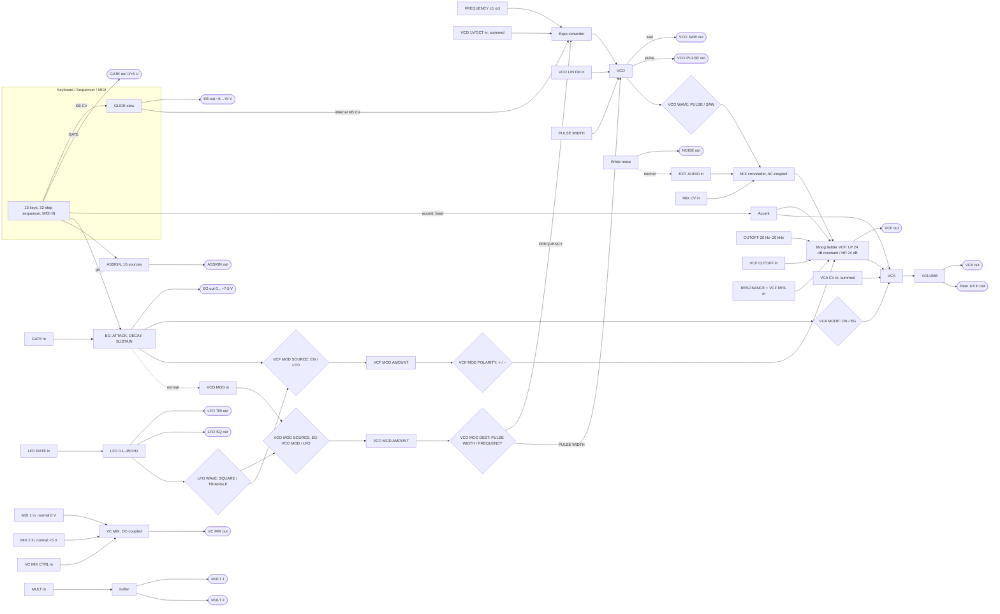

# Moog Mother-32: signal flow and spec (v2, checked against the manual)

This is the ground truth for building the twin. **Primary source: the Mother-32 Owner's Manual,
Version 2 (©2020)**, cited as **(M32 p.N)**. *N is the PDF page of the local copy*
(`scratchpad/manuals/mother32/Mother_32_Owners_Manual/`); **the printed page number is N − 1**.
The other source ids (SOS, VP, MDG …) and the confidence tags are defined in `sources.md`.
"Twin" means the current `devices/mother32/*`, which is identical at commit 89801d8. §15
lists what to change.

Everything here is a fact stated in our own words. Quotations are kept to one short sentence.
Signal convention, as in the other twins: **1.0 = 5 V**, so EG 0…+7.5 V = 0…1.5 and KB
−5…+5 V = −1…+1.

> **v2 changes** (now verified in M32): 1V/OCT **sums** with KB (p.49). KB 0 V = octave 5, low C
> = C4 = 261.6 Hz (p.63), and the default octave is 4 (p.30). SUSTAIN OFF also ends the attack
> early when the gate ends (p.17). Swing runs from −100 % to +100 % (p.29). TEMPO is **not** a
> gate input (p.47). Step Random is ±5 V (p.53). The CTRL/CV sensitivities of VC MIX, MIX and RES
> are ±5 V around a centred knob (pp.48–51). Every switch orientation is now verified from the
> panel drawings (p.10, pp.65–67). The real panel layout is in §1.1.

## 1. At a glance

| | Spec | Source | Confidence |
|---|---|---|---|
| Format | semi-modular analog mono synth, 60 HP Eurorack panel, aluminium rails, wood side pieces; 31.93 × 10.69 × 13.3 cm, 1.58 kg | M32 p.10, p.71 | verified |
| Voice | VCO (saw or pulse) and white noise / EXT AUDIO → MIX → Moog ladder VCF (LP or HP) → VCA → VOLUME | M32 p.11 (signal-path diagram), p.10 | verified |
| Modulation | one EG (ATTACK, DECAY, SUSTAIN switch), one LFO (square and triangle), VCO MOD and VCF MOD sections, GLIDE | M32 pp.13–18 | verified |
| Utilities | VC MIX (DC-coupled mixer/attenuator/VCA), MULT (buffered 1 → 2), ASSIGN (16 sources) | M32 pp.22, 51–53 | verified |
| Control | 13-key keyboard with 8 octave settings, 32-step sequencer with 64 patterns (8 banks × 8), 5-pin MIDI IN | M32 pp.18–19, 22 | verified |
| Patch bay | 32 × 3.5 mm: **18 inputs, 14 outputs**. Reversed (boxed) labels are outputs; ringed jacks are gate inputs | M32 pp.8, 23, 47 | verified |
| Rear | 1/4" TS instrument/headphone out, 12 VDC barrel (centre positive, adapter 1000 mA), Kensington slot | M32 pp.9, 71 | verified |
| Power | 2.8 W typical. In a Eurorack case: 230 mA max from +12 V, −12 V unused | M32 pp.64, 71 | verified |

### 1.1 Panel layout (from the manual's panel drawings)

The control order and the switch legends below are **verified** from the default-settings
drawing (M32 p.10) and the nine patch sheets (pp.65–67). The millimetre positions are scaled
from the p.10 drawing (faceplate 304.8 × 128.5 mm, x from the left edge of the faceplate, y from
its top) and are accurate to about ±3 mm: **likely**.

| Row (y ≈) | Left → right (x ≈ mm) |
|---|---|
| 1 (19 mm) | FREQUENCY (23) · VCO WAVE switch (52) · PULSE WIDTH (81) · MIX (111; CCW legend "VCO", CW "NOISE / EXT") · CUTOFF (145; scale legends 20Hz, 200Hz, 2kHz, 20kHz) · RESONANCE (181) · VCA MODE switch (204) · VOLUME (227) |
| 2 (47 mm) | GLIDE (23) · VCO MOD SOURCE switch (52) · VCO MOD AMOUNT (81) · VCO MOD DEST switch (111) · VCF MODE switch (138) · VCF MOD SOURCE switch (169) · VCF MOD AMOUNT (198) · VCF MOD POLARITY switch (227) |
| 3 (77 mm) | MIDI IN LED (16) · TEMPO / GATE LENGTH, "(SWING)" printed under it (43) · LFO RATE (81) · LFO WAVE switch (111) · ATTACK (141) · SUSTAIN switch (169) · DECAY (198) · VC MIX (227; CCW "LO / MIX 1", CW "HI / MIX 2") |
| Buttons, upper (96 mm) | HOLD / REST (41) · Tempo LED (57) · PATTERN (BANK) (71) · OCTAVE / LOCATION LEDs 1–8 (81–116) · black-key row: 1-8 (134), 9-16 (149), 17-24 (180), 25-32 (195), SET END (209) |
| Buttons, lower (109 mm) | MIDI IN DIN socket (16) · RESET / ACCENT (41) · (SHIFT) (57) · RUN / STOP (REC) (71) · ◄ (KB) (90) · ► (STEP) (107) · white-key row: steps 1–8 (125, 141, 156, 172, 187, 202, 217, 232), each with a Step LED just below (117 mm) |
| Patch bay | 4 columns at x ≈ 254, 267, 282, 295 mm; 8 rows at y ≈ 17, 31, 44, 57, 71, 84, 98, 112 mm (§10) |

| Switch | UP | DOWN | Source |
|---|---|---|---|
| VCO WAVE | PULSE (⊓) | SAW (⟋) | M32 pp.10, 65–67 |
| VCO MOD SOURCE | EG / VCO MOD | LFO | M32 p.50 ("UP position … EG/VCO MOD"), p.10 |
| VCO MOD DEST | PULSE WIDTH | FREQUENCY | M32 p.10 |
| VCF MODE | HI PASS | LOW PASS | M32 p.10 |
| VCF MOD SOURCE | EG | LFO | M32 p.10 |
| VCF MOD POLARITY | + | − | M32 p.10 |
| VCA MODE | ON | EG | M32 p.10 |
| LFO WAVE | SQUARE (⊓) | TRIANGLE (^) | M32 p.10 |
| SUSTAIN | ON | OFF | M32 p.10 |

The drawings mark the active position by circling its legend. In the twin, option index 0
should be the UP position. Several current `spec.ts` option orders are reversed (§15).

Other panel details:
- The keyboard's 13 keys double as sequencer buttons. The eight lower keys are **Step buttons
  1–8**. Four of the five upper keys are the **page selectors** 1-8, 9-16, 17-24, 25-32, and the
  fifth is **SET END** (M32 p.37).
- Four small holes near FREQUENCY, PULSE WIDTH and VCO MOD AMOUNT are probably the four VCO
  calibration trimmers (VCO Offset, Frequency Control Gain, External 1V/Oct Gain, KB CV Gain;
  M32 p.62): likely. The circle beside LFO RATE is probably an LFO LED: guess.
- LEDs (M32 pp.18, 22, 25–28, 33, 35–37, 55, 59): the Tempo LED (above SHIFT) blinks at the
  step rate. It is red on the internal clock, green on an external or MIDI clock, solid yellow
  in Record, flashes yellow in Setup, and alternates yellow and red while a step is being
  edited. The 8 OCTAVE / LOCATION LEDs mean different things by colour:
  - **red**: the keyboard octave, the gate-length bar graph, and Setup values 9–16;
  - **green**: the pattern page, the step flags in KB mode (5 glide, 6 ratchet, 7 accent,
    8 rest), the pattern location, the swing interval, and Setup values 1–8;
  - **yellow**: the bank, the ratchet count (LEDs 1–4), the clock division, the step flags in
    Step mode, and the Setup page.

  The Step LEDs sit under the eight step keys. The MIDI IN LED flashes red on incoming data.

### 1.2 Default panel settings (the manual's "basic sawtooth" start point)

M32 p.10 shows the default positions. The tutorials (p.25, p.33) and the calibration (p.63)
start from them. Read from the drawing (**verified** positions; units from the §14 model):

FREQUENCY 12:00 · VCO WAVE **SAW** · PULSE WIDTH 12:00 · MIX 7:00 (VCO only) · GLIDE 7:00 (off) ·
VCO MOD SOURCE **LFO** · VCO MOD AMOUNT 7:00 (0) · VCO MOD DEST **FREQUENCY** · TEMPO about 2:30 ·
LFO RATE 12:00 · LFO WAVE **TRIANGLE** · CUTOFF 11:00 · RESONANCE 7:00 (0) · VCA MODE **EG** · VOLUME
12:00 · VCF MODE **LOW PASS** · VCF MOD SOURCE **EG** · VCF MOD AMOUNT 12:00 · POLARITY **+** · ATTACK
7:00 · SUSTAIN **ON** · DECAY about 11:30 · VC MIX 7:00 · keyboard octave LED **4** · no cables.

This is `presets.md` preset 00 (INIT).

## 2. Block diagram (ASCII)

```
 KEYBOARD (13 keys, ◄KB / STEP► octave 1–8, default 4)  ┐
 SEQUENCER (32 steps × 64 patterns)                     ├─► KB CV ─► GLIDE ─┬─────────────► [KB] −5…+5 V (incl. glide + bend)
 MIDI IN (note 0 = −5 V … 120 = +5 V; bend ±1 oct)      ┘                   │
                                          GATE ──────────────────────────────┼──┬──────────► [GATE] 0 / +5 V
                                          ACCENT (fixed level) ──┐           │  └─(internal)─► EG ◄── GATE in (0…+5 V)
                                                                 │           │
 FREQUENCY (≈ ±1 oct) ─────────────────────────────(+)──► EXPO ◄─(+)─ internal KB CV
 VCO 1V/OCT in (±5 V, SUMMED) ─────────────────────(+)┘   ▲  ▲
 VCO MOD (DEST = FREQUENCY) ─────────────────────────────┘  │
 VCO LIN FM in (±5 V) ──────────────────────────────────────┘ (linear)
                                                    ▼
 PULSE WIDTH (2–98 %) ─(+)─► PW ◄── VCO MOD (DEST = PULSE WIDTH; may reach 0/100 % = silence)
                                                   VCO ─┬─ SAW ───► [VCO SAW] ±5 V
                                                        └─ PULSE ─► [VCO PULSE] ±5 V
                                 VCO WAVE (UP PULSE / DOWN SAW) ─┐
 NOISE (white) ─► [NOISE] ±5 V                                    │
     └──(normal)──► EXT. AUDIO in (unity, 10 V p-p) ─┐            │
                                                     ▼            ▼
                     MIX (AC-coupled crossfader): CCW = VCO wave … CW = NOISE / EXT   ◄─(+)─ MIX CV in (±5 V = full sweep from noon)
                                                        │
 CUTOFF 20 Hz–20 kHz ──(+)─┐                            ▼
 VCF CUTOFF in (±5 V) ─(+)─┼─► MOOG LADDER, 4 pole:  LOW PASS 24 dB/oct resonant  |  HI PASS 24 dB/oct non-resonant
 VCF MOD (amount, ±) ──(+)─┤     ▲ RESONANCE (+) VCF RES in (±5 V = full sweep from noon); LP self-oscillates past 3 o'clock
 ACCENT ───────────────(+)─┘     │
                                 ├─────────────────────────────────────────────► [VCF] max ±5 V
                                 ▼
                VCA ◄── [VCA MODE: UP ON = held open | DOWN EG = follows EG] (+) VCA CV in (0…+8 V EG / ±5 V ON) (+) ACCENT
                                 │
                              VOLUME ──► [VCA] ±5 V typical   and   rear 1/4" AUDIO / HEADPHONE

 EG: ATTACK, DECAY, SUSTAIN (ON = hold while the gate is high; OFF = decay after the attack or at gate-off, whichever is first)
   ├─► [EG] 0…+7.5 V            ├─► VCA (VCA MODE EG)
   ├─► VCF MOD (SOURCE EG)      └─► VCO MOD jack normal (SOURCE UP = EG / VCO MOD)

 LFO: RATE 0.1–350 Hz (600 Hz with CV) ◄─(+)─ LFO RATE in (±5 V from noon ≈ 0.18–190 Hz)
   ├─ TRI ─► [LFO TRI] ±5 V    ├─ SQ ─► [LFO SQ] ±5 V
   └─ LFO WAVE (UP SQUARE / DOWN TRIANGLE) ─► the LFO position of VCO MOD SOURCE and VCF MOD SOURCE

 VCO MOD:  SOURCE [UP EG / VCO MOD jack | DOWN LFO] ─► AMOUNT ─► DEST [UP PULSE WIDTH | DOWN FREQUENCY]
 VCF MOD:  SOURCE [UP EG | DOWN LFO] ─► AMOUNT ─► POLARITY [UP + | DOWN −] ─► cutoff

 VC MIX (DC-coupled, not wired to the synth): MIX 1 in (normal 0 V, CCW) ─┐
                                              MIX 2 in (normal +5 V, CW) ─┴─► crossfade (knob (+) VC MIX CTRL ±5 V) ─► [VC MIX] ±5 V
 MULT:    MULT in ─► buffer ─┬─► [MULT 1]
                             └─► [MULT 2]   (splitter only, never a mixer)
 ASSIGN:  Setup page 1, 16 sources (default 2 = Sequencer Clock) ─► [ASSIGN]

 SEQUENCER INPUTS: TEMPO in (Setup p.3: Tempo CV | Single Clock Advance (default) | Analog Clock | Step Address CV)
                   RUN/STOP in (plays while +5 V) · RESET in (step 1, held while high) · HOLD in (repeat step while high)
 CLOCK PRIORITY:   analog clock at TEMPO > MIDI clock > internal clock
```

## 3. Block diagram (Mermaid)



## 4. VCO

| Item | Spec | Source | Confidence |
|---|---|---|---|
| Range | with every internal CV at 0 V, ±5 V into 1V/OCT sweeps 8 Hz–8 kHz (10 octaves); 16 kHz max with LFO/CV | M32 p.49; SPEC | verified |
| Tuning reference | FREQUENCY exactly at centre, octave 5, low C (KB = 0 V) gives **C4 = 261.6 Hz**. Octave 7 low C (+2 V) gives C6 = 1046.5 Hz | M32 p.63 | verified |
| FREQUENCY | tunes ±1 octave from centre; factory-calibrated to *slightly more* than ±1 octave, and the end positions vary a little between units | M32 p.12 | verified |
| VCO WAVE | picks SAW or PULSE for the CCW side of MIX; both waves are always at their jacks | M32 p.12 | verified |
| PULSE WIDTH | about 2 % fully CCW to about 98 % fully CW; square at mid position | M32 p.12 | verified |
| PWM limit | modulation can push the pulse to 0 % or 100 %, which silences it, by design | M32 pp.12, 13 | verified |
| Saw + pulse together | patch VCO PULSE into EXT. AUDIO with VCO WAVE on SAW, and MIX then blends saw and pulse | M32 p.12 | verified |
| 1V/OCT in | ±5 V exponential, **summed** with FREQUENCY, the KB CV and VCO modulation. Use it for 1 V/oct tracking from external gear | M32 p.49 | verified |
| LIN FM in | ±5 V linear FM, for audio-rate modulation | M32 p.50 | verified (depth: guess, §14) |
| Outputs | VCO SAW ±5 V, VCO PULSE ±5 V | M32 p.50 | verified |
| Calibration | four trimmers reachable through the panel: VCO Offset, Frequency Control Gain, External 1V/Oct Gain, KB CV Gain | M32 pp.62–63 | verified |

## 5. VCO MOD section

| Item | Spec | Source | Confidence |
|---|---|---|---|
| SOURCE | UP = **EG / VCO MOD** (the EG, or a cable in the VCO MOD jack), DOWN = **LFO** (the wave chosen by LFO WAVE) | M32 pp.13, 14, 50 | verified |
| VCO MOD jack | feeds the UP position. A cable overrides the EG normal there, and AMOUNT then works as its attenuator | M32 pp.13, 50 | verified |
| AMOUNT | depth to the chosen destination. Low settings on FREQUENCY give subtle vibrato; medium settings on PULSE WIDTH give chorus-like movement | M32 p.13 | verified (wording); depth guess (§14) |
| DEST | UP = PULSE WIDTH (of the pulse wave), DOWN = FREQUENCY (pitch) | M32 p.13, p.10 | verified |
| Polarity | VCO MOD has no polarity switch | M32 p.10 panel | verified |
| Uses (manual) | slow PWM gives big chorus-like basses, fast PWM sounds like two beating oscillators; subtle pitch modulation is vibrato, extreme modulation gives octave jumps and pitched drums | M32 p.13 | verified |

## 6. Mixer

| Item | Spec | Source | Confidence |
|---|---|---|---|
| MIX | voltage-controlled crossfader, AC-coupled: CCW = the selected VCO wave, CW = white noise or EXT. AUDIO | M32 p.14 | verified |
| MIX CV in | summed with the knob; with MIX at centre, −5…+5 V crossfades fully from VCO to noise/EXT | M32 p.48 | verified |
| NOISE | white noise, ±5 V typical, normalled to the CW side of MIX | M32 pp.11, 49 | verified |
| EXT. AUDIO in | unity gain at Eurorack level: feed it about 10 V p-p, since line level is far too quiet. A cable overrides the noise normal | M32 pp.14, 48 | verified |
| Dead cable | a plug in EXT. AUDIO with nothing at the other end silences the noise side (used for the filter-sine trick) | M32 p.15 | verified |

## 7. VCF

| Item | Spec | Source | Confidence |
|---|---|---|---|
| Type | classic Moog ladder, switchable: LOW PASS 24 dB/oct *with* resonance, HI PASS 24 dB/oct *non-resonant* | M32 pp.15, 71 | verified |
| CUTOFF | 20 Hz – 20 kHz. Panel legends put 200 Hz and 2 kHz at about ⅓ and ⅔ of the travel, so the taper is logarithmic | M32 p.15; p.10 drawing | range verified; taper likely |
| RESONANCE | feeds the output back to the input; a peak at the cutoff; **self-oscillates above 3 o'clock** | M32 p.15 | verified |
| RESONANCE in HP | if it is turned up at all in HI PASS, the high-pass no longer works fully: it brings the bottom end back | M32 p.15 | verified |
| HP resonance | patch VCF into EXT. AUDIO with RESONANCE fully CCW. MIX becomes the HP resonance, right up to self-oscillation | M32 p.15 | verified |
| HP bypass | CUTOFF at minimum in HI PASS passes the mixer straight to the VCA (the raw VCO) | M32 p.15 | verified |
| Sine source | LP, RESONANCE and MIX at max, a dead cable in EXT. AUDIO, KB into VCF CUTOFF; tune with CUTOFF | M32 p.15 | verified |
| VCF CUTOFF in | summed with CUTOFF and VCF MOD; with CUTOFF at centre and AMOUNT off, −5…+5 V sweeps 20 Hz–20 kHz (≈ 1 V/oct) | M32 p.49 | verified |
| VCF RES in | summed with RESONANCE; with the knob at centre, −5…+5 V sweeps min → max | M32 p.49 | verified |
| VCF out | max about ±5 V; the level depends on the input and the cutoff | M32 p.49 | verified |
| VCF MOD SOURCE | UP EG / DOWN LFO (the wave chosen by LFO WAVE) | M32 p.16, p.10 | verified |
| VCF MOD AMOUNT | how far the source moves the cutoff (a unipolar knob) | M32 p.16 | verified |
| VCF MOD POLARITY | UP + / DOWN −. With −, the EG attack lowers the cutoff. Tip: with + set CUTOFF to the lowest wanted point, with − to the highest | M32 p.16 | verified |
| Bass loss | the low end drops as resonance rises, a ladder trait | MT, MR | verified (reviews) |
| HP character | even at high cutoff a lot of mid-range passes (SOS); a triangle comes out almost square (F) | SOS, F | likely |

## 8. EG, VCA, accent, LFO, glide

### 8.1 EG (one envelope for everything)

| Item | Spec | Source | Confidence |
|---|---|---|---|
| Start | started by a gate (keys, sequencer, GATE in) or a MIDI Note On | M32 p.16 | verified |
| ATTACK | time from zero to maximum. Times are not in the manual; Moog told SOS 1.25 ms – 3 s (nominal) | M32 p.16; SOS | wording verified; times verified (Moog via SOS) |
| DECAY | time from the current or maximum level down to zero; nominal 1.25 ms – 7 s | M32 p.17; SOS | verified |
| SUSTAIN ON | holds at maximum while the note is held (like an organ), then decays at release. **Overlapping keyboard/MIDI notes do not retrigger** (legato) | M32 p.17 | verified |
| SUSTAIN OFF | the attack moves straight into decay **when it completes or when the note is released, whichever comes first**. Every keyboard/MIDI note retriggers | M32 p.17 | verified |
| Gate length | per-step gate lengths need SUSTAIN ON to sound right | M32 p.26 | verified |
| EG out | 0 … +7.5 V, following ATTACK, DECAY and SUSTAIN | M32 p.54 | verified |
| GATE in | 0 … +5 V gate triggers the EG, 10 V tolerant | M32 p.54 | verified |
| Destinations | VCA (VCA MODE EG), VCF MOD (SOURCE EG), the VCO MOD jack normal, EG out | M32 pp.13, 16, 17, 54 | verified |
| Curves | RC-style segments | — | guess |

### 8.2 VCA

| Item | Spec | Source | Confidence |
|---|---|---|---|
| VCA MODE | UP **ON**: held at maximum, so sound passes with no gate (drones). DOWN **EG**: follows the envelope | M32 p.17 | verified |
| VCA CV in | **summed** with the ON/EG signal: 0…+8 V in EG mode, ±5 V in ON mode. An LFO here gives tremolo | M32 p.48 | verified |
| VOLUME | sets the level of both the VCA jack and the rear AUDIO/HEADPHONE out; fully CCW is silent | M32 pp.11, 17 | verified |
| VCA out | after VOLUME, ±5 V typical | M32 p.48 | verified |

### 8.3 Accent

| Item | Spec | Source | Confidence |
|---|---|---|---|
| Internal accent | accented steps get a brief emphasis in volume and brightness: routed internally to the VCF and VCA *at a fixed level* | M32 pp.19, 24, 26 | verified (amount: guess, §14) |
| ASSIGN = 1 Accent | 0…+5 V filtered pulse on accented steps only | M32 p.53 | verified |
| Accent Out CV Only | Setup p.8 option 4: ON disables the internal accent while ASSIGN is on Accent. Default OFF | M32 pp.61–62 | verified |
| Sources | step data (ACCENT while editing; OCTAVE/LOCATION LED 7), Live Accent (SHIFT + ACCENT), MIDI velocity ≥ 96 while recording or step-editing | M32 pp.26, 30, 58 | verified |

### 8.4 LFO

| Item | Spec | Source | Confidence |
|---|---|---|---|
| RATE | about 0.1 Hz – 350 Hz; up to 600 Hz with an external CV at LFO RATE | M32 p.14 | verified |
| LFO RATE in | summed; with the knob at centre, −5…+5 V sweeps about 0.18–190 Hz (≈ 1 V/oct); max about 600 Hz | M32 p.50 | verified |
| WAVE | square (UP) or triangle (DOWN), sent automatically to both mod-source switches | M32 p.14 | verified |
| Outputs | LFO TRI ±5 V, LFO SQ ±5 V, both always live | M32 pp.14, 51 | verified |
| Uses | square: trills, octave jumps, slap-delay effects; triangle: vibrato and PWM, and FM at audio rate. Tip: KB → LFO RATE makes the rate follow the notes | M32 p.14 | verified |
| Phase of TRI vs SQ | not documented | — | guess |

### 8.5 Glide

| Item | Spec | Source | Confidence |
|---|---|---|---|
| GLIDE | time for the VCO to move from one pitch to the next; applies to keyboard, MIDI and sequencer notes | M32 p.18 | verified |
| Sequencer | glide is on or off per step (turn GLIDE clockwise to switch it on, fully CCW for off; OCTAVE/LOCATION LED 5); the rate is always the panel GLIDE knob | M32 pp.27, 44, 46 | verified |
| Slide | the step *before* the target needs a tie (8/8 gate), and the target step gets glide on | M32 p.27 | verified |
| KB out | includes glide and pitch bend | M32 p.54 | verified |
| MIDI | CC 5 portamento time, CC 65 portamento on/off | M32 p.58 | verified |
| Range | not documented; twin model 0–2 s | — | guess |

## 9. Utilities: VC MIX, MULT, ASSIGN, attenuators

### 9.1 VC MIX (M32 pp.22, 51–52)

| Item | Spec | Confidence |
|---|---|---|
| Nature | DC-coupled, patchable mixer/attenuator for CV or audio; not wired to the synth (it needs cables) | verified |
| MIX 1 in | normalled to **0 V**, at the CCW end of the knob, accepts ±5 V | verified |
| MIX 2 in | normalled to a nominal **+5 V**, at the CW end, accepts ±5 V | verified |
| VC MIX CTRL in | summed with the knob; with the knob at centre, −5…+5 V crossfades MIX 1 → MIX 2. So **10 V spans the whole travel** | verified |
| VC MIX out | the blend, ±5 V | verified |
| Fixed voltage | nothing patched: the knob gives 0 … +5 V | verified |
| Attenuator | the signal into MIX 2; fully CCW = fully attenuated, turning CW passes more | verified |
| VCA | the signal into MIX 2, knob fully CCW, and a 0-to-positive CV (an EG, say) into VC MIX CTRL sets the level | verified |
| Mixer | two signals into MIX 1 and MIX 2, the knob or CTRL crossfades | verified |
| Law | linear crossfade | guess |

### 9.2 MULT (M32 p.52)

A buffered input feeding two buffered outputs. It is a signal splitter for CV; **never use it to
mix**. The manual also says to split outputs freely, but never to drive one input from two
outputs (p.47). All verified.

### 9.3 ASSIGN (Setup page 1; M32 pp.53, 60)

| # | Source | Output | Confidence |
|---|---|---|---|
| 1 | Accent | 0…+5 V filtered pulse, accented steps only | verified |
| 2 | **Clock (default)** | 0…+5 V clock at the internal clock tempo, one pulse per step | verified |
| 3 | Clock / 2 | 0…+5 V at half the clock rate | verified |
| 4 | Clock / 4 | 0…+5 V at a quarter of the clock rate | verified |
| 5 | Step Ramp | −5…+5 V, rising evenly over the pattern's steps; reset to minimum at step 1 | verified |
| 6 | Step Saw | −5…+5 V, falling evenly over the steps; reset to maximum at step 1 | verified |
| 7 | Step Triangle | −5…+5 V, alternating each pattern run between rising and falling | verified |
| 8 | Step Random | random −5…+5 V each step while running | verified |
| 9 | Step 1 Trigger | 0…+5 V pulse on step 1 only | verified |
| 10 | MIDI Velocity | −5…+5 V from 0–127 | verified |
| 11 | MIDI Channel Pressure | −5…+5 V | verified |
| 12 | MIDI Pitch Bend | −5…+5 V | verified |
| 13–16 | MIDI CC 1, CC 2, CC 4, CC 7 | −5…+5 V from 0–127 | verified |

Notes:
- Setup p.5 sets "Clock Output PPQN" (default 4, i.e. 16ths), and Setup p.8 option 3 "Clock
  Output Swing" (default ON) makes the clock output follow the swing (M32 pp.61–62). The manual
  does not say how PPQN interacts with ASSIGN = Clock ("one pulse per step"). **Model**: at the
  default 1/16 division the two agree; otherwise emit one pulse per step. Guess.
- The ASSIGN mode can also be chosen by MIDI Program Change 71–86 (M32 p.58).

### 9.4 Attenuators

There is no dedicated attenuator. Use VC MIX (the signal into MIX 2), or VCO MOD AMOUNT for a
cable in the VCO MOD jack. These inputs take the full signal with no attenuator: VCF CUTOFF,
VCF RES., MIX CV, LFO RATE, 1V/OCT, LIN FM and VCA CV.

## 10. Patch bay: all 32 points (M32 pp.47–57)

Labels are exactly as printed (M32 p.47 drawing). Col and row are 0-based, as in `spec.ts`. ◉
marks a ringed gate input (only GATE, RUN / STOP, RESET and HOLD are ringed, p.47). All rows
are **verified (M32, page given)** unless marked.

| Col,Row | Label | Dir | Level | Normal / behaviour | Twin id | M32 p. |
|---|---|---|---|---|---|---|
| 0,0 | EXT. AUDIO | in | unity, Eurorack 10 V p-p | **normalled to NOISE**; a cable overrides it at MIX's CW side | in_ext_audio | 14, 48 |
| 1,0 | MIX CV | in | ±5 V | summed with MIX; ±5 V from centre = full crossfade | in_mix_cv | 48 |
| 2,0 | VCA CV | in | 0…+8 V (EG mode) / ±5 V (ON mode) | **summed** with the VCA MODE signal; no normal | in_vca_cv | 48 |
| 3,0 | VCA | out | ±5 V typical | after VOLUME | out_vca | 48 |
| 0,1 | NOISE | out | ±5 V typical | white noise; also normalled into MIX | out_noise | 49 |
| 1,1 | VCF CUTOFF | in | ±5 V | summed with CUTOFF and VCF MOD; ±5 V from centre = 20 Hz–20 kHz | in_vcf_cutoff | 49 |
| 2,1 | VCF RES. | in | ±5 V | summed with RESONANCE; ±5 V from centre = min–max | in_vcf_res | 49 |
| 3,1 | VCF | out | max ±5 V | ladder output, before the VCA | out_vcf | 49 |
| 0,2 | VCO 1V/OCT | in | ±5 V, 1 V/oct | **summed** with FREQUENCY, KB CV and VCO mod; 8 Hz–8 kHz | in_vco_1voct | 49 |
| 1,2 | VCO LIN FM | in | ±5 V | linear FM | in_vco_lin_fm | 50 |
| 2,2 | VCO SAW | out | ±5 V | sawtooth | out_vco_saw | 50 |
| 3,2 | VCO PULSE | out | ±5 V | pulse | out_vco_pulse | 50 |
| 0,3 | VCO MOD | in | ±5 V CV | feeds VCO MOD SOURCE UP (EG/VCO MOD); **overrides the EG normal**; AMOUNT attenuates it | in_vco_mod | 50 |
| 1,3 | LFO RATE | in | ±5 V | summed; ±5 V from centre ≈ 0.18–190 Hz; max ≈ 600 Hz | in_lfo_rate | 50 |
| 2,3 | LFO TRI | out | ±5 V | triangle | out_lfo_tri | 51 |
| 3,3 | LFO SQ | out | ±5 V | square | out_lfo_sq | 51 |
| 0,4 | MIX 1 | in | ±5 V, DC | **normal 0 V**; knob CCW | in_mix1 | 51 |
| 1,4 | MIX 2 | in | ±5 V, DC | **normal +5 V**; knob CW | in_mix2 | 51 |
| 2,4 | VC MIX CTRL | in | ±5 V | summed with VC MIX; ±5 V from centre = full crossfade | in_vc_mix_ctrl | 51 |
| 3,4 | VC MIX | out | ±5 V | the blend | out_vc_mix | 52 |
| 0,5 | MULT | in | any (buffered) | splitter only | in_mult | 52 |
| 1,5 | MULT 1 | out | = MULT | buffered copy | out_mult1 | 52 |
| 2,5 | MULT 2 | out | = MULT | buffered copy | out_mult2 | 52 |
| 3,5 | ASSIGN | out | 0…+5 V (clocks, triggers, accent) or ±5 V (CVs) | Setup p.1, 16 sources; default Clock | out_assign | 53 |
| 0,6 | GATE ◉ | in | 0…+5 V, 10 V tolerant | triggers the EG. The manual gives **no override** rule (unlike EXT. AUDIO and VCO MOD), so the internal gate stays active: **likely OR-ed** (note 2) | in_gate | 54 |
| 1,6 | EG | out | 0…+7.5 V | envelope | out_eg | 54 |
| 2,6 | KB | out | −5…+5 V | keyboard, sequencer or MIDI pitch, including glide and bend | out_kb | 54 |
| 3,6 | GATE | out | +5 V | keyboard, sequencer or MIDI gate | out_gate | 54 |
| 0,7 | TEMPO (not ringed) | in | −5…+5 V by default; 0…+5 V by Setup p.8 option 5 | 4 modes, Setup p.3; default **Single Clock Advance** (§11.6) | in_tempo | 56 |
| 1,7 | RUN / STOP ◉ | in | ≥ +3.2 V = high; safe to +15 V | +5 V plays from the current location while held; 0 V stops there; the last action (button or jack) wins. A clock here advances the pattern like repeated presses but does **not** sync the internal clock | in_run_stop | 57 |
| 2,7 | RESET ◉ | in | as above | +5 V resets to step 1 and repeats step 1 while high; on 0 V it advances from step 1 | in_reset | 57 |
| 3,7 | HOLD ◉ | in | as above | +5 V while running repeats the current step at tempo; on 0 V it advances again | in_hold | 57 |

**Note 1 (resolved): VCO 1V/OCT sums** (M32 p.49). Consequences for the twin and for patching:
- Patching KB → 1V/OCT doubles the tracking (2 V/oct), so never do it.
- External pitch CV (from the DFAM, another sequencer or MIDI-CV) adds to the Mother-32's own
  KB CV. To follow external pitch exactly, stop the M32 sequencer and play low C in octave 5
  (KB 0 V, calibration condition p.63), or offset with FREQUENCY.
- The manual's own patches only ever send KB to VCF CUTOFF (the filter tracks the keys), never
  to 1V/OCT.

**Note 2: GATE in.** The manual routes the internal keyboard/sequencer/MIDI gate "internally to
trigger the EG" (M32 p.54) and describes GATE in only as an input that triggers the EG. It
documents normal overrides explicitly for EXT. AUDIO and VCO MOD, but not for GATE.
**Recommendation: OR the two** (likely). The twin currently mutes the internal gate when GATE
is patched; mark that as a model choice if kept. Every patch and lesson here works either way,
because the M32 sequencer is stopped when an external gate drives it.

## 11. Keyboard and sequencer (M32 pp.18–46)

### 11.1 Keyboard, octaves and pitch

| Item | Spec | M32 p. | Confidence |
|---|---|---|---|
| Keyboard | 13 keys, one octave C to C. ◄ (KB) and ► (STEP) select one of **8 octaves** (red OCTAVE / LOCATION LED). Power-up mode is KB | 18 | verified |
| Default octave | **4**; transpose reference note = low C | 30 | verified |
| Octave → voltage | octave 5 low C = 0 V (C4), octave 7 low C = +2 V (C6), so **octave n low C = (n − 5) V**: octave 4 = −1 V (C3), octave 1 = −4 V (C0), octave 8 = +3 V (C7, top key +4 V) | 63 (derived) | verified (5 and 7), likely (the rest) |
| Default step note | new or initialised steps hold −1 V (octave 4 low C = C3) with a 50 % gate | 44, 45 | verified |
| MIDI notes | KB CV = (note − 60) / 12 V: note 0 = −5 V, 120 = +5 V; notes 121–127 repeat 109–115 | 57 | verified |
| Key priority | not documented: model last-note priority | — | guess |
| Live play | sequencer stopped: the keys play; KB/STEP choose the octave | 43 | verified |
| Live transpose | sequencer running: choose an octave and press a key to transpose relative to low C. It acts only once a key is pressed, and it is not stored. MIDI notes transpose too, in both modes | 30, 43, 57 | verified |

### 11.2 Modes

| Mode | Enter | Behaviour | M32 p. |
|---|---|---|---|
| **KB** (default) | SHIFT + KB | play, record (SHIFT + REC), transpose during playback | 24, 40 |
| **REC** (KB mode) | SHIFT + RUN/STOP (REC). The Tempo LED goes solid yellow and the internal clock pauses | **Step-Write**: each note or REST stores the step and advances. While a step blinks you can set its gate length, accent, rest, tie, glide and ratchet. Holding the current note while playing the next makes a tie (legato). SHIFT + Step 1–8 selects any step and stops step-write; SHIFT + page key changes page; RUN/STOP (or entering Step mode) exits | 25–28, 31, 43–44 |
| **STEP** | SHIFT + STEP | Step keys 1–8 toggle steps on/off (off = rest, LED 8). Page keys select the page (pausing LED chasing). SET END + Step key sets the last step. KB/STEP **rotate** the pattern one step left/right. SHIFT + Step key edits that step: the keys enter its note, KB/STEP its octave, and GATE LENGTH, ACCENT, REST, GLIDE and SHIFT + GLIDE (ratchet) apply. SHIFT + the same key exits. No record function | 33–37, 45–46 |
| **Setup** | SHIFT + RESET + SET END + STEP 8 (the same to exit). The Tempo LED flashes yellow | pages on yellow LEDs (KB/STEP choose the page); values 1–8 with Step keys (green), 9–16 with SHIFT + Step keys (red); settings survive power-off | 59 |

### 11.3 Step parameters (each of up to 32 steps)

| Parameter | Values | How it is set | LED | M32 p. | Confidence |
|---|---|---|---|---|---|
| Note | any key in any of the 8 octaves (also by MIDI note) | key while the step is edited | red octave LED | 25, 46, 57 | verified |
| Gate length | **1/8 … 8/8** of the step. 8/8 = **tie**: same next note = held through, a different note = legato. A new note copies the previous step's gate length; new steps default to 50 % | TEMPO/GATE LENGTH while editing | red bar graph | 26–27, 44 | verified |
| Glide | on/off; the rate is the GLIDE knob | GLIDE CW = on, fully CCW = off | LED 5 green (yellow in Step-mode overview) | 27, 44, 46 | verified |
| Ratchet | **1–4** notes within the step | SHIFT + GLIDE | LEDs 1–4 yellow show the count; LED 6 green when 2–4 | 20, 28, 44, 46 | verified |
| Accent | on/off | ACCENT (RESET/ACCENT) | LED 7 green | 26, 43, 46 | verified |
| Rest | on/off | REST (HOLD/REST); in Step mode also the Step key | LED 8 green (yellow in Step mode) | 27, 43, 45 | verified |
| Tie | = gate 8/8 (or legato key entry in REC) | see Gate length | all 8 red | 26 | verified |

Playback details:
- **Ratchet** divides the step evenly ("divides Step 6 in half … two notes", M32 p.36). Ratchets
  are easier to hear with shorter gates (p.28). With an external clock in Single Clock Advance,
  ratchets follow the incoming clock (p.56).
- **Twin model** (guess): each ratchet sub-step is gated for the step's gate fraction of the
  sub-step.
- **Pause and resume**: RUN/STOP pauses on the last step played, and pressing it again resumes
  from the next step (p.29). RESET returns to step 1 at any time (p.29).

### 11.4 Patterns, banks, saving (M32 pp.31–33, 38–40)

| Item | Spec | Confidence |
|---|---|---|
| Locations | 64 = 8 banks × 8. There is always one active pattern | verified |
| Select pattern | hold PATTERN + KB/STEP or Step keys 1–8. PATTERN alone shows it (green LED) | verified |
| Select bank | hold SHIFT + PATTERN (BANK) + Step keys 1–8 or KB/STEP. SHIFT + BANK shows it (yellow LED) | verified |
| Delay Pattern Change | default ON: a new pattern starts when the current one ends. OFF = immediately (Setup p.8 option 6) | verified |
| Load Saved Timing | default ON: loading restores the saved clock division, swing amount and swing interval (Setup p.8 option 7) | verified |
| Save (manual mode) | hold SHIFT + RUN/STOP about 1 s; the destination LED blinks green; KB/STEP or SHIFT + location key moves it; BANK + KB/STEP changes the bank; SHIFT + RUN/STOP saves (the LEDs sweep green to the centre); RUN/STOP cancels (they sweep red) | verified |
| Save modes (Setup p.6) | 1 Manual Save (default), 2 Auto Save (edits saved automatically; the original kept in a buffer until the pattern changes), 3 Write Protect | verified |
| Restore | PATTERN + RESET reloads the stored pattern, discarding edits | verified |
| Initialise | SHIFT + RESET + PATTERN (the LEDs sweep red right to left); memory is untouched | verified |
| Unsaved edits | lost on pattern change, initialise or restore (in manual mode) | verified |
| MIDI | Program Change 1–64 selects the pattern location | verified |
| Length | 1–32 via SET END (§11.2). Extending into never-edited steps fills them with −1 V and 50 % gates; previously edited steps are restored | verified |

### 11.5 Timing (M32 pp.20–22, 29, 41–42, 55)

| Item | Spec | Confidence |
|---|---|---|
| TEMPO (internal) | base tempo **20–300 BPM**; also used to set the clock division | verified |
| Clock division | 24 values = 8 note values × {dotted, triplet, straight}. The values: two whole notes, whole, half, quarter, eighth, sixteenth, thirty-second, sixty-fourth. Selection: dotted = hold KB + TEMPO; triplet = hold STEP + TEMPO; straight = hold KB + STEP + TEMPO on the internal clock, or TEMPO alone when synced to MIDI or analog clock. Shown on yellow LEDs | verified |
| Default division | the global defaults list 4 PPQN (= sixteenth note) for clock in and out; the step default is presumably 1/16 | likely |
| Swing amount | SHIFT + TEMPO (SWING). Centre (12:00) = no swing. Page 29 states the range as **−100 % … +100 %**: negative moves the off-beats earlier (at −100 % only the off-beats play), positive moves the on-beats later (at +100 % only the on-beats play). Page 20 describes the same knob as an on-beat share (50 % at 12:00) | verified |
| Swing interval | independent of the step rate; the same 24 values; dotted = KB + GLIDE, triplet = STEP + GLIDE, straight = KB + STEP + GLIDE (shown green). One on-beat plus one off-beat always lasts two intervals; the on-beat stays aligned to the clock | verified |
| Mid-step swing | if an interval boundary falls inside a step, the rest of the step plays at the other phase's rate | verified |
| Stored per pattern | swing amount and swing interval (and the division, given Load Saved Timing) | verified |
| Reset swing | set or reset the clock division (this resets the interval), then SHIFT + TEMPO to 12:00 | verified |
| Direction | KB + STEP + Step key 1 Forward (default) / 2 Reverse / 3 Pendulum (back and forth) / 4 Random | verified |
| Knob catch-up | after a SHIFT edit, GLIDE and TEMPO chase their real values until the knob catches up | verified |
| Swing + external clock | when starting or resuming in sync with an external clock, start on a swing on-beat | verified (FW2 addendum) |

### 11.6 Clock sources, TEMPO input, transport (M32 pp.41, 55–58)

| Item | Spec | Confidence |
|---|---|---|
| Sources | internal (Tempo LED red), external TEMPO input or MIDI clock (green) | verified |
| Priority | 1 internal, overridden by 2 MIDI clock, overridden by 3 an analog clock at TEMPO | verified |
| TEMPO mode 1: **Tempo CV** | summed with the knob; with the knob at centre, ±5 V spans 20–300 BPM | verified |
| TEMPO mode 2: **Single Clock Advance** (default) | a rising edge suppresses the internal clock (Tempo LED green) and advances one step per edge. Edges must rise faster than 1 V/ms. The TEMPO knob is ignored. If the pulses stop, RUN/STOP or turning TEMPO restarts the internal clock | verified |
| TEMPO mode 3: **Analog Clock** | follows a regular clock at the PPQN of Setup p.4 (default 4; choices 1–14, 24, 48); overrides internal and MIDI. Before v2.0 it was fixed at 24 PPQN and called DIN Sync | verified |
| TEMPO mode 4: **Step Address CV** | no clock: the input voltage range is divided evenly across the steps, and crossing a boundary plays that step. A ramp gives normal playback. RUN/STOP restores normal playback until the voltage changes | verified |
| Pre-arm | in modes 2 or 3, hold KB + STEP and press RUN/STOP: stopped but armed to start on the next edge. Press RESET after arming to start from step 1 | verified |
| MIDI clock | the Tempo LED blinks green and TEMPO becomes a clock divider. When the clock stops, RUN/STOP restarts the internal clock | verified |
| MIDI Start / Stop / Continue | Start runs from **step 1**; Stop stops on the last active step; Continue starts on the next active step. "Follow MIDI Clock" and "Follow MIDI Start Stop" (Setup p.8 options 1–2) default ON | verified |

### 11.7 Performance functions (not stored; M32 pp.29–30, 41–42)

| Function | Buttons | Confidence |
|---|---|---|
| Start / pause | RUN/STOP (resumes from the next step) | verified |
| Return to step 1 | RESET | verified |
| Hold step | hold HOLD: repeats the current step at tempo | verified |
| Live Accent | hold SHIFT + ACCENT: every step accented | verified |
| Live Mute | hold SHIFT + REST: output muted while the sequence advances | verified |
| Live Ratchet | hold SHIFT and turn GLIDE: 1–4 ratchets on every step while SHIFT is held | verified |
| Live transpose | keys and octave arrows while running (KB mode) | verified |
| Rotate | in Step mode, KB/STEP shift all steps by one (moves the downbeat) | verified |

### 11.8 Proposed data model for the twin (there is no hardware file format)

```ts
interface M32Step {
  note: number;            // MIDI note; default 48 (C3 = -1 V)
  gate: 1|2|3|4|5|6|7|8;   // eighths of the step; default 4 (50 %); 8 = tie/legato into the next step
  glide: boolean;          // slide INTO this step (needs gate 8 on the previous step)
  ratchet: 1|2|3|4;        // notes per step
  accent: boolean;
  rest: boolean;           // off in Step mode; the note is kept
}
interface M32Pattern {     // 64 per instance: banks 1-8 x patterns 1-8
  steps: M32Step[];        // 32 slots
  length: number;          // 1..32 (SET END)
  division: { value: 1|2|3|4|5|6|7|8; kind: 'straight'|'dotted'|'triplet' }; // 6 = sixteenth
  swing: number;           // -100..+100, 0 = straight (p.29 scale)
  swingInterval: { value: 1|2|3|4|5|6|7|8; kind: 'straight'|'dotted'|'triplet' };
  direction: 'forward'|'reverse'|'pendulum'|'random';
}
interface M32Setup {       // Setup mode, global, survives power-off; defaults per M32 p.62
  assign: number;          // 1..16, default 2 (Clock)
  midiChannel: number;     // default 1
  tempoInMode: 'tempoCv'|'singleClockAdvance'|'analogClock'|'stepAddress'; // default singleClockAdvance
  clockInPpqn: number;  clockOutPpqn: number;  // default 4 each
  saveMode: 'manual'|'auto'|'protect';         // default manual
  followMidiClock: boolean; followMidiStartStop: boolean; clockOutputSwing: boolean; // default true
  accentOutCvOnly: boolean; tempoInUnipolar: boolean; delayPatternChange: boolean; loadSavedTiming: boolean;
  // defaults: false, false, true, true
}
```

## 12. MIDI implementation (MIDI IN only; M32 pp.9, 22, 57–58)

| Message | Effect |
|---|---|
| Channel | default 1, set on Setup p.2 |
| Note On / Off | KB CV (note 0 = −5 V … 120 = +5 V) and a gate for the note's length. Transposes a running pattern (KB and Step modes). Enters notes in REC and Step Edit |
| Velocity | ASSIGN mode 10 (−5…+5 V). In REC or Step Edit, ≥ 96 sets the step's accent and < 96 clears it |
| Pitch Bend | added to the KB CV; default ±1 octave (±1 V at KB). Depth 0–±12 semitones by RPN (CC101 = 0, CC100 = 0, CC6 = 0…12). ASSIGN mode 12 |
| Channel Pressure | ASSIGN mode 11 |
| CC 1, 2, 4, 7 | ASSIGN modes 13–16 |
| CC 5 / CC 65 / CC 64 | portamento time / portamento on-off / sustain |
| Program Change | 1–64 select the pattern location; 71–86 select the ASSIGN mode |
| Clock | followed (Setup p.8 option 1); TEMPO becomes a divider |
| Start / Stop / Continue | Start runs from step 1; Stop on the last active step; Continue from the next active step (Setup p.8 option 2) |
| Firmware | updated over MIDI (p.22) |

All verified (M32).

## 13. Setup mode (M32 pp.59–62)

| Page | Content | Default |
|---|---|---|
| 1 | ASSIGN source (16, §9.3) | 2 Sequencer Clock |
| 2 | MIDI channel 1–16 | 1 |
| 3 | TEMPO input mode: 1 CV Input, 2 Single Clock Advance, 3 Analog Clock (revised in v2.0), 4 Step Address CV (added in v2.0) | 2 ("Step Advance / Trigger") |
| 4 | Clock Input PPQN: 1–14, 24, 48 | 4 (sixteenth note) |
| 5 | Clock Output PPQN: 1–14, 24, 48 | 4 (sixteenth note) |
| 6 | Save mode: 1 Manual, 2 Auto, 3 Write Protect | Manual |
| 7 | reserved, not selectable | — |
| 8 | on/off: 1 Follow MIDI Clock · 2 Follow MIDI Start Stop · 3 Clock Output Swing · 4 Accent Out CV Only · 5 Tempo Input Range (ON = 0…+5 V) · 6 Delay Pattern Change · 7 Load Saved Timing | On · On · On · Off · Off (±5 V) · On · On |

All verified. The Delay Pattern Change default comes from the text on p.38. Page 62 lists the
other defaults.

## 14. Model choices (guesses to check against a unit)

Knob convention: fully CCW = 7:00 = 0, fully CW = 5:00 = 10, **1 clock hour = 1 unit** (noon = 5).
`presets.md` and `lessons.md` use these mappings. The endpoints are verified where §4–§9 say so;
the tapers are guesses, except CUTOFF, whose decade legends sit at ⅓ and ⅔ of the travel.

| Control | Mapping, v ∈ [0, 10] | Noon | Basis |
|---|---|---|---|
| FREQUENCY | oct = 1.05 × (v − 5) / 5 | 0 | ±1 oct and "slightly more" verified |
| PULSE WIDTH | PW % = 2 + 9.6 v | 50 % | endpoints and midpoint verified |
| MIX | noise share = v / 10, linear | 50/50 | guess |
| CUTOFF | f = 20 Hz × 1000^(v/10) | 632 Hz | endpoints verified; decade legends at ⅓ and ⅔ (likely) |
| RESONANCE | r = v / 10; ladder k = 5r, so self-oscillation at k ≈ 4, r ≈ 0.8 (3:00) | — | "above 3 o'clock" verified |
| VCF MOD AMOUNT | cutoff shift = ±(v/10) × source V × 1 oct/V (EG peak 7.5 V → +7.5a oct; LFO ±5 V → ±5a oct) | — | guess, consistent with the 1 V/oct CUTOFF input |
| VCO MOD AMOUNT | FREQUENCY: shift = 3a² × (source V / 5) oct; PULSE WIDTH: ΔPW = 45 % × a × (source V / 5), allowed to hit 0 %/100 % (silence) | — | guess; PWM-to-silence verified |
| ATTACK | 1.25 ms × 2400^(v/10) | 61 ms | endpoints: Moog via SOS |
| DECAY | 1.25 ms × 5600^(v/10) | 94 ms | endpoints: Moog via SOS |
| LFO RATE | 0.1 Hz × 3500^(v/10) | 5.9 Hz | endpoints verified; the p.50 CV sweep of ~0.18–190 Hz around noon fits |
| GLIDE | T = 2000 ms × (v/10)² | 500 ms | guess |
| TEMPO | 20 BPM × 15^(v/10) | 77.5 BPM | endpoints verified |
| Swing knob | s = (v − 5) / 5 × 100 % (p.29 scale) | 0 | verified scale; linear guess |
| VC MIX | m = v/10 + CTRL / 10 V (clamped 0–1); unpatched out = 0.5 v volts | — | verified (±5 V around noon = full) |
| MIX CV | m += CV / 10 V | — | verified |
| VCF RES CV | r += CV / 10 V | — | verified |
| LFO RATE CV | ≈ 1 V/oct | — | verified (p.50 figures) |
| VOLUME | gain = (v/10)² | — | guess |
| LIN FM | 5 V = deviation of 1 × the current frequency, not through-zero | — | guess |
| Accent | cutoff +1 oct; VCA +25 % for the step | — | guess ("fixed level" verified) |
| HP mode | 24 dB/oct HP; RESONANCE in HP adds low-end back (blend in the LP response by r) instead of a peak; no self-oscillation from the knob | — | shaped to M32 p.15 |
| VCA gain | clamp(CV/5 V, 0, 1.6) with soft clip above 1 | — | guess |
| EG curves | RC attack toward 1.2 × peak; exponential decay to −60 dB in DECAY | — | guess |
| Ratchet gate | each sub-step gated at the step's gate fraction | — | guess |
| Drift | ±3 cents, slow random | — | guess (as the DFAM twin) |

## 15. Corrections for the current twin (`devices/mother32/*`, identical at 89801d8)

| # | Current twin | Spec (M32 page) | Change |
|---|---|---|---|
| 1 | FREQUENCY −3…+3 oct | ±1 oct (slightly more) (p.12) | min −1.05, max +1.05 |
| 2 | VCF MOD AMOUNT bipolar −100…+100 | unipolar AMOUNT **+ VCF MOD POLARITY** (+/−) switch (p.16) | `vcf_mod_amount` 0–100; new `vcf_mod_polarity` ['+', '−'] |
| 3 | VCA CV replaces the EG normal | **summed** with ON/EG (p.48) | no normal on `in_vca_cv` |
| 4 | VCO 1V/OCT replaces KB | **summed** with KB (p.49) | remove the `onConnect` that mutes `kbToVco` |
| 5 | GATE in replaces the internal gate | not documented; likely OR (§10 note 2) | OR them (or document the model choice) |
| 6 | EG level 1.0 (5 V) | 0…+7.5 V (p.54) | EG out × 1.5; rescale destinations |
| 7 | KB_LOW C3 = 0 V, base 130.8 Hz at KB 0 V | KB 0 V = C4 = 261.6 Hz at FREQUENCY centre; octave n low C = (n − 5) V; default octave 4 (pp.30, 63) | KB V = (note − 60)/12, base 261.63 Hz; octaves 1–8, default 4 (the heard pitch of C3 doesn't change) |
| 8 | octave −2…+2 | 8 octave settings (p.18) | 1–8 |
| 9 | TEMPO 30–300 BPM; SHIFT + TEMPO = global gate length | 20–300 BPM; TEMPO = per-step GATE LENGTH while editing; SHIFT + TEMPO = **swing** (pp.19–20, 55) | as stated |
| 10 | ASSIGN: ACCENT/CLOCK, default ACCENT | 16 sources, default **Clock** (pp.53, 60) | full list |
| 11 | switch option orders: `vcf_mode` [HP, LP] ✓, `vco_wave` [SAW, PULSE], `vco_mod_source` [EG, LFO] ✓, `vco_mod_dest` [FREQ, PW], `vcf_mod_source` [EG, LFO] ✓, `vca_mode` [ON, EG] ✓, `sustain` [ON, OFF] ✓, `lfo_wave` [TRI, SQ] | UP-first: VCO WAVE [PULSE, SAW], VCO MOD DEST [PULSE WIDTH, FREQUENCY], LFO WAVE [SQUARE, TRIANGLE] (p.10) | reorder those three (and migrate presets) |
| 12 | HP = generic hp24 with resonance | HP non-resonant; resonance brings the lows back (p.15) | §14 HP model |
| 13 | accent drives ASSIGN only | internal fixed accent on VCF and VCA (p.19) | add it, plus the Setup p.8 option 4 switch |
| 14 | one pattern; note + accent only | 64 patterns; gate, glide, ratchet, accent, rest; length; division; swing; direction (pp.19–46) | §11.8 |
| 15 | keyboard legato never retriggers | SUSTAIN ON: no retrigger on overlap; OFF: every note retriggers (p.17) | follow SUSTAIN |
| 16 | SUSTAIN OFF = full AD regardless of gate | OFF: the attack is cut short at gate-off (p.17) | end the attack at gate-off |
| 17 | REC clears the pattern first | REC uses step-write from the current position; initialising is a separate SHIFT + RESET + PATTERN (pp.25, 31, 33) | keep "clear" off REC, or make it an explicit init |
| 18 | gate-input rings on GATE, TEMPO, RUN/STOP, RESET, HOLD | rings on GATE, RUN / STOP, RESET, HOLD only (p.47) | remove the TEMPO ring |
| 19 | labels "EXT AUDIO", "VCF RES", "RUN/STOP" | printed "EXT. AUDIO", "VCF RES.", "RUN / STOP" (p.47) | match the print |
| 20 | panel layout (TEMPO row 1 left, GLIDE row 2 left, LFO RATE row 3 left …) | §1.1 layout (pp.10, 65–67) | relayout |
| 21 | VC MIX CTRL +5 V = full travel; MIX CV ±5 V = half travel | ±5 V around centre = full crossfade for VC MIX CTRL, MIX CV and VCF RES (pp.48–51) | 10 V per full travel |
| 22 | LFO and EG ranges; MIX 2 +5 V; MULT; NOISE → EXT; EG → VCO MOD | match | keep |
