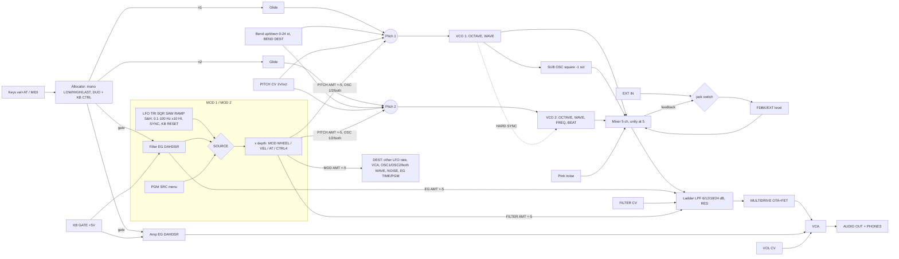

# Sub 37 / Subsequent 37: real signal flow and behaviour spec

Companion to `sources.md`. Revised 2026-10-29. "**p.N**" means the official manual page; the Sub 37 v1.1 and Subsequent 37 manuals have identical text and page numbers. Tags: **verified** (manual), **likely**, **guess**. Every diagram here is our own drawing, made from the facts.

---

## 0. Summary

**Architecture.** An all-analog synth that plays one note, or two paraphonically (p.9, p.61):
- **Sources:** two VCOs with continuously variable wave shape, a square sub one octave below VCO 1, pink noise, and an external-input/feedback channel.
- **Mixer:** five channels with mutes. Levels above 5 overdrive the filter input (p.27).
- **Filter and amp:** one 20 Hz–20 kHz Moog ladder (1–4 poles), then MULTIDRIVE (OTA and FET stages between filter and amplifier), then one VCA (p.11, p.28).
- **Control:** two DAHDSR envelopes and two mod busses (an LFO or Filter EG source routed to PITCH, FILTER and a 7-way DEST, with bipolar amounts).
- **Also:** glide, an arpeggiator with a 64-step paraphonic sequencer, a SYNC switch in each timed section, and four CV/gate inputs.

**Paraphony.** Both oscillators share **one filter, one VCA and one pair of envelopes**.

---

## 1. Block diagram

### 1.1 ASCII (audio `═`, control `─`)

```
 KEYBOARD 37 keys (velocity + aftertouch) — sends MIDI 36–72 at KB OCTAVE 0; "Middle C" = MIDI 48 (p.19)
 MIDI DIN / USB (notes, CC, NRPN, clock)        PITCH CV in (0..+5 V, 1 V/oct)      KB GATE in (+5 V)
          │                                               │                               │
 ┌────────▼───────────────────────────────────────────────▼───────────────┐              │
 │ VOICE ALLOCATOR  mono: KB PRIORITY LOW / HIGH / LAST (default LAST)     │              │
 │ DUO MODE + KB CTRL  HI: OSC1=lowest, OSC2=highest · LO: swapped ·       │              │
 │                     OFF: OSC2 drones (FREQUENCY ±3 oct)                 │              │
 └──┬───────────────────┬─────────────────────────────┬───────────────────┘              │
    │ note 1            │ note 2                      │ gate (GATE SRC: NOTES / EXT / BOTH)◄┘
  GLIDE (LCR/LCT/EXP, OSC 1/2/both, LEGATO, GATED)    ├──► FILTER EG (DAHDSR) ──► EG AMT ±5 ─┐
    ▼                   ▼                             └──► AMP EG (DAHDSR) ──► VCA           │
 PITCH 1 CV & MOD    PITCH 2 CV & MOD  ◄── bend (BEND DEST), MOD 1/2 PITCH (OSC 1/2/both),   │
    ▼                   ▼                  FINE TUNE ±1 st, PITCH CV                          │
 VCO 1 CORE ──sync──► VCO 2 CORE    (NOTE SYNC = KB RESET on VCO 1; OSC 1-2 SYNC = HARD SYNC)│
  ├─ WAVE (tri>saw>sqr>pulse) ═╗     └─ WAVE ═╗  FREQUENCY ±7 st, BEAT FREQ ±3.5 Hz         │
  └─ SUB (square, −1 oct) ═╗   ║              ║                                             │
                           ║   ║              ║      NOISE CORE (pink) ═╗                   │
  level/mute:      SUB OSC ║ OSC 1 ║      OSC 2 ║            NOISE ║                         │
                           ▼   ▼              ▼                  ▼                           │
                     ╔═══════════════════ MIXER ══════════════════════╗ ◄═ FDBK/EXT IN level │
                     ║  (each channel 0–10; above 5 = past unity →    ║    input = EXT IN jack │
                     ║   gentle overdrive of the filter input)        ║    if plugged, else   │
                     ╚════════════════════╤═══════════════════════════╝    FEEDBACK = mixer   │
                                          ║ ═════════════════════════════► output (loop)     │
                                          ▼                                                   │
     LADDER FILTER (low-pass) ── SLOPE 1/2/3/4 poles = −6/−12/−18/−24 dB/oct ◄───────────────┘
       cutoff CV (oct): CUTOFF 20 Hz–20 kHz + KB TRACK (0–2:1, pivot MIDI 48) + EG AMT·FEG
                        + MOD1/2 FILTER AMT·src + FILTER CV (0..+5 V)
       RESONANCE 0–10 (output → input feedback; self-oscillates > 7)
                                          ▼
     MULTIDRIVE 0–10 (OTA + FET stages between filter and amplifier: asym. warmth → hard clip)
                                          ▼
     VCA ◄── AMP EG · (VOL CV 0..+5 V) · MOD DEST "VCA LEVEL" · PRESET VOL
                                          ▼
     VOLUME ──► AUDIO OUT (¼" TS, mono; MUTE button silences this only)
            └─► HEADPHONES (¼" TRS, same mono signal; own level, follows VOLUME)
```

### 1.2 Mermaid



---

## 2. Oscillators (pp.25–26, 61)

### 2.1 Pitch

```
f1 = 440·2^((n1−69)/12 + oct1 + bend1 + modP1 + fine + cv)
f2 = 440·2^((n2−69)/12 + oct2 + freq2/12 + bend2 + modP2 + fine + cv) + beat_hz
oct: 16' = −1, 8' = 0, 4' = +1, 2' = +2          (verified p.25)
freq2: ±7 semitones (centre = unison, full CW = fifth)        (verified p.26)
       ±36 st while DUO MODE on and KB CTRL OFF (OSC 2 drone) (verified p.26)
beat_hz: ±3.5 Hz, added in Hz, so the beat rate is the same on every note   (verified p.26)
fine: FINE TUNE ±1 semitone, both oscillators                 (verified p.14)
bendN: BEND UP 0..+24, BEND DOWN 0..−24 (defaults ±2), applied per BEND DEST (verified p.42)
cv: PITCH CV, 1 V/oct, 0..+5 V                                (verified p.8)
```

- **Range:** oscillator calibration covers 22 Hz–6.8 kHz, and the guaranteed note range at 8' is MIDI 18–116 (p.61).
- **Drone reference (guess):** in drone mode, OSC 2's pitch is set by OCTAVE + FREQUENCY around a fixed reference. Use MIDI 48, the instrument's middle C.
- **VARIANCE (global):** random detune of up to 0–40 cents per note-on, applied symmetrically to the two oscillators (one sharp, one equally flat) (p.44).

### 2.2 WAVE

The knob is continuous: **triangle → sawtooth → square → narrow pulse** (p.25). Moog describes each zone:
- **Triangle to saw** adds harmonics.
- **Saw to square** drops the even harmonics.
- **Square to narrow pulse** changes the balance further, which the manual describes as weakening the overtones against the fundamental.

For the twin: band-limited morph (PolyBLEP/BLAMP), with the waypoints at 0, ⅓, ⅔ and 1 (**guess:** the panel draws four icons). Beyond ⅔ it is a pulse-width sweep from 50 % down to about 5 %. WAVE can be modulated through MOD DEST **OSC 1, OSC 2 or BOTH WAVE**; this never affects the sub (p.24).

### 2.3 HARD SYNC, KB RESET and the sub

- **HARD SYNC** locks OSC 2's phase to OSC 1: each new OSC 1 cycle restarts OSC 2 (p.26). With OSC 1 above OSC 2 there is "little or no output from oscillator 2" (p.26). Sweeping OSC 2's pitch (FREQUENCY, OCTAVE, or MOD PITCH aimed at OSC 2) is the sync sound.
- **KB RESET** starts both oscillators' cycles together on every new note. It gives a defined leading edge with a possible click; a short Amp release reduces the click (p.26).
  - In the block diagram this is "NOTE SYNC" into VCO 1 (p.11).
  - While the arp runs, PRESET EDIT **STEP 1 RESET** limits the reset to the first note of the pattern (p.40).
- **SUB OSC:** a square, **exactly one octave below OSC 1**, always (p.27). Implement it as a divide-by-two of OSC 1's phase, so it follows OSC 1's note, glide and pitch modulation.

---

## 3. Voice allocation (pp.26, 42, 44)

| DUO MODE | KB CTRL | Notes | OSC 1 | OSC 2 |
|---|---|---|---|---|
| off | inert | 1 | the priority note | the same note (+ FREQUENCY, BEAT FREQ, OCTAVE) |
| on | **HI** | 2 | **lowest** held key | **highest** held key |
| on | **LO** | 2 | highest held key | lowest held key |
| on | **OFF** | 1 + drone | the priority note | fixed drone; FREQUENCY ±3 oct |

- **Mono priority** comes from PRESET EDIT **KB PRIORITY**: LOW, HIGH or **LAST (the default)** (p.42). The GLOBAL KB PRIORITY can override every preset with LOW, HIGH or LAST, or leave them alone with PRST (p.44).
- **One key in DUO** sounds on both oscillators, because it is both the highest and the lowest key (likely; S2 observed it on a unit).
- **Shared envelopes.** A new key while others are held is legato: the envelopes don't retrigger unless MULTI TRIG is lit (p.30–31).
- **Sequencer in DUO.** Steps can store one or two notes. Two-note steps play both pitches; one-note steps play both oscillators. While a sequence plays, holding two keys makes the single-note steps follow your keys (p.17).

Allocator (twin):

```
held = keys down (+ latched arp/seq notes)
if !duo: n1 = n2 = priority(held)                       // LAST by default
elif kb == HI: n1 = min(held); n2 = max(held)
elif kb == LO: n1 = max(held); n2 = min(held)
else: n1 = priority(held); n2 = DRONE
gate = held non-empty || latch || KB GATE (per GATE SRC)
note-on while gate already on → retrigger an EG only if its MULTI TRIG is lit
```

**Filter KB TRACK note (guess):** use the most recent note in mono and n1 in DUO.

---

## 4. Mixer (p.27, p.11)

| Channel | Source | Knob | Mute |
|---|---|---|---|
| OSC 1 | VCO 1 wave output | 0–10 | yes |
| SUB OSC | square, −1 octave of OSC 1 | 0–10 | yes |
| OSC 2 | VCO 2 | 0–10 | yes |
| NOISE | **pink** noise (equal energy per octave, deeper than white) | 0–10 | yes |
| FDBK / EXT IN | the **EXT IN** jack if plugged; otherwise **the mixer's own output fed back** | 0–10 | yes |

**Gain staging (verified):** for every channel, above 5 is past unity and gently overdrives the filter input; 5 or below is clean (p.27). Feedback can raise the output level a lot (p.27). The Subsequent 37 has about twice the Sub 37's mixer headroom (S6, likely).

Twin model:
- Per channel: `g = level/5`. Sum: `bus = Σ g·x + g_fb·fbState`.
- Filter input: `ladderIn = sat(bus)`, with a soft, slightly asymmetric curve that stays clean for one channel at ≤ 5.
- `fbState = bus[n−1]`: a one-sample loop **inside one AudioWorklet**. A Web Audio graph cycle adds at least 128 samples of delay and would comb-filter.
- The manual's description, "distorted, sometimes chaotic, sometimes mellow" (p.27): add a gentle low-pass and DC blocking inside the loop (guess) so high settings growl rather than squeal.
- Pink noise: Paul Kellet's filter, or Voss–McCartney.

---

## 5. Filter (pp.28–29, p.11)

- **Topology:** a Moog low-pass **transistor ladder**. **SLOPE** chooses 1, 2, 3 or 4 poles (−6/−12/−18/−24 dB/oct) and can be switched in real time (p.29). RESONANCE feeds output back to input (p.28).
  - **guess:** feedback is taken from the 4th stage and SLOPE picks the output tap. A ZDF/TPT ladder with per-stage tanh is the recommended model.
- **CUTOFF:** 20 Hz ("effectively closes") to 20 kHz (fully open) (p.28). The panel legend reads 20 Hz, 80, 320, **500 Hz at noon**, 1.2 k, 5 k, 20 kHz (p.28 drawing), so the knob is exponential, about 10 octaves.

**Cutoff CV, in octaves:**

```
log2(fc) = log2(CUTOFF)
         + KBTRACK·(note − 48)/12                 KB TRACK 0..2, 1:1 at halfway, 2:1 at max (verified p.29)
         + (EGAMT/5)·D_eg·FEG(t)                  EG AMT −5..+5 (verified); D_eg ≈ 6–7 oct (guess)
         + Σ_bus (FILTERAMT/5)·D_mod·depth·src(t) FILTER AMT bipolar (verified); D_mod ≈ 5 oct (guess)
         + FILTER CV (0..+5 V; guess 1 V/oct)
clamped to 20 Hz … 20 kHz
```

The manual stresses that EG AMT has little effect when CUTOFF is already near the end it pushes toward (p.29). A clamped exponential sum reproduces that.

- **RESONANCE 0–10:** a peak at the cutoff; **self-oscillation above 7** (p.28). With KB TRACK at 1:1 the self-oscillating filter plays in tune around MIDI 48.
- **MULTIDRIVE 0–10:** "asymmetrical, tube-like warmth to aggressive hard clipping" (p.28). It drives **OTA and FET stages located between the filter and the amplifier** (p.28; the block diagram on p.11 agrees: LADDER → MULTI-DRIVE → VCA). Per the manual it also makes the sound respond more to resonance, wave and oscillator levels.
  - Twin: `y = blend(asymTanh(k·x), hardClip(k·x))`, with k and the blend rising together. Use 2–4× oversampling and a DC blocker.

| Where the grit happens | Position | Character |
|---|---|---|
| Mixer level above 5 | filter input (before) | warm, compressed, tamed by the filter |
| FDBK | loop around the mixer (before) | thick, growly, unstable at extremes |
| MULTIDRIVE | after the ladder, before the VCA | adds highs the filter can't remove; turns resonance into snarl |

---

## 6. Envelopes (pp.29–33, 41–42)

Two **DAHDSR** envelopes. The **filter** one feeds EG AMT and can be a mod source; the **amp** one feeds the VCA.

| Knob | Normal | Range | KNOB SHIFT (blinking) | Range |
|---|---|---|---|---|
| 1 | ATTACK | 1 ms–10 s | **DELAY** | 0–10 s |
| 2 | DECAY | 1 ms–10 s | **HOLD** | 0–10 s |
| 3 | SUSTAIN | 0–100 % (marked 1–10) | **VEL AMT** | 0–100 % |
| 4 | RELEASE | 1 ms–10 s | **KB TRACK** | 0–2:1, 1:1 at noon |

Buttons per envelope: **MULTI TRIG, RESET, SYNC, LOOP, LATCH ON** (p.31, 33; panel order as the manual lists them is likely). One KNOB SHIFT covers both envelopes (p.30).

### 6.1 Behaviour

```
gate on (source per GATE SRC: NOTES / EXT (KB GATE jack) / BOTH; default BOTH, likely)
  level := RESET ? 0 : current                 RESET off (default) attacks from the current level (p.31)
  DELAY (0–10 s; AMP EG DELAY only acts when LOOP is on, p.33)
  ATTACK → peak            peak = 1 − VEL_AMT·(1 − velocity)
                           (the hardest strike always gives the full amount, p.32)
                           attack curve linear, or exponential with EXP. ATTACK (default OFF, p.41–42)
  HOLD at peak (0–10 s)
  DECAY → SUSTAIN
  SUSTAIN while gate on    (held until note-off or end of gate, p.31–32)
  LOOP lit: after DECAY → RELEASE → restart at DELAY while the key is held
            (delay, attack, hold, decay and release loop: a multistage LFO, p.31/33)
gate off: LATCH ON lit → ignore (stays at SUSTAIN "as if the gate was on", p.31/33)
          else RELEASE from the current level to 0
legato note-on: MULTI TRIG lit → new gate (multiple triggering); off → nothing (single triggering, default)
SYNC lit: the envelope retriggers at every CLOCK DIV of the internal or MIDI clock (p.31/33, p.41–42)
KB TRACK (shifted RELEASE): scales DECAY and RELEASE only; higher keys are shorter;
          0 = none, 1:1 at noon, 2:1 max (p.32–33). guess: t·2^(−k·(note−48)/12), k = 0..2
MOD DEST "EG TIME": scales the times of both envelopes keeping shape; negative = shorter (p.24)
```

- Decay and release curves are not published. **guess:** exponential, RC-like, to about −80 dB, with a 1 ms minimum.
- **Single triggering by default** is the core Moog legato feel: legato lines don't re-attack (p.30).
- The FILTER EG as a source (MOD SOURCE F.EG/PGM, or CTRL4 SRC FLT EG) uses the same stages (p.30–31). A delayed LFO is possible: set CTRL4 SRC to FLT EG and give the Filter EG a DELAY (p.50).

---

## 7. Mod busses MOD 1 and MOD 2 (pp.22–24, 50–52)

| Block | Spec |
|---|---|
| LFO RATE | **0.1–100 Hz**; **HI RANGE** ×10 = **1–1000 Hz** (audio-rate FM and AM); vibrato works in either range (p.22–23) |
| SYNC | RATE becomes a 21-step **clock division** of the internal or MIDI clock (p.23, p.52). PGM DST `LFOxRNGE` shows a 3-state LOW/MED/HIGH range; LOW is MIDI/PGM-only (**guess:** 0.01–10 Hz, per the p.61 floor) |
| KB RESET | the LFO restarts at zero on each new note (p.23). STEP 1 RESET limits this to the first arp step (p.40) |
| SOURCE knob | **TRIANGLE**, **SQUARE**, **SAWTOOTH**, **RAMP** (reverse saw), **S&H** (random steps), **F. EG/PGM** (LFO bypassed: the Filter EG, or the PGM SRC) (p.22) |
| PGM SRC | AMP EG, CONST ON, SINE LFO (an extra sine LFO), NOISE LFO, OSC1 PCH, OSC2 PCH, SEQ NOTE, SEQ VEL, SEQ MOD, PRESSURE, KB TRACK (bipolar about MIDI 48), VELOCITY (p.50) |
| PITCH AMT + OSC | bipolar; OSC 1 only, OSC 2 only, or both (p.23) |
| FILTER AMT | bipolar (p.23) |
| MOD AMT + MOD DEST | bipolar amount (p.23) to one of seven destinations (p.24). See the list below |
| PGM DST | about 88 more: filter resonance, drive, slope, EG amount and KB amount, every mixer level and mute, arp, glide, LFO, oscillator and both-envelope parameters, bend, volume, swing, seq mod, ratchet (p.51). Assign by holding MOD DEST and touching the control (p.24) |
| Depth (CONTROLLERS) | **MOD WHEEL**, **VELOCITY**, **AFTERTOUCH** and **CTRL4 AMT**, each −100…+100 % (the depth at full controller). CTRL4 SRC is BREATH (CC 2), FLT EG, AMP EG, LFO 1 or LFO 2 (p.50). **Default: the MOD wheel sets MOD 1's overall depth** (p.22). Combining formula (guess): `depth = Σ amt_i·ctrl_i` if any amount is set, else 1. MOD 2's default is full depth (likely) |
| LFO KBTRACK | 0–200 %: the LFO rate rises with the key (p.52) |
| SWING LFO | ON by default: a synced LFO follows the arp SWING (p.40, p.52) |

The seven MOD DEST positions (p.24):
- **LFO RATE** of the *other* LFO (MOD 1 drives LFO 2; MOD 2 drives LFO 1)
- **VCA LEVEL** (tremolo; ring-mod-like at audio rate)
- **OSC 1 WAVE**, **OSC 2 WAVE** and **BOTH** (never the sub)
- **NOISE LEVEL** (added to the mixer knob)
- **EG TIME/PGM** (EG times keep their shape; or the PGM DST)

Twin depth constants are **guesses**:
- PITCH ±5 gives about ±2 octaves at full, with a squared taper so small settings give vibrato.
- FILTER ±5 gives about ±5 octaves.
- WAVE ±5 gives ±full travel.
- VCA ±5 gives ±100 %.
- EG TIME ±5 gives about ×/÷ 8.
- LFO RATE ±5 gives about ±4 octaves.

Classic routes:

| Sound | Route |
|---|---|
| Vibrato | MOD 1 TRI, about 5.5 Hz, PITCH AMT small positive (OSC 1+2), MOD wheel up |
| Wobble | MOD 2 TRI or SQR, SYNC 1/8, FILTER AMT +2…+3, RESONANCE 4–6 |
| PWM / wave shimmer | MOD 2 TRI, 0.3–1 Hz, DEST BOTH (OSC 1+2 WAVE), MOD AMT about +1.5, WAVE near square |
| Sync sweep | HARD SYNC on; MOD 2 SOURCE F.EG/PGM, PITCH AMT +3…+4, OSC = OSC 2 |
| Computer bleeps | MOD 2 S&H 6–10 Hz, FILTER AMT +2.5, RESONANCE about 6 |
| Audio-rate FM / AM | HI RANGE; RATE in the hundreds of Hz; PITCH AMT on OSC 2, or DEST VCA LEVEL |
| Delayed vibrato | MOD 1: CTRL4 SRC FLT EG, CTRL4 AMT +100 %, Filter EG DELAY 500 ms |
| Evolving wobble | MOD 1 DEST LFO RATE (modulating LFO 2's rate) |

---

## 8. Glide (p.21)

| Control | Behaviour |
|---|---|
| **ON** | must be lit for any glide |
| **TIME** | the time to reach the next pitch; no unit is published. Twin (guess): panel 0–10 → `t = 10 ms·1000^(x/10)`, so x = 2 ≈ 40 ms (Moog's Quickstart acid setting) |
| **TYPE LCR** | linear constant rate: larger intervals take longer. "The most commonly used type" (p.21) |
| **TYPE LCT** | linear constant time: the same time whatever the interval |
| **TYPE EXP** | exponential: fast at first, slowing into the target |
| **OSC** | OSC 1, OSC 2 or both (two LEDs) |
| **GATED** | on: the pitch CV glides only while a key is held. Off: it keeps gliding to the target after release (p.21) |
| **LEGATO** | glide only when a key is pressed while another is held (ON must be lit) |
| Sequencer | with GLIDE ON and LEGATO, glide happens only between **tied** steps (p.17) |

---

## 9. Arpeggiator and 64-step sequencer (pp.15–20, 40–41, 46–47)

### 9.1 Arpeggiator

- **ON / REST** turns the arp on or off; in REC it enters a rest.
- **LATCH / TIE** keeps the arp looping hands-free; in REC it enters a tie (p.15–16).
  - Notes added while others are held join the list.
  - The first new note after all keys are released starts a new list.
  - GLOBAL **LATCH RSTRT** sets whether a new latched note restarts the sequence (default OFF: it transposes without restarting) (p.47).
- **RATE:** 2–280 BPM.
  - **SYNC** lit: RATE picks a clock division, and the arp follows MIDI clock. Without clock, and outside TAP mode, it **will not play** (p.15).
  - **TAP:** hold SYNC for 1 s, tap quarter notes, and the tempo locks on the 3rd tap (a running average after that). Hold for 1 s again to exit (p.15).
- **PATTERN:** UP (low to high), DWN (high to low), ORDR (the order held), RND (random), **SEQ** (play the sequence), **REC** (record) (p.16).
- **RANGE:** −2, −1, 0, +1, +2 octaves. Pressing past either end lights **0 and ±2**, which plays the original octave, the 2nd, the 3rd, then back to the 2nd before the original (p.15).
- **BACK / FORTH** (p.16):
  - UP becomes up then down (C-E-G-E-C), and DWN becomes down then up.
  - ORDR plays forwards then reversed.
  - RND is unaffected.
  - **END NOTES** ONCE / TWICE decides whether the turn-around notes repeat: C-E-G-G-E-C-C (p.16, p.40).
- **INVERT:** each note plays in two or three successive octaves before the next note. With RANGE +1 and C-E-G held: C, C', E, E', G, G'. It does nothing at RANGE 0 (p.16).
- **Menu** (p.40):
  - **GATE LENGTH**: OFF–100 %, default 50 %; the envelopes release at that point.
  - **CLOCK DIV**: 4 whole notes (384 clocks) to a 1/64 triplet (1 clock).
  - **SWING**: 0–100 %, default 50 (straight). Below 50 the off-beats move earlier; at 0 only off-beats sound, at 100 only on-beats.
  - **STEP 1 RESET**.

Generator (twin):

```
base = sort(held) for UP, reverse for DWN, press order for ORDR; RND picks randomly each step
octs = RANGE: 0→[0] +1→[0,1] +2→[0,1,2] −1→[0,−1] −2→[0,−1,−2]
       0&+2→[0,1,2,1] 0&−2→[0,−1,−2,−1]          (cycles; verified wording p.15)
seq  = INVERT ? [n+12o for n in base for o in octs] : [n+12o for o in octs for n in base]
BACK/FORTH: append reverse(seq) without (ONCE) or with (TWICE) repeating the end notes
each step: gate for GATE LENGTH % of the step; the step length is CLOCK DIV
     (likely also when unsynced: RATE = tempo, CLOCK DIV = note value)
```

### 9.2 Step sequencer

- **Record:**
  - With the arp **off**, turn PATTERN to **REC**. The next key erases the old sequence and becomes step 1, and the display shows `REC 01 / 01`.
  - Each key or REST advances one step, up to **64** (p.17).
  - **TIE** connects the previous note to the next: a different pitch sounds without retriggering the envelopes, and the same pitch doubles the length.
  - Shortcut: press the next key before releasing the previous one. This doesn't work in DUO (p.17).
- **Play:** PATTERN to **SEQ**, then press ON. The key you press sets the transposition (p.17).
  - **REF NOTE** FIRST (default) means the key is the sequence's first note. MID C means MIDI 48 plays the sequence as recorded (p.46).
  - **PHASE RESET** off (default) means a new note waits for the next beat (p.47).
- **STEP EDIT** (hold BANK and press LATCH, p.18–20):
  - PRESET 1–16 show four pages of 16 steps. Lit dim means active, dark means a rest or past the last step, and bright marks the playing step.
  - Per step: pitch 1 and 2, velocity, rest, tie, **SEQ MOD**.
  - First and last step; **ROTATE** (BANK + RANGE ◄/►); **SKIP**; **RATCHET** (1–8×, one count per sequence, default 2×).
  - Tie groups by holding two step buttons; quick-erase with BANK + PATTERN→REC.
- **SEQ MOD:** the mod-wheel position is stored per step, from −100 % (down) through 0 (centre) to +100 % (up). It goes to PRESET EDIT **MOD DST** scaled by **SEQ MOD AMT** (0–100 %), with optional **MODWHL CTRL**, or acts as a MOD bus source (**SEQ MOD**). **SEQ MOD ONLY** turns the sequencer into a 1–64-step modulation source (p.20, p.40–41).
- **Storage:** sequences are saved with the preset. A sysex SEQUENCE SEND exists (p.20, p.37).

### 9.3 Clock and sync

- **Clock sources:** the internal tap/RATE clock, or MIDI clock at 24 PPQN over DIN or USB (p.15).
- **SYNC switches:** the arp, both LFOs and both envelopes each have their own SYNC switch (p.9).
- **MIDI out:** SEND CLOCK OFF / ARP (only while the arp or sequencer runs) / ON; SEND ST/STP (default ON); FOLLOW SPP (p.37).
- **No analog clock jack.** Mapping **KB GATE** to **STEP ADV** in CV MAPPING advances the arp/sequencer one step per +5 V trigger and overrides internal or MIDI clock for the arp and sequencer. **ST1 RESET** on PITCH or VOL CV restarts at step 1 on a rising edge above 2.5 V (p.45–46).

---

## 10. Outputs and CV/gate I/O (pp.7–8, 34, 45–46, 61)

| Jack | Dir | Spec | Conf |
|---|---|---|---|
| AUDIO OUT | out | ¼" TS mono, after VOLUME. **MUTE** (lit) silences it, but not the headphones | verified |
| HEADPHONES | out | ¼" TRS, the same mono signal on both sides. HEADPHONES VOLUME balances against VOLUME | verified |
| EXT IN | in | ¼" TS, unbalanced, line level, into the FDBK/EXT IN channel. A note must be gated to hear it (key, FS-1, or AMP EG LATCH ON with SUSTAIN up) | verified |
| PITCH CV | in | 0…+5 V or an expression pedal; 1 V/oct; can be remapped | verified |
| FILTER CV | in | 0…+5 V or an expression pedal (cutoff) | verified |
| VOL CV | in | 0…+5 V or an expression pedal (level); can be remapped | verified |
| KB GATE | in | +5 V gate, triggers the envelopes (per GATE SRC). It can be remapped to a switch parameter, STEP ADV or SUST PED, with GATE INVERT | verified |
| MIDI | in / out | DIN IN and OUT, plus class-compliant USB-MIDI (no audio). Default channel 1 | verified |

There are no CV outputs on these models.

---

## 11. Implementation notes for the Web Audio twin

1. **One voice-core AudioWorklet**: OSC 1 + sub, OSC 2 with sync, pink noise, mixer with the 1-sample FDBK loop, input saturation, the ladder (with taps), MULTIDRIVE, and the VCA multiply. Run it 2× oversampled. Envelopes and LFOs feed it a-rate.
2. **Sum control in octaves** (`pitch1`, `pitch2`, `cutoffOct`, `wave1`, `wave2`, `noiseLvl`, `vca`), as the hardware's CV summing does (p.11 "CV & MOD" inputs).
3. **Pivot KB TRACK and the PGM SRC KB TRACK at MIDI 48.**
4. **Clock:**
   - The arp, sequencer, LFO SYNC and env SYNC follow the studio transport as MIDI clock.
   - The internal clock is RATE (or TAP) when unsynced.
   - SYNC lit with no clock means silence, as on the hardware.
5. **Velocity:** the on-screen keys send full velocity, so VEL AMT has no audible effect from them. Say so in the UI, or add a velocity strip.
6. **Gain staging:** mixer unity at 5. Keep FDBK's level rise (the manual warns about it, p.27) but protect the output with a limiter.
7. **Presets** store every panel control, the arp state, the sequence, and the menu items (p.14). Load toggles explicitly.

## 12. Synth Studio reset patch

Moog's PANEL/INIT exists (p.14), but its values aren't listed in the manual. The menu defaults the manual *does* give are verified and marked ✓.

| Section | Value |
|---|---|
| OSC 1 / OSC 2 | 8' SAW; FREQUENCY 0, BEAT 0; SYNC off; KB RESET off; DUO off; KB CTRL HI |
| Mixer | OSC 1 at 5 (on), others 0 |
| Filter | CUTOFF 20 kHz, RES 0, DRIVE 0, 24 dB, EG AMT 0, KB TRACK 1:1 |
| Envelopes | A 1 ms, D 300 ms, S 10, R 100 ms; DELAY and HOLD 0; VEL 0; KB 0; all buttons off; EXP. ATTACK off ✓; GATE SRC BOTH |
| MOD 1 | TRI 5 Hz, amounts 0, DEST VCA, the wheel sets depth ✓ |
| MOD 2 | TRI 1 Hz, amounts 0 |
| Glide | off, TIME 2, LCR, OSC both, LEGATO off, GATED off |
| Arp | off, 120 BPM, RANGE 0, UP, gate 50 % ✓, swing 50 % ✓, END NOTES ONCE |
| Keys | KB PRIORITY LAST ✓, bend ±2 ✓ with BEND DEST BOTH, PRESET VOL 100 % ✓ |
