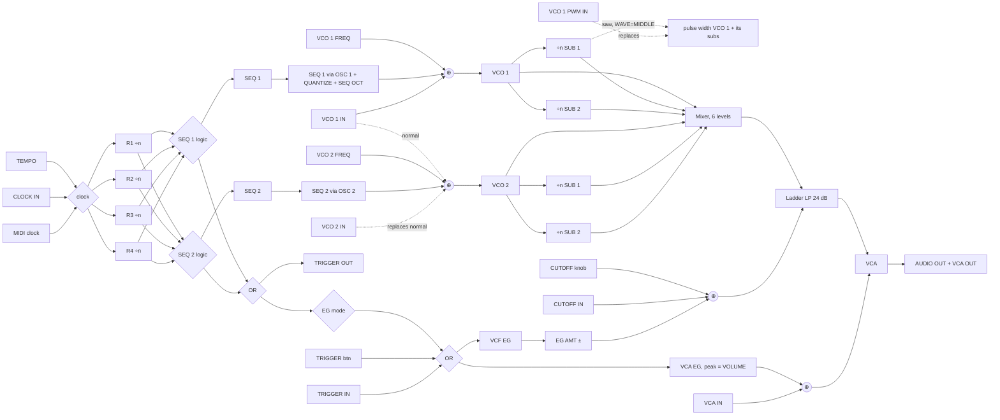

# Moog Subharmonicon: signal flow and specification (v2, from the owner's manual)

This is the engineering reference for the `subharmonicon` twin. **v2** replaces v1. The primary
sources are now Moog's own documents (scratchpad `manuals/subharmonicon/`):

- **MAN**: *Subharmonicon Owner's Manual*, 58 pp.
- **PWI**: *Patching with Intention*, 16 pp.
- **XPB**: *Exploration Patchbook*, 10 patches.

Page numbers are the PDF pages, the `===== page N =====` markers in `text.txt`. The printed page
number is one higher (MAN p.17 is printed "18").

Facts are written in our own words, following `manuals/COPYRIGHT-RULES.md`. Labels:
**verified** (a page is cited), **likely** (inferred from verified facts or a secondary source,
with the reason given), **guess** (not documented; listed in §14 with a recommended twin value).
Ids in `code` are the current twin's (`devices/subharmonicon/spec.ts`).

**v1 claims that the manual overturned:** NEXT does *not* fire the EGs. PLAY IN is gate-level
(rising edge = play, falling edge = stop), not a toggle. PWM IN sweeps 1–99 % and also sets the
pulse width of that VCO's **subs**. With QUANTIZE on, the **VCO FREQ knobs themselves snap to the
scale**. VOLUME sets the VCA EG peak. CLOCK OUT is 0–10 V. TRIGGER OUT is a 1 ms, 5 V pulse. VCA IN
and CUTOFF IN are **summed** with their envelopes (the signal-flow diagram shows ⊕ nodes).

---

## 1. At a glance

| Item | Value | Source |
|---|---|---|
| Format | Semi-modular analog; 60 HP Eurorack panel in a wooden case. Size 12.57 × 4.21 × 5.24 in (W×D×H), 3.5 lb. Draws at most 360 mA from +12 V as a module, and nothing from −12 V | MAN p.8, p.39, p.56 |
| Sources | VCO 1 + SUB 1 + SUB 2, VCO 2 + SUB 1 + SUB 2: six sources into one mixer, one filter and one VCA | MAN p.6, p.56 |
| VCO FREQ | 4 octaves: fully CCW = middle C (262 Hz), fully CW = 4186 Hz. Continuous when QUANTIZE is off; snaps to scale steps when it is on | MAN p.11, p.17, p.18, p.20 |
| Subharmonics | each sub = its VCO ÷ n, n = 1…16 (CW = ÷1 unison, CCW = ÷16) | MAN p.17–19 |
| Waveforms | 3-position WAVE switch per VCO: UP = all square; MIDDLE = VCO pulse with the SUB 1 saw normalled to PWM, subs saw; DOWN = all saw | MAN p.18–19 |
| Filter | Moog ladder low-pass, 4-pole, −24 dB/oct, 20 Hz–20 kHz, self-oscillating | MAN p.22, p.56 |
| Envelopes | VCF EG and VCA EG, each Attack (1 ms–10 s) and Decay (5 ms–10 s). A trigger runs A→D; a gate gives A, hold at maximum, then D. A new trigger is ignored during Attack | MAN p.23–24 |
| Sequencers | two 4-step sequencers; SEQ OCT ±1/±2/±5 (shared); QUANTIZE OFF/12-ET/8-ET/12-JI/8-JI (shared) | MAN p.20, p.25–27 |
| Rhythm | four generators, clock ÷1…16, each assignable to SEQ 1 and/or SEQ 2; OR/XOR logic (MIDI CC 113) | MAN p.29, p.43 |
| Clock | TEMPO 0.333–50 Hz = 20–3000 BPM at 1 pulse per quarter note; CLOCK IN overrides it; MIDI clock overrides both and runs the master pulse at 16ths | MAN p.24, p.56 |
| Patch bay | 32 × 3.5 mm: 17 inputs (plain legends), 15 outputs (inverted legends) | MAN p.30, p.56 |
| Rear | ¼" AUDIO OUT (TRS headphones or TS instrument; do not use a balanced TRS cable as a line out); 12 V DC in (1.2 A supply, centre-positive, 4.8 W typical); no power switch | MAN p.7, p.56 |
| MIDI | 3.5 mm Type A MIDI IN in the patch bay (adapter included), with an activity LED. Notes are offsets from C4; there are CCs for VCO freq, subs and EG times; logic, channel and transport settings | MAN p.36, p.41–43 |
| Global | Fine Tune ±50 cents (stored) | MAN p.40 |
| Firmware after the manual | v1.1.0 (Mar 2022): SEQ CLK outputs in phase with the clock; MIDI notes transpose a running sequence; note priority via CC 91; pitch bend; settings stored at power-off | FW (web; see sources.md) |

---

## 2. Block diagram

Redrawn from the facts (MAN p.55 signal-flow diagram, p.30–36). ⊕ = summing node; `[n]` = normalled jack.

```
 PITCH ─────────────────────────────────────────────────────────────────────────────────────────
  VCO 1 FREQ (C4…C8, snaps when QUANTIZE on) ─┐
  SEQ 1 (if OSC 1 lit; SEQ OCT range; quant.) ─⊕──► VCO 1 ──► WAVE sw ──► VCO 1 OUT / mixer
  VCO 1 IN (1 V/oct, ±5 V) ───────────────────┘ │                      PW ◄─ VCO 1 PWM IN [n: SUB 1 saw, MIDDLE only]
            └──────────[n]──► VCO 2 IN ...      ├─► ÷n SUB 1 ─► WAVE sw ─► SUB 1 OUT / mixer   (PW also)
  MIDI note/CC offsets → both VCOs              └─► ÷n SUB 2 ─► WAVE sw ─► SUB 2 OUT / mixer   (PW also)
  SUB 1 n = SUB 1 FREQ ⊕ VCO 1 SUB IN ⊕ SEQ 1 (if SUB 1 lit)
  SUB 2 n = SUB 2 FREQ ⊕ VCO 1 SUB IN ⊕ SEQ 1 (if SUB 2 lit)         (VCO 2 side identical)

 AUDIO ─────────────────────────────────────────────────────────────────────────────────────────
  6 sources ─► MIXER (6 LEVEL knobs; warm overdrive near max) ─► LADDER LP24 ─► VCA ─► VOLUME ─┬─► AUDIO OUT ¼"
                                                         ▲ cutoff ⊕            ▲ gain ⊕      └─► VCA OUT jack (10 Vpp)
                        CUTOFF knob + CUTOFF IN + VCF EG × EG AMT(±)    VCA EG + VCA IN (0–8 V)
                                                                          (VCA EG peak = VOLUME)

 TIME ──────────────────────────────────────────────────────────────────────────────────────────
  TEMPO ─┐                                   ┌► RHYTHM 1 ÷n ─┬─[SEQ 1 btn]─┐         ┌─[SEQ 2 btn]
  CLOCK IN (overrides) ─► CLOCK ─► master ───┼► RHYTHM 2 ÷n ─┤             ├► SEQ 1 ─┤   (OR/XOR per sequencer)
  MIDI clock (overrides both)  │  pulse      ├► RHYTHM 3 ÷n ─┤             └► SEQ 2 ─┘
  PLAY (button / PLAY IN) ─────┘             └► RHYTHM 4 ÷n ─┘   (RHYTHM n IN offsets the divisor)
  CLOCK OUT ◄─ master pulse (only while playing)             RESET (button / RESET IN) ─► all generators + both SEQs
  SEQ 1 CLK / SEQ 2 CLK ◄─ each sequencer's own clock
  seq clocks ─► OR ─┬─► TRIGGER OUT (1 ms)
                    └─► [EG mode] ─► OR ◄─ TRIGGER button, TRIGGER IN ─► VCF EG + VCA EG
```



---

## 3. Oscillators

### 3.1 Pitch

```
V_vco1 = Qk( 4·p(VCO 1 FREQ) )                 knob: 0 V = C4 … 4 V = C8; snaps to the scale when QUANTIZE is on   MAN p.17, p.20
       + Qs( STEP(SEQ 1) ) · [OSC 1 lit]        STEP = ±1/±2/±5 V by SEQ OCT; quantized                             MAN p.25, p.27
       + V(VCO 1 IN)                           1 V/oct, −5…+5 V, summed                                            MAN p.30
       + (note − 60)/12 + CC4 offset (±2.5 oct) + pitch bend (fw 1.1)                                               MAN p.41
       + Fine Tune (±50 c, global)                                                                                  MAN p.40
V_vco2 = same, using VCO 2 IN if patched, otherwise VCO 1 IN (normal)                                               MAN p.30
f = 261.63 Hz · 2^V
```

| Fact | Detail | Conf. |
|---|---|---|
| Knob range | four octaves, 262 Hz (CCW) to 4186 Hz (CW) | verified MAN p.17 |
| Knob taper | exponential (equal octaves per rotation), so noon ≈ C6 (1046.5 Hz) | likely (the knob is quantizable and the MIDI CC is "added" to it, so it is read as a pitch voltage) |
| Quantized knob | with QUANTIZE on, turning VCO FREQ steps through the chosen scale instead of sweeping | verified MAN p.11, p.17, p.18, p.20 |
| Scale anchor | the quantizer grid is anchored at **C**. Fully CCW is C4, and the manual's JI example is C major. So 8-ET/8-JI give C major and 12-ET/12-JI give chromatic scales on C | likely (MAN p.16 example; MAN p.41 makes C4 the MIDI reference; forum users ask how to play "in keys other than C major"; Squinky's emulation also anchors at C) |
| Ceiling | the sequencers cannot drive the VCOs above about 10 kHz, and the subs are not accurate above about 10 kHz. VCO CV inputs can push the VCOs "far above" 10 kHz | verified MAN p.27 |
| Full ±5 range | set VCO FREQ fully CCW (C4) to use the whole ±5 octave step range | verified MAN p.27 |
| MIDI anchor | with VCO FREQ fully CCW, incoming MIDI notes play at their own pitch (offset from C4) | verified MAN p.41 |
| Warm-up | analog VCOs: allow a few minutes to stabilise (longer after a cold night) | verified MAN p.7 |

Twin note: clamp the VCOs at about 10 kHz for sequencer and knob contributions, and about 16 kHz
when CV is added. Model slow drift of ±2–3 cents per VCO, and **zero** drift between a VCO and its
own subs (guess).

### 3.2 Subharmonic dividers

| Fact | Detail | Conf. |
|---|---|---|
| Ratio | each sub = its VCO's frequency ÷ a whole number 1–16; the knob selects the integer | verified MAN p.17–19 |
| Direction | SUB FREQ fully CW = ÷1 (unison), stepping to ÷16 at fully CCW | verified MAN p.17 |
| Tracking | subs follow every VCO pitch change ("maintain their constant harmonic relationship") | verified MAN p.25 |
| SUB IN | the VCO n SUB input sets the integer of **both** subs of that VCO; centre the SUB FREQ knobs for bipolar CV; −5…+5 V | verified MAN p.30, p.32; PWI p.12 |
| SEQ ASSIGN SUB 1/SUB 2 | the sequencer's step value changes that sub's integer (summed with the SUB FREQ knob and SUB IN at the same node) | verified MAN p.25–26, p.55 |
| Phase | integer division of the VCO, so a sub cannot drift or beat against its own VCO | verified (integer division MAN p.17); phase-lock **likely** |
| CV → integer scaling | not published | **guess**: Δn = −1.6 × volts (10 V spans the 16 values; Count Modula uses the same 1.6 scaling); positive = higher pitch / smaller n |

DSP recipe (phase-locked and alias-free), as used by Squinky Labs *Substitute*
(`repos/squinkyvcv/dsp/generators/SubVCO.h`, GPL-3.0): run one master phase per VCO. On each master
wrap, decrement each sub's counter. When a counter reaches 0, reload it with n and resync that sub's
phase to `masterPhase / n` (sub-sample accurate). Use minBLEP/polyBLEP at every discontinuity. Apply
a divisor change at the next reload.

**Undertones of C4** (VCO fully CCW). The same intervals apply at any VCO pitch.

| ÷n | Hz | Nearest note, cents off 12-ET |
|---|---|---|
| 1 | 261.63 | C4 |
| 2 | 130.81 | C3 |
| 3 | 87.21 | F2 −2.0 |
| 4 | 65.41 | C2 |
| 5 | 52.33 | G♯1/A♭1 +13.7 |
| 6 | 43.60 | F1 −2.0 |
| 7 | 37.38 | D1 +31.2 |
| 8 | 32.70 | C1 |
| 9 | 29.07 | A♯0/B♭0 −3.9 |
| 10 | 26.16 | G♯0 +13.7 |
| 11 | 23.78 | F♯0 +48.7 |
| 12 | 21.80 | F0 −2.0 |
| 13 | 20.13 | E0 −40.5 |
| 14 | 18.69 | D0 +31.2 |
| 15 | 17.44 | C♯0 +11.7 |
| 16 | 16.35 | C0 |

Teaching consequences: f/4 : f/5 : f/6 is a just **minor** triad (the mirror of the overtone major
triad 4:5:6). The manual notes that JI removes the beating usually heard in minor chords (MAN p.16).

### 3.3 WAVE switch and pulse width

| Position (top → bottom) | VCO | SUB 1, SUB 2 | Pulse width | Source |
|---|---|---|---|---|
| **UP** | square | square | 50 % unless PWM IN is patched. PWM IN then sets the pulse width of the VCO **and both subs** | MAN p.18, p.31 |
| **MIDDLE** | square/pulse | **saw** | normalled from the **SUB 1 saw** (audio-rate PWM); a cable in PWM IN replaces it | MAN p.18, p.31, p.55 |
| **DOWN** | saw | saw | n/a | MAN p.18 |

- **PWM IN**: −5…+5 V maps to 1 % (narrow) … 99 % (wide) duty (MAN p.31). Use a linear map:
  duty = 50 % + 49 % × V/5 (likely).
- **SUB 1 normal depth**: the SUB 1 saw is a full-level signal into the same PWM path, so take it
  as a full sweep (likely, MAN p.55 shows it feeding the PWM jack's normal).
- **The middle position adds a pitch.** Because SUB 1 runs at f/n, the PWM can make the VCO output
  seem to contain a second, lower pitch even with SUB 1 LEVEL at zero (MAN p.18 tip). At ÷1 it is a
  static waveshape change.
- **Manual inconsistency.** The VCO 2 PWM page names the normal source "subharmonic oscillator
  sawtooth 2" (MAN p.32), but the VCO 2 WAVE text says SUB 1 (MAN p.19). Follow p.19: **SUB 1 of
  VCO 2**.
- Twin ids: `vcoN_wave` `['SQR','SQ/SAW','SAW']` = UP/MIDDLE/DOWN (correct).

### 3.4 Oscillator outputs

VCO 1, VCO 1 SUB 1, VCO 1 SUB 2 and the VCO 2 equivalents each carry their selected waveform at
**10 V p-p**, ahead of the mixer levels (MAN p.31, p.33, p.55).

---

## 4. Mixer

- Six LEVEL knobs: VCO 1, SUB 1, SUB 2 (VCO 1) and VCO 2, SUB 1, SUB 2 (VCO 2) feed one bus, which is
  internally wired to the filter input (MAN p.20–22).
- **Overdrive.** Sources near maximum push the mixer into a warm distortion; moderate levels are
  clean (MAN p.20).
- Twin model (guess): `level^1.5` taper; bus = tanh soft clip calibrated so one source at full is
  nearly clean and three or more at full are clearly driven. The saturation sits before the ladder.

---

## 5. Filter

| Control / jack | Spec | Source |
|---|---|---|
| CUTOFF | 20 Hz – 20 kHz; CW brighter (MAN p.22). Taper exponential (noon ≈ 630 Hz) | range verified; taper likely |
| RESONANCE | feedback around the ladder gives a peak at cutoff. Maximum resonance with a low cutoff can self-oscillate (MAN p.22, "Self-Oscillating" in the specs p.56). SOS reports oscillation from about 2 o'clock | verified; onset likely |
| Topology | Moog ladder, low-pass only, 4-pole, 24 dB/oct | verified MAN p.22 |
| VCF EG AMT | bipolar, centre = none. **+** opens on Attack and closes on Decay; **−** closes on Attack and opens on Decay | verified MAN p.23, p.15 |
| CUTOFF IN | −5…+5 V; with CUTOFF at noon it sweeps up to ±5 octaves (≈ 1 V/oct). It is **summed** with the knob and the EG (⊕ on MAN p.55) and does **not** disconnect the EG | verified MAN p.33, p.55 |

```
cutoff_Hz = 20·1000^p(CUTOFF) · 2^( V(CUTOFF IN) + AMT·V(VCF EG)·k_eg )      AMT ∈ [−1, +1]
```

`k_eg` is a **guess**: about 1 octave per volt of EG at full AMT, so the 8 V envelope reaches about
±8 octaves (the EG at full can sweep the whole range from a low CUTOFF). Moog's Bateria preset tunes
the kick with CUTOFF and shapes it with VCF DECAY and EG AMT (MAN p.46), which is consistent with a
deep sweep.

Resonance model (guess): k = 5.7·r, so oscillation begins at r ≈ 0.70. Use a tanh input stage, and
keep the ladder's passband loss as resonance rises.

---

## 6. Envelopes

| Fact | VCF EG | VCA EG | Source |
|---|---|---|---|
| Attack | 1 ms – 10 s, from the CUTOFF setting to the peak set by EG AMT | 1 ms – 10 s, from zero to the level set by **VOLUME** | MAN p.23 |
| Decay | 5 ms – 10 s, back to the CUTOFF setting | 5 ms – 10 s, back to zero | MAN p.23–24 |
| Trigger | Attack then Decay | same | MAN p.23–24 |
| Gate | Attack, **hold at maximum** while the gate lasts, then Decay | same | MAN p.23–24 |
| Retrigger | **ignored during Attack**; only after Attack completes can a trigger or gate restart it | same | MAN p.23 (both), p.27, p.34 |
| Output jack | VCF EG OUT 0…+8 V | VCA EG OUT 0…+8 V | MAN p.32, p.34 |

Twin curve choices (guess): log knob tapers; RC-shaped attack; exponential decay; DECAY = time to
fall 60 dB (the DFAM twin's convention). A retrigger during Decay restarts Attack from the current
level.

### EG button (`eg_mode`)

| State | Button | What fires the EGs | TRIGGER button | Source |
|---|---|---|---|---|
| **OFF** | unlit | **not** the sequencer steps; only the TRIGGER button, TRIGGER IN and MIDI | **gate**: holds the EGs at maximum while pressed, Decay on release | MAN p.27–28 |
| **ON** | lit | every sequencer clock (either sequencer, after its rhythm logic), plus TRIGGER button/IN and MIDI | instant restart, except during Attack | MAN p.27–28 |
| **HELD** | blinking | none: both EGs run Attack and then hold at maximum; leaving HELD runs Decay | no effect | MAN p.28–29 |

A quick press toggles OFF/ON. Holding until it blinks gives HELD, and the next press leaves HELD
(MAN p.28).

---

## 7. VCA and output

```
vca_gain = clamp( VCA_EG(peak = VOLUME) + V(VCA IN)/8 , 0, 1 )     ⊕ node, MAN p.32, p.55
outputs  = VCA OUT jack (Eurorack level, 10 V p-p) and the rear AUDIO OUT ¼"  (both after VOLUME, MAN p.31, p.55)
```

- **VCA IN** (0…+8 V) is **summed** with the VCA EG (MAN p.32). PWI's "normalled" wording means
  internally wired; the jack does not break the EG.
  - Patch a SEQ output into VCA IN for per-step level/accents.
  - Patch a VCO or sub into it for AM (PWI p.12).
  - Patch CLOCK OUT into it to get rhythmic "drums" (MAN p.48, Poly Rock notes).
- **VOLUME** sets the VCA EG's peak level and the output level (MAN p.22–23). The twin may implement
  it as a post-VCA gain; the result is the same.
- VCA response: linear (guess).

---

## 8. Sequencers

### 8.1 Steps and assignment

| Fact | Detail | Source |
|---|---|---|
| Layout | 2 identical sequencers × 4 STEP knobs, each step with an LED showing the active step | MAN p.25 |
| STEP knob | centre = no change (0 V); CW adds positive CV (higher), CCW negative. The range comes from SEQ OCT and the result is quantized by QUANTIZE | MAN p.25; PWI p.4 |
| SEQ 1 ASSIGN (buttons **OSC 1, SUB 1, SUB 2**) | OSC 1: the step modifies VCO 1's pitch, and the subs follow. SUB 1/SUB 2: the step modifies that sub's integer. Any combination works | MAN p.25 |
| SEQ 2 ASSIGN (**OSC 2, SUB 1, SUB 2**) | same for VCO 2 | MAN p.26 |
| Clocking | a sequencer moves only when at least one rhythm generator is assigned to it (or with NEXT) | MAN p.25, p.12 |
| Patch alternative | SEQ OUT → VCO IN does what OSC assign does. Both together add (for example, SEQ 2 into VCO 1 IN plus OSC 1 transposes SEQ 1 with SEQ 2) | MAN p.25; PWI p.4–5 |

### 8.2 SEQ OCT (shared)

| LED | Range per STEP knob | Notes |
|---|---|---|
| ±5 | ±5 octaves around the VCO FREQ setting | needs VCO FREQ fully CCW to use fully (MAN p.27). It is the setting in PWI's initialized patch (PWI p.4) |
| ±2 | ±2 octaves | used by the manual tutorial (MAN p.12) |
| ±1 | ±1 octave | best for melodies (PWI p.4) |

The button cycles the three (MAN p.27). **Hold** it until its LED flashes: the **SEQ 1/2 OUT jacks
then always output ±5 V**, while the oscillators keep the selected range. Hold again to return
(MAN p.27).

### 8.3 QUANTIZE (shared)

The button cycles through four settings; all LEDs dark = off (MAN p.20). Cycle order: OFF → 12-ET →
8-ET → 12-JI → 8-JI → OFF (guess, panel order). **Hold** it until the LED flashes: the SEQ 1/2 OUT
jacks become unquantized, while the oscillators stay quantized (MAN p.20).

| Mode | Meaning (MAN p.20) | Scale used by the twin | Conf. |
|---|---|---|---|
| **12-ET** | chromatic, equal temperament | 2^(k/12) | verified |
| **8-ET** | diatonic ("8-step" = 7 notes + octave), ET | C major: 0, 2, 4, 5, 7, 9, 11 st | diatonic verified; major likely (MAN p.16 example) |
| **12-JI** | chromatic, just intonation | 1, 16/15, 9/8, 6/5, 5/4, 4/3, 45/32, 3/2, 8/5, 5/3, 9/5, 15/8 | chromatic JI verified; **ratios likely** (standard 5-limit; Moog does not print a 12-JI table). m7 (9/5 vs 16/9) and tritone (45/32 vs 64/45) are **guesses** |
| **8-JI** | diatonic, just intonation | **1/1, 9/8, 5/4, 4/3, 3/2, 5/3, 15/8, 2/1** | **verified**: the manual's own just C-major example (MAN p.16) |

What is quantized (likely, from MAN p.17, p.20, p.25, p.55): the VCO FREQ knob position and the
sequencer step are snapped to the scale grid anchored at C. CV inputs and MIDI offsets are added
after the quantizer (the VCO CV jack enters its own ⊕ after the assign path, MAN p.55).

**ET vs JI, in cents** (for ear-training):

| Interval | 12-ET | JI | JI − ET |
|---|---|---|---|
| m2 16/15 | 100 | 111.7 | +11.7 |
| M2 9/8 | 200 | 203.9 | +3.9 |
| m3 6/5 | 300 | 315.6 | +15.6 |
| **M3 5/4** | 400 | **386.3** | **−13.7** |
| P4 4/3 | 500 | 498.0 | −2.0 |
| TT 45/32 | 600 | 590.2 | −9.8 |
| **P5 3/2** | 700 | **702.0** | **+2.0** |
| m6 8/5 | 800 | 813.7 | +13.7 |
| M6 5/3 | 900 | 884.4 | −15.6 |
| m7 9/5 (16/9) | 1000 | 1017.6 (996.1) | +17.6 (−3.9) |
| M7 15/8 | 1100 | 1088.3 | −11.7 |

Worked example: VCO 1 = C4, ÷4 → 65.41 Hz. VCO 2 = E4, ÷5:
- 12-ET (329.63 Hz) gives 65.93 Hz, which **beats at 0.52 Hz** against VCO 1's sub.
- 12-JI (327.03 Hz) gives exactly 65.41 Hz, with **no beat**.

### 8.4 SEQ outputs

| Jack | Signal | Source |
|---|---|---|
| SEQ 1 / SEQ 2 | the current step's CV, −5…+5 V; follows QUANTIZE and SEQ OCT unless their hold modes are on | MAN p.35 |
| SEQ 1 CLK / SEQ 2 CLK | 0…+5 V clock, one pulse each time that sequencer moves (its own rhythm) | MAN p.35–36; PWI p.15 |

---

## 9. Rhythm generators

| Fact | Detail | Source |
|---|---|---|
| Count | four identical generators | MAN p.29 |
| RHYTHM knob | integer 1 (fully CW) … 16 (fully CCW) dividing the current clock; ÷1 = the clock itself; 16 discrete steps | MAN p.14, p.29 |
| SEQ 1 / SEQ 2 buttons | lit = this generator advances that sequencer; one, both or neither | MAN p.29 |
| RHYTHM n IN | −5…+5 V sets that generator's integer by offsetting its knob; centre the knob for the widest range | MAN p.34–35 |
| Sources | internal TEMPO, external clock, or MIDI clock | MAN p.29 |
| Re-sync | all generators count the same clock, so they return together to a shared downbeat; RESET forces it | MAN p.10, p.27 |
| Logic | **OR** (default, CC 113 = 0): a sequencer advances when one or more of its generators fire. **XOR**: only when exactly one fires, so coincident hits, including the downbeat, are dropped | MAN p.43 |
| CV scaling | not published | **guess**: Δn = −1.6 × V (positive = faster) |

### 9.1 Reference algorithm (per master pulse)

```ts
// master pulse = TEMPO (1 PPQ) | CLOCK IN rising edge | every 6 MIDI clocks (16ths)   — MAN p.24, p.36
function onMasterPulse(t: number) {
  if (!playing) return;                               // PLAY gates the clock (MAN p.27); CLOCK OUT stops too
  pulse('CLOCK OUT', t);                              // 0–10 V, mirrors the active source (MAN p.36)
  const fire = [0, 1, 2, 3].map(r => {                // phase 0 fires; RESET returns all to phase 0
    const n = divisor(r);                             // knob + RHYTHM IN CV, read each pulse
    if (count[r] >= n) count[r] %= n;
    const f = count[r] === 0; count[r] = (count[r] + 1) % n; return f;
  });
  let anyClk = false;
  for (const s of [0, 1]) {
    const k = fire.filter((f, r) => f && assign[r][s]).length;
    const clk = logic === 'OR' ? k >= 1 : k === 1;     // MAN p.43
    if (!clk) continue;
    anyClk = true;
    pulse(`SEQ ${s + 1} CLK`, t);                     // 0–5 V; in phase since fw 1.1.0
    if (resetHeld) continue;                          // RESET hold: stay on step 1, EGs still fire (MAN p.28)
    if (armed[s]) armed[s] = false; else pos[s] = (pos[s] + 1) % 4;   // after RESET the next clock plays step 1
    applyStep(s, t);
  }
  if (anyClk) {
    pulse('TRIGGER OUT', t);                          // seq clocks reach TRIGGER OUT (MAN p.55, PWI p.15)
    if (egMode === 'ON') fireEGs(t);                  // ignored by an EG still in Attack (MAN p.23)
  }
}
```

### 9.2 Pattern math

- One generator ÷a: a 4-step loop takes 4a pulses.
- Two sequencers on ÷a and ÷b: their onsets meet every lcm(a, b) pulses, and both 4-step loops
  realign every lcm(4a, 4b) pulses.
- Several generators on one sequencer: count the hits h in one period L = lcm(set). Melody and
  rhythm cycle together every L·4/gcd(h, 4) pulses.

| On one SEQ | Logic | L | Hits | Composite (`x` = step, pulse 0 first) | Melody+rhythm cycle |
|---|---|---|---|---|---|
| ÷2 + ÷3 | OR | 6 | 4 | `x.xxx.` | 6 |
| ÷2 + ÷3 | XOR | 6 | 3 | `..xxx.` | 24 |
| ÷3 + ÷4 | OR | 12 | 6 | `x..xx.x.xx..` | 24 |
| ÷3 + ÷4 | XOR | 12 | 5 | `...xx.x.xx..` | 48 |
| ÷2 + ÷4 | XOR | 4 | 1 | `..x.` (pure off-beat) | 16 |
| ÷4 + ÷6 | OR | 12 | 4 | `x...x.x.x...` | 12 |
| ÷3 + ÷5 | OR | 15 | 7 | `x..x.xx..xx.x..` | 60 |
| ÷5 + ÷7 | OR | 35 | 11 | `x....x.x..x...xx....xx...x..x.x....` | 140 |
| ÷2+÷3+÷5 | OR | 30 | 22 | `x.xxxxx.xxx.x.xxx.x.xxx.xxxxx.` | 60 |
| ÷2+÷3+÷4+÷6 | XOR | 12 | 4 | `..xx.....xx.` | 12 |

**Musical time.** On the internal clock TEMPO is the pulse rate, so set TEMPO = 4 × song BPM: then
÷1 = 16ths, ÷2 = 8ths, ÷3 = dotted 8ths, ÷4 = quarters. Under MIDI clock the pulse is already a 16th
(MAN p.24).

---

## 10. Transport and clock

| Control | Behaviour | Source |
|---|---|---|
| TEMPO | 20–3000 BPM, 1 PPQ (0.333–50 Hz). Taper **linear in Hz**: BPM = 20 + 2980·p (noon ≈ 1510 BPM). Under a log taper, nearly all 20 Moog patch sheets would step at 5–30 BPM; linear puts them all at musical rates (see presets.md). Also adjusts Fine Tune in Fine Tune mode | range MAN p.24, p.40; taper **likely** (inferred from MAN p.44–48 and XPB) |
| PLAY | lit = running. Starts and stops the sequencers and the rhythm generators; CLOCK OUT stops when unlit | MAN p.27 |
| RESET | instant: both sequencers to step 1, rhythm generators to phase 0. If running, it restarts on the next clock pulse; if stopped, it waits for PLAY | MAN p.28 |
| RESET held | hold: the sequencers stay on step 1 but the EGs keep firing from the assigned rhythms. NEXT while holding still advances (and the EGs keep firing). Release = normal | MAN p.28 |
| NEXT | advances the sequencer(s) one step immediately. It does **not** retrigger the EGs, except while RESET is held or gated | MAN p.28 |
| NEXT scope | the manual's tutorial assigns a rhythm "so that we can use the NEXT and RESET buttons" | MAN p.12 → **likely**: NEXT moves only sequencers that have a rhythm assigned |
| TRIGGER | see §6 (depends on EG mode) | MAN p.27–28 |
| Tuning workflow | EG HELD + PLAY off + NEXT lets you tune each step and each sub by ear | MAN p.29 |

**Start semantics** (likely): after power-up or RESET the sequencers are armed on step 1, so the
first clock plays step 1. STOP then PLAY continues from the current step. The internal clock fires
its first pulse when PLAY starts.

### 10.1 Clock sources (MAN p.24, p.36)

1. **MIDI clock** at MIDI IN overrides CLOCK IN and TEMPO. Master pulse = a **16th note** (4 PPQ).
2. **CLOCK IN**, 0…+10 V, each rising edge = one master pulse; overrides TEMPO.
3. **TEMPO**, 1 PPQ.

**CLOCK OUT**, 0…+10 V, follows the active source and is only present while playing (MAN p.36).
Pulse width is not given; use 5 ms (guess).

**Sync recipes from the manual:**
- **Subharmonicon → DFAM** (MAN p.37): CLOCK OUT → DFAM ADV/CLOCK. Press DFAM RUN/STOP first, then
  Subharmonicon PLAY. For a polyrhythmic DFAM, use TRIGGER OUT or SEQ 1/2 CLK instead.
- **Mother-32 → Subharmonicon** (MAN p.38): Mother-32 ASSIGN (set to clock) → CLOCK IN. Press
  Subharmonicon PLAY first, then Mother-32 RUN/STOP. Mother-32's clock divisions give divided tempos.

### 10.2 Studio integration for the twin (`midiSync: true`)

- **Synced** stands for MIDI clock present: one master pulse per **16th** of the studio transport
  (`PPQN/4`). TEMPO and CLOCK IN are ignored (MIDI wins).
- **Transport.** "Play (MIDI Transport)" defaults to **ON** (MAN p.43), so studio start/stop drive
  PLAY. Recommend start = RESET + PLAY.
- **Analog-clock lesson.** Studio Clock `out_clock` → `in_clock` only works with studio sync **off**
  for this instance, because of MIDI priority. CLOCK DIV 1/4 behaves like TEMPO; 1/16 behaves like
  MIDI sync. Add `out_reset` → `in_reset` for bar alignment and `out_run` → `in_play`, which suits
  PLAY IN's gate behaviour.

---

## 11. MIDI (MAN p.41–43; fw 1.1 from web sources)

| Item | Spec | Source |
|---|---|---|
| Port | MIDI IN, 3.5 mm TRS Type A (adapter included), with an activity LED | MAN p.7, p.36 |
| Channel | default 1; 1–16 or All; set by SysEx | MAN p.43 |
| Notes | offset from C4 on **both** VCOs (the subs follow); with VCO FREQ fully CCW, notes play at true pitch. Note-on starts the EGs like a gate (Attack, hold, Decay at note-off) | offset verified MAN p.41; gate behaviour likely (MAN p.23 names "an external keyboard, via MIDI" as a gate source) |
| Running sequence (fw 1.1) | notes transpose the playing sequence | FW |
| Note priority (fw 1.1) | CC 91: low / high / last | FW (value split guess) |
| Pitch bend (fw 1.1) | supported; range not given | FW; ±2 st guess |
| Clock | master clock in; master pulse = 16ths | MAN p.24, p.36 |
| Transport | "Play (MIDI Transport)" SysEx setting, default **ON** | MAN p.43 |

| CC (MSB/LSB) | Parameter | Behaviour (MAN p.41–43) |
|---|---|---|
| 4 / 36 | VCO 1 frequency | 14-bit, ±2.5 octaves **added** to the knob. With the knob centred it covers the same span as the knob |
| 12 / 44 | VCO 2 frequency | same |
| 103 / 104 | VCO 1 SUB 1 / SUB 2 | 8 values per integer: 0–7 → ÷16 … 120–127 → ÷1. **Replaces** the knob until the knob is moved |
| 105 / 106 | VCO 2 SUB 1 / SUB 2 | same |
| 23 / 55 · 24 / 56 | VCF attack · decay | 14-bit; replaces the knob until it is moved |
| 28 / 60 · 29 / 61 | VCA attack · decay | same |
| 113 | Rhythm generator logic | 0–63 OR (default) · 64–127 XOR |
| 91 | Note priority (fw 1.1) | low / high / last |

---

## 12. Patch bay (32 points; R/C verified, PWI p.12–15)

Twin signal convention: 1.0 = 5 V. Inputs have plain legends, outputs inverted (MAN p.30).

| R/C | Label | Dir | Level | Normal / behaviour | Source |
|---|---|---|---|---|---|
| 1/1 | **VCO 1** `in_vco1` | in | −5…+5 V, 1 V/oct | summed with VCO 1 FREQ + SEQ 1 steps; **normalled on to VCO 2** | MAN p.30, p.55 |
| 1/2 | **VCO 1 SUB** `in_vco1_sub` | in | −5…+5 V | sets the integer of **both** VCO 1 subs (centre the knobs) | MAN p.30; PWI p.12 |
| 1/3 | **VCO 1 PWM** `in_vco1_pwm` | in | −5…+5 V → 1–99 % duty | pulse width of VCO 1 **and its subs** (square selected); replaces the SUB 1-saw normal of the MIDDLE position | MAN p.31, p.55 |
| 1/4 | **VCA** `out_vca` | out | 10 V p-p | final output, post-VOLUME, Eurorack level | MAN p.31, p.55 |
| 2/1 | **VCO 1** `out_vco1` | out | 10 V p-p | VCO 1 waveform per WAVE | MAN p.31 |
| 2/2 | **VCO 1 SUB 1** `out_vco1_sub1` | out | 10 V p-p | | MAN p.31 |
| 2/3 | **VCO 1 SUB 2** `out_vco1_sub2` | out | 10 V p-p | | MAN p.31 |
| 2/4 | **VCA** `in_vca` | in | 0…+8 V | **summed** with the VCA EG | MAN p.32, p.55 |
| 3/1 | **VCO 2** `in_vco2` | in | −5…+5 V, 1 V/oct | receives VCO 1 IN when empty; a cable replaces that normal | MAN p.30, p.32, p.55 |
| 3/2 | **VCO 2 SUB** `in_vco2_sub` | in | −5…+5 V | both VCO 2 subs | MAN p.32 |
| 3/3 | **VCO 2 PWM** `in_vco2_pwm` | in | −5…+5 V → 1–99 % | VCO 2 and its subs; replaces the SUB 1-saw normal | MAN p.32 |
| 3/4 | **VCA EG** `out_vca_eg` | out | 0…+8 V | | MAN p.32 |
| 4/1 | **VCO 2** `out_vco2` | out | 10 V p-p | | MAN p.33 |
| 4/2 | **VCO 2 SUB 1** `out_vco2_sub1` | out | 10 V p-p | | MAN p.33 |
| 4/3 | **VCO 2 SUB 2** `out_vco2_sub2` | out | 10 V p-p | | MAN p.33 |
| 4/4 | **CUTOFF** `in_cutoff` | in | −5…+5 V ≈ ±5 oct | **summed** with the knob and the VCF EG×AMT | MAN p.33, p.55 |
| 5/1 | **PLAY** `in_play` | in | 0…+10 V gate | rising edge starts PLAY, falling edge stops it; the PLAY button overrides | MAN p.33; PWI p.13 |
| 5/2 | **RESET** `in_reset` | in | 0…+10 V | rising edge = reset; a held-high gate = hold (as holding RESET) | MAN p.34 |
| 5/3 | **TRIGGER** `in_trigger` | in | 0…+10 V | rising edge fires both EGs (not during Attack); works in EG OFF and ON, ignored in HELD | MAN p.34, p.28 |
| 5/4 | **VCF EG** `out_vcf_eg` | out | 0…+8 V | | MAN p.34 |
| 6/1–6/4 | **RHYTHM 1–4** `in_rhythmN` | in | −5…+5 V | offsets that RHYTHM knob's integer (centre the knob) | MAN p.34–35 |
| 7/1 | **SEQ 1** `out_seq1` | out | −5…+5 V | current step CV (SEQ OCT and QUANTIZE unless held) | MAN p.35 |
| 7/2 | **SEQ 1 CLK** `out_seq1_clk` | out | 0…+5 V | pulse on each Sequencer 1 move | MAN p.35 |
| 7/3 | **SEQ 2** `out_seq2` | out | −5…+5 V | | MAN p.35 |
| 7/4 | **SEQ 2 CLK** `out_seq2_clk` | out | 0…+5 V | | MAN p.36 |
| 8/1 | **MIDI IN** `in_midi` | in | MIDI (TRS-A) | notes, CC, clock; LED beside it | MAN p.36 |
| 8/2 | **CLOCK** `in_clock` | in | 0…+10 V | rising edge = master pulse; overrides TEMPO (MIDI overrides it) | MAN p.36 |
| 8/3 | **CLOCK** `out_clock` | out | 0…+10 V | master clock from the active source, only while playing | MAN p.36 |
| 8/4 | **TRIGGER** `out_trigger` | out | 0…+5 V, **1 ms** | each time the EGs are triggered (sequencers, TRIGGER button/IN); fires on sequencer moves even in EG OFF (diagram p.55) | MAN p.36, p.28, p.55; PWI p.15 |

Counts: 17 inputs, 15 outputs (MAN p.30). The current twin's grid, labels and ids match this table.

---

## 13. Panel inventory (MAN p.6 overview; preset sheets p.44–48; XPB)

| Section | Controls, left to right / top to bottom | Indicators |
|---|---|---|
| SEQUENCER 1 / SEQUENCER 2 | STEP 1–4 each (small knobs with 11 tick marks) | one LED under each step |
| POLYRHYTHM | RHYTHM 1–4 (16-segment knobs); **SEQ 1** and **SEQ 2** buttons under each | lit buttons |
| Transport | **TEMPO** (large); buttons **RESET · EG · NEXT** (upper row) and **PLAY · TRIGGER** (lower row) | PLAY lit while running; EG unlit/lit/blinking |
| OSCILLATORS 1 | **VCO 1 WAVE** (3-way toggle, left of the knob) · **VCO 1 FREQ** (large) · **SUB 1 FREQ** · **SUB 2 FREQ** · SEQ 1 ASSIGN **OSC 1 · SUB 1 · SUB 2** · **VCO 1 LEVEL** · **SUB 1 LEVEL** · **SUB 2 LEVEL** | lit buttons |
| Centre column | SEQ OCT LEDs **±5 / ±2 / ±1** above the **SEQ OCT** button; QUANTIZE LEDs **12-ET / 8-ET / 12-JI / 8-JI** above the **QUANTIZE** button | LEDs |
| OSCILLATORS 2 | mirror of 1, with **VCO 2 WAVE** to the right of VCO 2 FREQ and SEQ 2 ASSIGN **OSC 2 · SUB 1 · SUB 2** | |
| Filter / VCA | **CUTOFF · VOLUME** (top row) · **RESONANCE · VCF EG AMT** (marked − / +) · **VCF ATTACK · VCF DECAY** · **VCA ATTACK · VCA DECAY** | — |
| Patch bay | header "IN / OUT", 4 × 8 grid (§12); MIDI IN LED to its left | MIDI LED |

---

## 14. Model choices (still undocumented; check against a unit)

| Quantity | Recommended twin value | Basis |
|---|---|---|
| VCO FREQ taper | exponential (C6 at noon) | quantizable pitch knob; XPB "a fourth apart" sheet agrees |
| TEMPO taper | **linear in Hz** (0.333 + 49.67·p Hz) | the only taper that gives musical step rates across all 20 Moog sheets |
| CUTOFF / EG time tapers | log (CUTOFF 20·1000^p Hz; ATTACK 1 ms·10^(4p); DECAY 5 ms·2000^p) | MAN Bateria needs 80 Hz and about 20 ms decay at its knob positions |
| Quantizer grid | anchored at C (0 V = C4); applied to VCO FREQ + STEP; CV and MIDI added after | MAN p.16, p.17, p.20, p.41, p.55 |
| 12-JI m7 / tritone | 9/5 and 45/32 | standard 5-limit |
| Quantize rounding / cycle | nearest in log2 / OFF→12-ET→8-ET→12-JI→8-JI | panel order |
| Sub and rhythm CV scaling | Δn = −1.6 per volt (positive = higher/faster); integer changes at the next VCO cycle or pulse | Count Modula precedent |
| SEQ ASSIGN SUB depth | the same node as SUB IN, so SEQ volts × −1.6 (SEQ OCT ±1 gives ±1.6 positions; ±5 gives ±8) | MAN p.55 shows them summed |
| PWM map | duty = 50 % + 49 % × V/5; SUB 1 normal = full-scale saw | MAN p.31 |
| VCF EG AMT full scale | about 1 octave per EG volt (±8 oct at 8 V) | sweep-everything behaviour |
| Resonance | k = 5.7·r (oscillation from r ≈ 0.70) | SOS "2 o'clock" |
| EG curves | RC attack, exponential decay, −60 dB = DECAY time | the DFAM twin's convention |
| VCA | linear; EG peak × VOLUME + VCA IN/8 | MAN p.23, p.32 |
| Mixer | `level^1.5`, tanh bus | MAN p.20 |
| NEXT scope | only sequencers with a rhythm assigned | MAN p.12 |
| CLOCK OUT / SEQ CLK pulse width | 5 ms | not given (TRIGGER OUT is 1 ms) |
| Thresholds | CLOCK/RESET/PLAY/TRIGGER IN at about +1.5 V | standard |
| MIDI note-on | gates the EGs when stopped; transposes when running (fw 1.1) | MAN p.23, FW |
| Pitch bend | ±2 semitones | common |
| Drift | ±2–3 cents slow per VCO; 0 between a VCO and its subs | analog VCOs, integer division |

---

## 15. Deltas against the current twin (`devices/subharmonicon/*`)

| # | Current twin | Should be | Source |
|---|---|---|---|
| 1 | `vcf_decay`, `vca_decay` min 1 ms | **5 ms** | MAN p.23–24 |
| 2 | `in_vca` breaks the VCA EG | **sum** with the VCA EG | MAN p.32, p.55 |
| 3 | `in_cutoff` replaces the VCF EG and is scaled by EG AMT | **sum**, about 1 V/oct (±5 oct), independent of EG AMT; the EG keeps working | MAN p.33, p.55 |
| 4 | QUANTIZE affects only the steps | also **snaps VCO 1/2 FREQ** to the scale; grid anchored at C | MAN p.17, p.20 |
| 5 | `next` fires the EGs when EG = ON | NEXT **never** retriggers the EGs (except during a RESET hold) | MAN p.28 |
| 6 | `in_play` toggles on each edge | **gate**: rising = play, falling = stop; the button overrides | MAN p.33 |
| 7 | `in_reset` is a trigger only | a held-high gate = hold (as holding RESET) | MAN p.34 |
| 8 | PWM affects only the VCO | PWM IN sets the pulse width of the VCO **and both subs**; 1–99 % over ±5 V | MAN p.31 |
| 9 | EG retrigger lock-out during Attack not modelled | ignore triggers and gates during Attack (both EGs) | MAN p.23 |
| 10 | HELD jumps to maximum | entering HELD runs Attack, then holds; leaving runs Decay | MAN p.29 |
| 11 | no SEQ OCT hold / QUANTIZE hold | hold = SEQ jacks at ±5 V / unquantized | MAN p.20, p.27 |
| 12 | TRIGGER OUT | 1 ms pulse; fires on sequencer moves (even in EG OFF), the TRIGGER button and TRIGGER IN | MAN p.36, p.28, p.55 |
| 13 | CLOCK OUT level | 0–10 V (twin: 2.0 in 5 V units) | MAN p.36 |
| 14 | VCA EG peak independent of VOLUME | VCA EG rises to the VOLUME level | MAN p.23 |
| 15 | no studio sync | `midiSync: true`; synced master pulse = 16th; transport drives PLAY (Play transport default ON); MIDI beats CLOCK IN | MAN p.24, p.43 |
| 16 | no Fine Tune | optional: global ±50 cents (hold OSC 1 + OSC 2, set with TEMPO, exit with QUANTIZE) | MAN p.40 |
| 17 | `rhythm_logic` panel switch | fine as a convenience; label it "GLOBAL (MIDI CC 113)"; default OR | MAN p.43 |
| 18 | VCO, SUB and SEQ ceiling | clamp sequencer-driven pitch at about 10 kHz | MAN p.27 |
| 19 | `tempo` knob `curve: 'logarithmic'` | **linear** in Hz/BPM (presets.md stores BPM, so presets are unaffected by the curve) | likely (inferred from 20 Moog sheets) |
| 20 | presets from v1 / the current twin | replace them with presets.md v2 (20 Moog patch sheets + 6 PWI/MAN tutorials + 7 lesson patches) | MAN p.44–48, XPB, PWI |
| ok | wave options, VCO range, TEMPO range, the 32-jack grid and normals of VCO 1→2 and SUB 1→PWM | correct | MAN p.17–18, p.24, p.30 |
