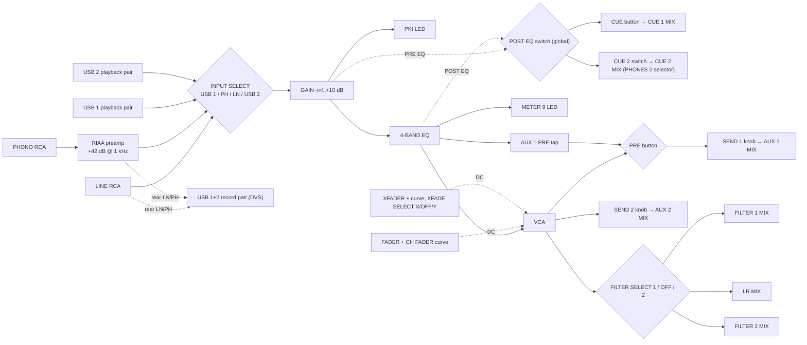
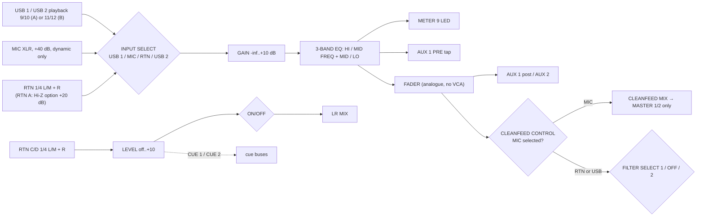
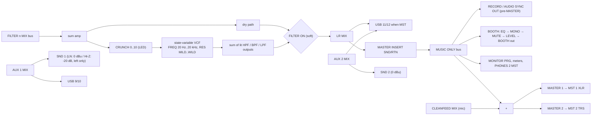

# Xone:96 signal flow and specification (v2, from the official documents)

**v2, 2026-10-29.** This version replaces v1, which was built from search snippets. It now follows the
official **block diagram** and the **User Guide**.

## Sources and marks

| Key | Document (scratchpad copy; never ship it, per `manuals/COPYRIGHT-RULES.md`) |
|---|---|
| **UG p.N** | *Xone:96 User Guide* AP11645 issue 2, the 41-page "Original with Diagram" PDF. `manuals/xone96/Xone_96_User_Guide_Original_with_Diagram/text.txt` |
| **BD** | The block diagram, UG p.34 (`Xone_96_Block_Diagram_ONLY/hires/tile-0..5.png`) |
| **WEB p.N** | The 2026 web export of the guide (same content, different page numbers) |

| Mark | Meaning |
|---|---|
| **V (UG p.N)** | verified (Xone:96 User Guide, p.N) |
| **V (BD)** | verified (Xone:96 User Guide, p.34, block diagram). These are my readings of the drawing, written in my own words. |
| **M (UG p.N)** | measured by me from a response graph on that page (±1–2 dB, ±5 % frequency) |
| **L** | likely (an inference consistent with the documents) |
| **G** | guess (an engineering assumption; label it in the twin) |

The diagrams below are my own schematics of the facts, not tracings of A&H artwork. Quotes are 25
words or fewer.

## What changed from v1 (the implementer should re-check these)

1. **CH A/B have no crossfader assign.** Only CH 1–4 have XFADER X/OFF/Y (UG p.11–12; BD). Remove `cha_xf` and `chb_xf`.
2. **CH A/B do have SEND 1 + PRE + SEND 2** (UG p.8). RTN C/D have no sends (BD).
3. **SEND 1 PRE is a per-channel button** under the SEND 1 knob on all six main channels (UG p.8, p.10 panel; BD). The send knobs run **∞ … +6 dB** (UG p.8/p.10 panel legends).
4. **Curve names:** CHANNEL FADER = *constant power / dipped / fast-cut*; XFADER = *constant power / **transition** / fast-cut* (UG p.12). The twin's crossfader "DIPPED" label is wrong.
5. **Channel meter legends** are −20, −15, −10, −6, −3, 0, +3, +6, **+10** (UG p.11 panel). The top LED is +10, not PK!. **PK! is a separate LED by GAIN** that reads post-GAIN, pre-EQ (BD; UG p.10).
6. **Main meters:** 11 LEDs, −35 … PK! (+10) (UG p.35, p.7 panel). The twin's 11 thresholds are right.
7. **CUE defaults to AUTO-CUE.** Pressing another CUE cancels the previous one. LATCHING-CUE mode, set from the panel, allows several (UG p.9).
8. **The rear LN/PH switches only choose what is sent to the computer** for CH 1–4: the LINE jack or the RIAA-equalised PHONO jack. They do not change the channel's own input (UG p.21; BD).
9. **The filter is 2-pole (about 12 dB/oct).** WILD gives a resonant peak of about **+7.6 dB** (Q about 2.4), MILD has Q about 0.5, and FREQ runs 20 Hz–20 kHz (UG p.13; M UG p.14). The twin's resonance is far too strong.
10. **The filter type buttons combine:** pressing several together gives a notch or an "all-pass" response, and a single press deselects the previous type (UG p.14). **FILTER ON** exists and is soft-switched (UG p.13–14). CRUNCH is out of circuit when the filter is OFF (BD).
11. **Sends are taken before FILTER SELECT,** so effects receive the *unfiltered* channel. On CH 1–4 the post-fade send is after the VCA, so it **also follows the crossfader** (BD).
12. **The mic clean feed:** with INPUT = MIC, CH A/B go to a separate CLEANFEED bus. It bypasses the filters, the master insert, booth, record, the USB MST feed and the headphone MST blend, and joins only **MASTER 1/2** (BD; UG p.22).
13. **The booth has STEREO/MONO, a 3-band EQ (−8…+8 on the panel), level and MUTE** (UG p.17).
14. **MASTER 1 and MASTER 2 are independent level controls** (UG p.16). The RTN C/D have ON/OFF, LEVEL, SIG and CUE (UG p.15). PHONES 2 has a **9-way source select** (UG p.16).
15. Dimensions are **339 × 410 × 109 mm, 7 kg** (UG p.37). The twin says 336 mm.

---

## 1. Architecture in brief

This is an analogue **6+2** mixer (UG p.36). It has four stereo channels with 4-band EQ (**CH 1–4**),
two stereo channels with 3-band parametric EQ (**CH A, CH B**), and two simple stereo returns
(**RTN C, RTN D**) (UG p.6).

On CH 1–4 the channel fader and the crossfader drive **one VCA per channel**, and the filter assign
comes after that VCA (BD; UG p.12). Every main channel then feeds one of three destinations: the
**LR MIX** bus, the **FILTER 1 MIX** bus or the **FILTER 2 MIX** bus. The filter sections sum their bus,
apply CRUNCH, then the VCF, and return into the LR MIX (BD).

The LR MIX passes the **master insert** and becomes the "music-only" bus. That bus feeds the booth,
record, monitor and PHONES 2. The mic **clean feed** is added only for the MASTER 1 and MASTER 2
outputs (BD).

---

## 2. Block diagrams (my own schematics)

### 2.1 Whole mixer (ASCII)

```
CH 1-4 (x4)                                                                          BUSES (BD)
 LINE RCA ─────────────┐                                                       ┌── CUE 1 MIX ─► MONITOR (PHONES 1)
 PHONO RCA ─► RIAA ────┼─► INPUT SELECT ─► GAIN ─┬─► PK! LED                   ├── CUE 2 MIX ─► PHONES 2
 USB 1 / USB 2 play ───┘   (4-way)        -∞..+10 │                             ├── AUX 1 MIX ─► SND 1 out + USB 9/10
   rear LN/PH: LINE or RIAA PHONO ─► USB record   ├─► PRE-EQ ─┐                 ├── AUX 2 MIX ─► SND 2 out + (USB 11/12)
                                                  ▼            │                 ├── FILTER 1 MIX ─► FILTER 1 ─┐
                                               4-BAND EQ       ├─► POST EQ sel ─► CUE 1 (button) / CUE 2 (via PHONES 2 sel)
                                                  ├─► POST-EQ ─┘                 ├── FILTER 2 MIX ─► FILTER 2 ─┤
                                                  ├─► METER (9 LED, pre-fader)   ├── CLEANFEED MIX (mic only) │
                                                  ├─► AUX 1 "PRE" tap            └── LR MIX ◄─────────────────┘
                                                  ▼
                              VCA ◄── FADER (CH FADER curve) + XFADER via XFADE SELECT X / OFF / Y
                                                  ├─► AUX 1 (if PRE off) ─► AUX 1 MIX
                                                  ├─► AUX 2 ───────────────► AUX 2 MIX
                                                  ▼
                              FILTER SELECT 1 / OFF / 2 ─► FILTER 1 MIX | LR MIX | FILTER 2 MIX

CH A/B (x2): USB 1 (9/10 | 11/12) / MIC (XLR +40 dB) / RTN (1/4", A: LN/Hi-Z +20 dB) / USB 2
             ─► GAIN ─► PK! ─► 3-BAND EQ (HI, MID FREQ + MID, LO) ─► METER ─► AUX 1 PRE tap
             ─► FADER (plain analogue, no VCA, no crossfader) ─► AUX 1 post / AUX 2
             ─► CLEANFEED CONTROL: INPUT=MIC ─► CLEANFEED MIX ; RTN/USB ─► FILTER SELECT 1/OFF/2

RTN C/D (x2): 1/4" L/M + R ─► LEVEL (off..+10) ─► SIG LED ─► CUE 1 / CUE 2 taps ─► ON/OFF ─► LR MIX

FILTER n: FILTER n MIX ─► amp ─┬──────────── dry ─────────────┐
                               └─► CRUNCH ─► SVF: HPF BPF LPF ─┴─► FILTER ON (soft) ─► LR MIX
                                              (selected outputs summed)

MASTER:  LR MIX ─┬─► USB 11/12 (switch = MST)                             [pre-insert, pre-MASTER: BD]
                 └─► INSERT SND ─► (ext) ─► INSERT RTN ─► "MUSIC ONLY" bus
  MUSIC ONLY ─┬─► RECORD out (RCA; default post-insert via internal option) and AUDIO SYNC OUT (3.5 mm)
              ├─► BOOTH: 3-band EQ ─► STEREO/MONO ─► MUTE ─► BOOTH level ─► BOOTH out (TRS)
              ├─► MONITOR "PRG" and the main meters when nothing is cued
              ├─► PHONES 2 "MST" / CUE-MST blend
              └─► (+) CLEANFEED MIX ─► "MUSIC+MIC" ─┬─► MASTER 1 level ─► MST 1 (XLR)
                                                    └─► MASTER 2 level ─► MST 2 (TRS)
MONITOR: [CUE 1 MIX | PRG] selected by CUE ACTIVE and SPLIT CUE ─► meters ─► CUE/MST ─► LEVEL ─► PHONES 1
PHONES 2: 9-way select (MST, 1-4, A-D) ─► CUE 2 MIX ─► CUE/MST (with music-only mix) ─► LEVEL ─► PHONES 2
```

### 2.2 CH 1–4 strip (Mermaid)



### 2.3 CH A/B and RTN C/D (Mermaid)



### 2.4 Filters, aux and outputs (Mermaid)



### 2.5 Order of operations for the engine

**CH 1–4:** input select → GAIN → (PK! detect) → EQ → [taps: meter, cue (PRE/POST EQ), AUX 1 PRE]
→ VCA (fader law × crossfader law for its X/Y side) → [taps: AUX 1 post, AUX 2] → FILTER SELECT
(1 / OFF / 2, soft) → bus. **(V (BD); UG p.10–12)**

**CH A/B:** the same up to the fader, except it is a plain fader with no VCA and no crossfader. Then
[AUX taps] → **clean-feed decision** (MIC goes to the clean-feed bus; RTN/USB go to FILTER SELECT).
**(V (BD); UG p.8–9, p.22)**

**Filter n:** bus sum → (dry | CRUNCH → SVF → sum of lit outputs) → FILTER ON crossfade → LR MIX. **(V (BD); UG p.13–14)**

**Master:** LR MIX → [USB MST tap] → insert → music-only bus → [record, booth chain, monitor PRG,
PHONES 2 MST] → (+ clean feed) → MASTER 1 / MASTER 2. **(V (BD); UG p.16, p.21–22)**

---

## 3. Channel strips: every control

### 3.1 CH 1–4 (panel top to bottom, UG p.10–11)

| Control | Twin id | Range / legend | Behaviour | Source |
|---|---|---|---|---|
| SEND 1 | `chN_snd1` | ∞ … +6 dB | Level into AUX 1 MIX, pre- or post-fade per the PRE button. The bus also feeds USB 9/10. | V (UG p.10; BD) |
| PRE (under SEND 1) | *`chN_snd1_pre`* (twin has global `send1_pre`) | button | On: AUX 1 taps post-EQ, pre-VCA. Off: post-VCA. | V (UG p.10 panel; BD) |
| SEND 2 | `chN_snd2` | ∞ … +6 dB | Always post-VCA | V (UG p.10; BD) |
| INPUT select | `chN_input` | USB 1 / PH / LN / USB 2 (rotary) | Also sends MIDI notes (§11). USB pairs: CH1 1-2, CH2 3-4, CH3 5-6, CH4 7-8. | V (UG p.10, p.23, p.28) |
| PK! LED | *`chN_pk`* (indicator) | – | Detects post-GAIN, pre-EQ overload; turn GAIN down when lit. Threshold not stated (G: about +16 dBu). | V (BD; UG p.10) |
| GAIN | `chN_gain` | **−∞ … +10 dB** | Input trim | V (UG p.10) |
| HI | `chN_hi` | ∞ (kill) / centre / +6 | 3 kHz | V (UG p.10) |
| HI MID | `chN_himid` | −27 / centre / +10 | 1.1 kHz | V (UG p.10) |
| LO MID | `chN_lomid` | −27 / centre / +10 | 350 Hz | V (UG p.10) |
| LO | `chN_lo` | ∞ (kill) / centre / +6 | 180 Hz | V (UG p.10) |
| FILTER assign | `chN_filter` | toggle 1 / OFF / 2 | Post-GAIN/EQ/FADER audio to FILTER 1 (left), FILTER 2 (right), or the LR MIX (centre). Soft-switched while hot. No MIDI. | V (UG p.11, p.14) |
| XFADER assign | `chN_xf` | toggle X / OFF / Y | Same tap point; OFF bypasses the crossfader | V (UG p.11) |
| CUE | `chN_cue` | illuminated button | AUTO-CUE by default; MIDI note (§11) | V (UG p.11, p.9) |
| Meter | – | 9 LEDs: −20 −15 −10 −6 −3 0 +3 +6 +10 dBu | post-GAIN, post-EQ, pre-fader | V (UG p.11, p.35) |
| Fader | `chN_fader` | 60 mm stereo linear VCA, ∞ … unity | User-replaceable; CH FADER curve applies; < −85 dB shutoff; MIDI CC | V (UG p.11, p.35) |

**Metering target:** "the meter averages around 0 with loudest peaks around +6" (UG p.11). If **+10**
stays lit, turn GAIN or EQ down (UG p.11).

### 3.2 CH A/B (UG p.8–9)

| Control | Twin id | Range / legend | Behaviour | Source |
|---|---|---|---|---|
| SEND 1 + PRE, SEND 2 | *`cha_snd1`, `cha_snd1_pre`, `cha_snd2`* (and `chb_…`) | ∞ … +6 | As CH 1–4, but "post" means post-fader | V (UG p.8; BD) |
| INPUT select | `chX_input` | USB 1 / MIC A (or B) / RTN A (or B) / USB 2 | USB plays pair 9-10 on CH A and 11-12 on CH B | V (UG p.8, p.23) |
| PK! LED, GAIN | `chX_gain` | GAIN −∞ … +10 dB | as CH 1–4 | V (UG p.8) |
| HI | `chX_hi` | ∞ / centre / +6, 3 kHz | – | V (UG p.8) |
| FREQ (parametric) | `chX_midf` | 190 Hz / **650 Hz** (centre) / 2.75 kHz | Sweeps the MID band (twin default is 700; use 650) | V (UG p.8 panel and legend) |
| MID | `chX_mid` | −24 / centre / +10 | Gain of the swept band | V (UG p.8) |
| LO | `chX_lo` | ∞ / centre / +6, 180 Hz | – | V (UG p.8) |
| FILTER assign | `chX_filter` | 1 / OFF / 2 | **Ignored while INPUT = MIC** (clean feed) | V (UG p.9; BD) |
| XFADER assign | **none** | – | **CH A/B are not on the crossfader** | V (UG p.12; BD) |
| CUE | `chX_cue` | button | AUTO-CUE | V (UG p.9) |
| Meter | – | 9 LEDs as CH 1–4 | post-GAIN/EQ, pre-fader | V (UG p.9) |
| Fader | `chX_fader` | 60 mm analogue, ∞ … unity | Not VCA; the curve switch doesn't affect it; no MIDI | V (UG p.9, p.12; UG p.28) |

**Clean feed** (BD): an internal option, enabled by default, means that whenever **MIC** is selected
the channel's post-fader signal goes to the **CLEANFEED MIX** bus instead of FILTER SELECT. With RTN
or USB selected, the channel behaves normally. Per the guide, the mics don't reach the BOOTH and are
unaffected by the MASTER INSERT (UG p.22). Per the diagram, they also miss RECORD, the USB MST feed
and the headphone MST blends (BD).

**Mic input:** use low-impedance dynamic mics; there is no phantom power (UG p.22); +40 dB gain,
EIN −120 dB (UG p.35).

### 3.3 RTN C / RTN D (UG p.15)

| Control | Suggested id | Range | Behaviour | Source |
|---|---|---|---|---|
| ON/OFF | *`rtnc_on`, `rtnd_on`* | illuminated button | Routes the return to the LR MIX (pre-MASTER); MIDI note | V (UG p.15, p.28) |
| SIG LED | – | bi-colour | Green = signal; continuously red = turn LEVEL down | V (UG p.15) |
| LEVEL | *`rtnc_level`, `rtnd_level`* | ∞ … +10 | Return level | V (UG p.15 panel) |
| CUE | *`rtnc_cue`, `rtnd_cue`* | button | AUTO-CUE; PHONES 2 can select C/D too | V (UG p.15; p.28) |
| EQ, filter, sends, USB | – | none | – | V (BD) |

Rear jacks are unbalanced 1/4", L/M + R; a mono source goes in L/M (UG p.22).

---

## 4. EQ in detail

### 4.1 Figures (V UG p.8, p.10, p.35)

| Channels | Band | Freq | Range | Type (M UG p.8, p.10) |
|---|---|---|---|---|
| 1–4 | HI | 3 kHz | +6 / −∞ | Kill skirt about 12 dB/oct; −3 dB near 2.7 kHz when killed. The +6 boost peaks at about +5.8 dB near 4 kHz and settles to about +4.5 dB at 20 kHz. |
| 1–4 | HI MID | 1.1 kHz | +10 / −27 | Bell. Boost Q about 1.4 (1 octave between +5 dB points). Cut Q about 0.85 (1.6 octaves at −13.5 dB) with very wide skirts. |
| 1–4 | LO MID | 350 Hz | +10 / −27 | Same shapes as HI MID |
| 1–4 | LO | 180 Hz | +6 / −∞ | Kill skirt about 12–13 dB/oct (−3 dB ≈ 165 Hz, −10 ≈ 98 Hz, −20 ≈ 60 Hz, −30 ≈ 35 Hz). The +6 boost is a shelf of about +5.5 dB below 100 Hz, half-gain near 200 Hz. |
| A/B | HI | 3 kHz | +6 / −∞ | as above |
| A/B | MID | 190 Hz – 2.75 kHz | +10 / −24 | Bell. **Narrower than the 4-band mids:** boost Q about 2.3–2.5 (0.6 octave at +5 dB), cut Q about 1.2. |
| A/B | LO | 180 Hz | +6 / −∞ | as above |
| Booth | HI / MID / LO | **not stated** | −8 … +8 (panel) | G: shelves at about 100 Hz and 8 kHz, bell at about 1 kHz |

All centred is flat within about +0.5 dB; the guide's graphs show a small lift around 300–600 Hz
(M UG p.10). Turning every band down is **not** silence, because the mids stop at −27 dB.

### 4.2 Recommended twin implementation

- **Kill bands: a 2nd-order (12 dB/oct) band split** that sums flat. LR2 is the simplest exact choice:
  - `lo = LP2(f1)`, then a first-order allpass at f2;
  - `rest = −HP2(f1)`, `mid = LP2(f2)·rest`, `hi = −HP2(f2)·rest`.

  In Web Audio use `lowpass`/`highpass` biquads with **Q = −6.0206** (the Q is in dB for these types)
  and an `IIRFilterNode` allpass with feedforward `[c, 1]`, feedback `[1, c]`, where `c = (K−1)/(K+1)`
  and `K = tan(π·f2/fs)`. With f1 = 180 Hz and f2 = 3 kHz, the kill corner sits a little high
  (−3 dB at about 280 Hz rather than the measured 165 Hz). For a closer match, use **f1 ≈ 120 Hz,
  f2 ≈ 4.5 kHz** (G); the slope is right either way. The current twin uses LR4 (24 dB/oct), which is
  steeper than the hardware (M).
- **Mids:** RBJ `peaking` biquads (Q is linear for this type) with **Q depending on gain**. Use about
  1.4 at +10 dB and about 0.88 at −27 dB for CH 1–4 (`Q = 1 + 0.04·g` for boosts, `1 + 0.0045·g` for
  cuts, g in dB). On A/B use about 2.4 for boosts and about 1.2 for cuts.
- **Knob laws** (unpublished, so G): keep the twin's HI/LO law (`+6v` dB; cut `40·log10(1+v)`) and the
  linear-in-dB mids. MID FREQ should be piecewise-log through **650 Hz** at the centre:
  `t<0.5: 190·(650/190)^(2t)`, otherwise `650·(2750/650)^(2t−1)`.

---

## 5. Xone:VCF filters (FILTER 1 left, FILTER 2 right)

| Control | Twin id | Range | Behaviour | Source |
|---|---|---|---|---|
| CRUNCH | `fN_crunch` | 0 … 10, with LED | Harmonic distortion in the pre-filter path. 0 is clean (LED off); 10 distorts dramatically (LED red). For optimum drive, keep assigned channels between ±6 dB on their meters. | V (UG p.13) |
| RES | `fN_res` | MILD … WILD | Feedback from the filter's output to its input. MILD is very subtle; WILD gives a strong peak "just short of self-oscillation" (UG p.13). **Measured WILD peak about +7.6 dB, so Q ≈ 2.4; MILD Q ≈ 0.5 (−6 dB at the corner); 12 o'clock Q ≈ 1.** | V (UG p.13); M (UG p.14) |
| HPF / BPF / LPF | `fN_type` → better *`fN_hpf`, `fN_bpf`, `fN_lpf`* | three illuminated buttons | Selects the SVF output. **Any combination can be pressed together** (notch, all-pass effects); pressing one alone deselects the previous. The last selection is kept at power-off. | V (UG p.13–14) |
| FREQ | `fN_freq` | 20 Hz … 20 kHz | Sets the −3 dB cut-off. (On the p.14 graph the WILD peaks sit at about 40 Hz and 17–18 kHz at the knob ends.) | V (UG p.13); M (UG p.14) |
| ON | *`fN_on`* (**missing in twin**) | illuminated button | OFF: the bus passes dry and unaffected, with CRUNCH out of circuit. ON: the filtered path. Soft-switched, with no clicks on ON/OFF, type changes or hot channel assigns. | V (UG p.13–14; BD) |
| Slope | – | – | **2-pole, about 12 dB/oct** (LPF: −20 dB at 137 Hz, −30 at 237 Hz, −40 at 411 Hz for a low setting). BPF skirts about 6 dB/oct; BPF peak equals Q (+7.6 dB at WILD). | M (UG p.14) |
| LFO | – | none | (The Xone:92 had one; the 96 has CRUNCH instead.) | V (UG p.13, by its absence) |

Two **stereo** VCFs sit either side of the crossfader (UG p.14). Every channel assigned to a filter is
**summed first** (BD). The crossfader VCA also scales what reaches the filters, since filtering is
post-VCA (UG p.12).

### 5.1 Twin model (fits the measurements)

- **SVF with natural outputs:** `LP = ω²/D`, `BP = ωs/D` (peak gain = Q), `HP = s²/D`, with
  `D = s² + (ω/Q)s + ω²`. The output is the **sum of the lit buttons' outputs.**
  - All three lit at Q = 1 is exactly flat. Q > 1 gives a bell boost at FREQ, and Q < 1 a broad dip.
    This is the guide's "all-pass" family and the user report that RES is neutral at 12 o'clock.
  - HPF + LPF gives a notch.
- **Web Audio recipe:** three parallel `BiquadFilterNode`s on the same frequency.
  - `lowpass` and `highpass` with `Q = 20·log10(Qlin)` dB.
  - `bandpass` with `Q = Qlin`, followed by a gain of `Qlin`.

  The RBJ LPF/HPF/BPF share one denominator, so the sum is exact.
- **RES law:** `Q = 0.5·2^(2t)` for t ≤ 0.5, giving 0.5 → 1.0; `Q = 2.4^(2t−1)` for t > 0.5, giving
  1.0 → 2.4. WILD is therefore about +7.6 dB of peak. **Replace the twin's mapping**, which reaches
  Q ≈ 8 (+18 dB) and is far too resonant.
- **FREQ law:** `f = 20·1000^t` Hz (−3 dB corner). Smooth the automation over about 15 ms.
- **CRUNCH:** pre-gain of 0 to about +24 dB into an asymmetric tanh soft clipper, then about 1/√drive
  of makeup gain. Use the level-dependent onset of the ±6 dB guidance: don't normalise the input. Put
  it only in the ON path and drive the LED from the clipper's activity (G).
- **ON / type / assign soft-switching:** linear crossfades of about 10–20 ms. The dry and wet signals
  are correlated, so use linear, not equal-power (G).

---

## 6. FX sends and returns

| Item | Fact | Source |
|---|---|---|
| SEND knobs | ∞ … +6 dB, on CH 1–4 and CH A/B | V (UG p.8, p.10; UG p.36 "Aux Sends") |
| AUX 1 | Pre (post-EQ, pre-fader/VCA) or post per channel PRE button → AUX 1 MIX → **SND 1** out and **USB 9/10** | V (UG p.8, p.10, p.23; BD) |
| AUX 2 | Post-fader only → AUX 2 MIX → **SND 2** out, and USB 11/12 when the USB 11/12 switch = SEND 2 | V (UG p.8, p.16; BD) |
| Tap position | Before FILTER SELECT, so **sends are unfiltered**. On CH 1–4 the post tap is after the VCA, so it **follows the crossfader**. | V (BD) |
| SND outputs | Balanced 1/4" TRS L and R (mono via L/M), 0 dBu nominal | V (UG p.22; BD) |
| LN / Hi-Z switch | One switch for **SND 1 + RTN A**. In Hi-Z mode SND 1 drops 20 dB and becomes left-only, and RTN A gains 20 dB, for guitar pedals. | V (UG p.21–22, p.36; BD) |
| Returns | RTN A/B are balanced 1/4" TRS L/M + R → CH A/B (INPUT = RTN), with full EQ, filter, cue and fader. RTN C/D are simple level returns. | V (UG p.22–23, p.15) |

**Twin:** keep the virtual delay on SND 1 → RTN A and reverb on SND 2 → RTN B. When A/B hold
instruments, add RTN C/D and return the FX there. Add a feedback guard: a return channel's own
send into its own effect should be muted or limited.

---

## 7. Cue, headphones and meters

| Item | Fact | Source |
|---|---|---|
| CUE buttons | CH 1–4, A, B, C, D. **AUTO-CUE by default:** pressing another CUE cancels the previous. **LATCHING-CUE:** hold any filter type button on both FILTER 1 and FILTER 2 for 3 s (MIDI 1/2 blink), then press any CUE; repeat to revert; the setting is stored. | V (UG p.9) |
| Cue tap | One global **POST EQ** switch (MONITOR section) for all cues, CUE 1 and CUE 2 alike | V (UG p.17; BD) |
| CUE ACTIVE LED | Lit while any CUE is on | V (UG p.17) |
| MONITOR bus | With no CUE, the program ("PRG", the music-only LR) plays; with CUE on, the sum of the cued channels; with SPLIT CUE, cue left and LR MIX right | V (UG p.16–17; BD) |
| CUE/MST | Fully anticlockwise gives only the cue; turning clockwise adds the LR MIX; **SPLIT overrides it** | V (UG p.17) |
| MONITOR LEVEL | 0 … 11 legend; affects only PHONES 1 | V (UG p.17) |
| PHONES 1 jacks | 1/4" TRS + 3.5 mm | V (UG p.17) |
| PHONES 2 | A **9-way source select (MST, 1, 2, 3, 4, A, B, C, D)**, CUE/MST blend and LEVEL (0 … 11); 1/4" + 3.5 mm jacks. It is independent of channel CUEs, BOOTH and MONITOR. Its MST is the music-only mix. | V (UG p.16, p.7 panel; BD) |
| Main meters | 11 LEDs: −35 −25 −20 −15 −10 −6 −3 0 +3 +6 **PK!** (+10 dBu); legends L–MIX–R / CUE–SPLIT–PRG. They follow the monitor source: LR MIX **pre-MASTER 1** when nothing is cued; the **sum of cued channels** when CUE is on; **L = CUE, R = PRG** in SPLIT. | V (UG p.16, p.35, p.7 panel) |
| Channel meters | 9 LEDs −20 … +10 dBu, post-EQ pre-fader | V (UG p.11, p.35) |
| Operating level | Normal music between −6 and +6 on the meters, averaging 0 dB | V (UG p.39) |

**Meter ballistics are not published** (G): sample-peak attack, about 20 dB/s release, PK! held for
about 1 s. Fix the twin's channel LED thresholds to `[-20, -15, -10, -6, -3, 0, 3, 6, 10]` and add the
separate PK! LED.

**Twin:**
- With nothing cued, the phones should play the master. Today, with CUE/MST at CUE, the twin plays
  silence.
- The main meters should switch to the cue sum whenever any CUE is on, not only in SPLIT.
- Implement AUTO-CUE as exclusive, with a latching option.

---

## 8. Faders and crossfader

### 8.1 Hardware

| Item | Fact | Source |
|---|---|---|
| CH 1–4 faders | 60 mm stereo linear **VCA**, user-replaceable, ∞ … unity; < −85 dB shutoff | V (UG p.11, p.35) |
| CH A/B faders | Analogue (not VCA) | V (UG p.9) |
| CHANNEL FADER switch | Global for CH 1–4: **constant power / dipped / fast-cut** (left to right; icons only) | V (UG p.12) |
| XFADER | **mini innoFADER**, 45 mm linear VCA, user-replaceable. Its cut-in is calibrated with an internal trim (calibrate at FAST CUT). | V (UG p.12, p.35–36); A&H calibration note |
| XFADER switch | **constant power / transition / fast-cut** | V (UG p.12) |
| Assign | CH 1–4 only: X / OFF / Y | V (UG p.11–12) |

### 8.2 Measured laws (M UG p.12; use these tables with linear interpolation in dB)

**Channel fader:** t = travel from the bottom (∞) to the top (unity), in 15 equal steps.

| t | 0 | .07 | .14 | .21 | .29 | .36 | .43 | .50 | .57 | .64 | .71 | .79 | .86 | .93 | 1 |
|---|---|---|---|---|---|---|---|---|---|---|---|---|---|---|---|
| constant power (dB) | −83 | −82 | −66 | −50 | −39 | −31 | −26 | −22 | −19 | −16 | −14 | −11 | −7 | −3 | 0 |
| dipped (dB) | −83 | −80 | −52 | −35 | −26 | −21 | −17 | −14 | −12 | −11 | −9 | −8 | −5 | −2 | 0 |
| fast-cut (dB) | −83 | −79 | −48 | −29 | −20 | −14 | −10 | −8 | −6 | −4 | −3 | −1.5 | −0.5 | 0 | 0 |

Treat the bottom stop as −∞ (the VCA shuts off below −85 dB).

**Crossfader:** attenuation of the side being closed, against s = how far the fader has travelled away
from that side's own end (0 = fully open, 1 = at the far end), in 17 equal steps. The other side is
the mirror image.

| s | ≤.25 | .31 | .38 | .44 | .50 | .56 | .63 | .69 | .75 | .81 | .88 | .94 | 1 |
|---|---|---|---|---|---|---|---|---|---|---|---|---|---|
| constant power (dB) | 0 | −0.4 | −1 | −2 | −3 | −3.8 | −4.6 | −6 | −8 | −11 | −22 | −46 | −77 |
| transition (dB) | 0 | 0 | 0 | 0 | 0 | 0 | 0 | 0 | 0 | 0 | −2 | −8 | −80 |
| fast-cut (dB) | 0 | 0 | 0 | 0 | 0 | 0 | 0 | 0 | 0 | 0 | 0 | 0 | −82 |

For fast-cut the plotted resolution is 1/16 of travel. The real cut-in is a millimetre or so and
calibratable, so model it as full level until s ≈ 0.97 and −∞ by s ≈ 0.99, optionally with a
"cut-in" setting.

**How these compare with the current twin:**
- At half travel, the real channel curves read −22, −14 and −8 dB. The twin's `p^2.5`, `p^1.5` and
  `1−(1−p)^3` give −15, −9 and −1 dB.
- The twin's crossfader "dipped" (cos²) is not a Xone curve. Replace it with *transition*.

---

## 9. Master, booth, record, insert

| Output / control | Connector | Level nom / max | Fed from | Source |
|---|---|---|---|---|
| MASTER 1 → MST 1 | XLR balanced | +4 / **+24 dBu** | music + mic (post-insert) | V (UG p.16, p.22, p.35; BD) |
| MASTER 2 → MST 2 | 1/4" TRS balanced | +4 / +18 dBu | same, with its own level control | V (UG p.16, p.22, p.35; BD) |
| MASTER INSERT | SND balanced TRS, RTN unbalanced | −2 dBu nominal | On the LR MIX before the music-only split. The guide calls it the MST 1 insert; per the drawing it also feeds MST 2, booth, record (by default) and monitor. It never touches the mics. | V (UG p.22, p.35; BD) |
| BOOTH | 1/4" TRS balanced | +4 / +18 dBu | Music only → 3-band EQ (−8…+8) → STEREO/MONO → MUTE (MIDI) → level (0–10) | V (UG p.17, p.22, p.35; BD) |
| RECORD | RCA unbalanced | −8 / +10 dBu | Music only, pre-MASTER; internal option for pre- or post-insert (default post) | V (UG p.21, p.35; BD) |
| AUDIO SYNC OUT | 3.5 mm stereo | – | A second record out (pre-MASTER) | V (UG p.21) |
| USB 11/12 switch | top panel, "MST/SEND2" | – | MST (LR MIX) or SEND 2 to the computer | V (UG p.16, p.33) |

MASTER 1 and MASTER 2 don't change the meters, RECORD, BOOTH, MONITOR or PHONES 2 (UG p.16). The
booth MONO switch also serves as a mono-compatibility check (UG p.17).

---

## 10. USB audio (two independent soundcards) (V UG p.21, p.23, p.35–36)

There are two independent Hi-Speed USB 2.0 cards (USB-B sockets), each 12 in / 12 out (6 stereo).
They run 32-bit/96 kHz (rates 44.1/48/88.2/96 kHz; 16 or 32-bit; buffers 32–8192 samples), are
class-compliant on macOS and use an ASIO driver on Windows. Line-up is **0 dBu = −14 dBFS**.

| Pair | Computer → mixer | Mixer → computer |
|---|---|---|
| 1-2 | CH 1 (INPUT = USB 1 or USB 2) | CH 1 LINE or RIAA-PHONO (rear LN/PH) |
| 3-4 | CH 2 | CH 2 LINE / PHONO |
| 5-6 | CH 3 | CH 3 LINE / PHONO |
| 7-8 | CH 4 | CH 4 LINE / PHONO |
| 9-10 | CH A (INPUT = USB) | SEND 1 (pre or post) |
| 11-12 | CH B (INPUT = USB) | SEND 2 **or** MST (top switch) |

Two laptops can play at once, one per card. A mix recording uses USB 11/12 = MST (UG p.33), which
leaves out the mics (BD).

---

## 11. MIDI (V UG p.27–29, p.36)

31 controls: **19 buttons, 5 faders, 7 rotary switches.** The default MIDI channel is 16. Note-on
velocity is 0x7F and note-off is 0x00. MIDI OUT goes to the 5-pin DIN, USB 1/2 (when the **MIDI 1 /
MIDI 2** switch is on) and X:LINK. MIDI IN from USB 1/2 can remotely set **CUE, ON/OFF and MUTE**.
GAIN, EQ, sends and filter knobs send nothing (no entries in the table).

| Control | Msg | Numbers (hex), ch 16 |
|---|---|---|
| CH 1–4 faders | CC | 00, 01, 02, 03 |
| Crossfader | CC | 05 |
| CUE 1, 2, 3, 4, A, B, C, D | Note | 00, 01, 02, 03, 04, 05, 06, 07 |
| RTN C / RTN D ON | Note | 08 / 09 |
| FILTER 1 HPF / BPF / LPF / ON | Note | 0A / 0B / 0C / 0D |
| FILTER 2 HPF / BPF / LPF / ON | Note | 0E / 0F / 10 / 11 |
| BOOTH MUTE | Note | 12 |
| INPUT CH 1: USB 1 / PHONO / LINE / USB 2 | Note | 13 / 14 / 15 / 16 |
| INPUT CH 2 · CH 3 · CH 4 | Note | 17–1A · 1B–1E · 1F–22 |
| INPUT CH A: USB 1 / MIC A / RTN A / USB 2 | Note | 23 / 24 / 25 / 26 |
| INPUT CH B: USB 1 / MIC B / RTN B / USB 2 | Note | 27 / 28 / 29 / 2A |
| PHONES 2 select: 1, 2, 3, 4, A, B, C, D, MST | Note | 2B … 32, 33 |

That gives 19 buttons (8 CUE + 6 type + 2 filter ON + 2 RTN ON + MUTE), 5 faders and 7 rotary switches
(6 input selectors + PHONES 2).

**Channel change:** hold MIDI 1 and MIDI 2 while powering on, then press a blinking key. CUE A = 1,
CUE B = 2, F1 HPF = 3, CUE 1–4 = 4–7, F2 HPF = 8. Press a FILTER ON first for 9–16. The setting is
stored (UG p.28).

**X:LINK:** RJ-45, for Xone:K controllers (UG p.21).

**Twin option:** a Web MIDI input on ch 16 so a real Xone:96 drives the twin's faders, crossfader,
filter buttons, cues and input selectors.

---

## 12. Levels and gain structure

| Point | Level | Twin internal (0.1 = 0 dBu) |
|---|---|---|
| Channel meter "0", normal average | 0 dBu | 0.1 |
| Loudest peaks target | +6 dBu | 0.2 |
| Channel meter top LED "+10" | +10 dBu | 0.316 |
| Internal clip (+20 dB headroom, UG p.35) | +20 dBu | 1.0 |
| MST 1 maximum output | +24 dBu balanced | output stage |

Other figures (UG p.35):
- Frequency response ±0.5 dB, 20 Hz–30 kHz.
- THD+N 0.03 % at 1 kHz, 0 dBu.
- Crosstalk < −85 dB.
- Residual noise −98 dBu on MST 1/2 and −101 dBu on booth. Mix noise −90 dBu on MST 1, −85 dBu on MST 2
  and booth, −90 dBu on record.
- RIAA gain +42 dB at 1 kHz (6 mV RMS = 0 VU).

The twin should be effectively noiseless.

---

## 13. Panel layout facts (for `layout.tsx`; UG p.7, p.37–38)

The unit is 339 mm wide × 410 mm deep × 109 mm high and weighs 7 kg (UG p.37). It is not compatible
with standard Xone rack ears; there is an X.96-RKX kit (UG p.38).

**Columns, left to right:**
1. **CH A, CH B.** SEND 1, PRE, SEND 2, input select, PK! and GAIN, HI, FREQ and MID (labelled
   PARAMETRIC EQ), LO, FILTER toggle, CUE, meter and fader.
2. **Returns and FILTER 1.** RTN C and RTN D stacked at the top (ON/OFF, SIG, LEVEL, CUE), then
   FILTER 1: CRUNCH with LED, RES (MILD–WILD), HPF/BPF/LPF buttons, FREQ, FILTER 1 ON.
3. **CH 1–4.** Same top section as A/B, then HI, HI MID, LO MID, LO, the FILTER and XFADER toggles,
   CUE, meter and fader.
4. **FILTER 2.** Below the main meters, mirroring FILTER 1.
5. **Master column.** USB ACTIVE LEDs and the MIDI 1/2 buttons, MASTER 1 and MASTER 2, the USB 11/12
   switch, then the BOOTH section (STEREO/MONO, HI/MID/LO, level, MUTE), the CHANNEL FADER and XFADER
   curve switches, and the MONITOR section (ACTIVE, POST EQ, SPLIT CUE, CUE/MST, level, jacks).

**Bottom:** PHONES 2 sits bottom-left (selector, CUE/MST, level, jack) and the crossfader bottom-centre.

---

## 14. Twin changes, in priority order

1. Remove `cha_xf` and `chb_xf` (A/B are not on the crossfader).
2. Add per-channel **PRE** (*`chN_snd1_pre`*) and SEND 1/2 on CH A/B. Show send knobs as ∞…+6 dB, and
   keep a feedback guard on return channels.
3. Add **FILTER ON** (*`fN_on`*); CRUNCH is active only while ON. Add combinable **HPF/BPF/LPF**
   buttons using the natural-SVF sum (§5.1). Change the RES law to Q 0.5…2.4 and FREQ to 20 Hz–20 kHz.
4. Fix the **meters**: channel legends, a separate PK! LED, and main meters that show the cue sum
   while CUE is on.
5. **Cue:** AUTO-CUE exclusive by default, an optional LATCHING mode, and the phones playing the
   master when nothing is cued.
6. Replace the **curve laws** with the §8.2 tables, and rename the crossfader positions
   CONST POWER / TRANSITION / FAST CUT.
7. Implement the **MIC clean feed**: MIC on A/B skips filters, insert, booth, record, the USB MST feed
   and the phones' MST, and reaches MASTER 1/2 only.
8. **Booth:** 3-band EQ (±8 dB, frequencies a twin assumption), STEREO/MONO (exists) and MUTE.
   **MASTER 2** as a second level.
9. **EQ shapes:** 12 dB/oct kill bands and gain-dependent mid Q (§4.2); MID FREQ centre at 650 Hz.
10. Add **RTN C/D** (where the FX return when A/B hold instruments), **PHONES 2** (9-way), the
    **USB 11/12** switch, and optionally Web MIDI (§11).
11. **Studio:** declare `studio.mixerInputs` for `studio_1 … studio_4, studio_a, studio_b`, the ids
    `lib/studio/sets.ts` already routes to. The module at commit 89801d8 doesn't declare them yet.
